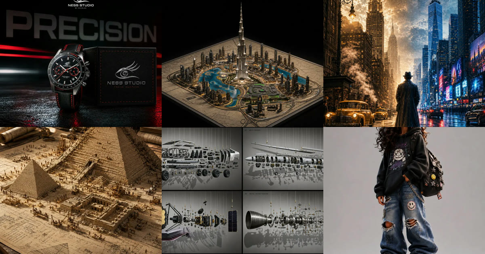

<div align="center">

<a href="https://apiko.app/gpt-image-2-prompts?utm_source=github&utm_medium=banner&utm_campaign=awesome-gpt-image-2-prompts"></a>

[](../LICENSE)
[](../README.md#menu)
[](https://apiko.app/models/gpt-image-2?utm_source=github&utm_medium=badge&utm_campaign=awesome-gpt-image-2-prompts&utm_content=model_try)
[](https://apiko.app/docs/api-manual/image-series/gpt-image-2/gpt-image-2-image-generation?utm_source=github&utm_medium=badge&utm_campaign=awesome-gpt-image-2-prompts&utm_content=docs)

[](poster.md)
[](poster_zh-CN.md)
[](poster_zh-TW.md)
[](poster_ko.md)

</div>

# 🪧 Posters (1/2) · Awesome GPT Image 2 Prompts

[← Back to the README](../README.md) · 323 cases on this page. The prompts are not translated.

Pages: **1** · [2](poster-2.md)

> Travel, movie, food and zodiac posters, infographics and collages where layout and lettering carry the design.

- [Dreamcore Brand Kit Illustration](#poster-02)
- [Whimsical Mirror Travel Journal](#poster-03)
- [Folk Papercraft Scene Remix](#poster-04)
- [Vintage Amalfi Travel Poster](#poster-06)
- [Chengdu Food Map Illustration](#poster-07)
- [Chinese Minimalist S-Shaped Poster](#poster-08)
- [2026 Spring Guangzhou City Poster](#poster-09)
- [Doodle Sketch AI Builder](#poster-10)
- [Futuristic Mandala Illustration](#poster-11)
- [Super Famicom Poster Style](#poster-12)
- [Browser Game Ad Creative Poster](#poster-13)
- [Surreal Koi Nebula Illustration](#poster-14)
- [Ink-Curve Guangzhou Aesthetics Poster](#poster-15)
- [Guangdong Super League Invitation Poster](#poster-16)
- [Spring 2026 Guangzhou Promo Poster](#poster-17)
- [Epic Silhouette World Poster](#poster-18)
- [Spring Guangzhou City Poster](#poster-19)
- [Science Encyclopedia Vertical Poster](#poster-20)
- [Journey to the West Chinese Comic](#poster-21)
- [Character Relationship Map Poster](#poster-22)
- [New Chinese Ink Landscape Poster](#poster-23)
- [AI Builder Doodle Sketch](#poster-24)
- [Character Visual Vertical Poster](#poster-25)
- [Science Encyclopedia Infographic](#poster-26)
- [Fictional Anime Movie Poster](#poster-27)
- [Product Ad Redesign](#poster-28)
- [Dark-Fantasy Guangzhou City Poster](#poster-29)
- [Science Fiction Movie Poster](#poster-30)
- [Refreshing Summer Udon Ad](#poster-31)
- [Handwritten Medical Prescription Sheet](#poster-32)
- [Silicon Valley 2026 Promo Poster](#poster-33)
- [Japanese Supermarket Sale Flyer](#poster-34)
- [Pilates Studio Ad Poster](#poster-36)
- [6-Block Fashion Campaign Prompt Formula](#poster-37)
- [Sony A7 Exploded View Breakdown Prompt](#poster-38)
- [1900 Istiklal Street Panorama Prompt](#poster-39)
- [Theme Science Encyclopedia Card](#poster-40)
- [Chili Pork Cooking Flowchart](#poster-41)
- [Cinematic Infographic Concept Poster](#poster-42)
- [Street-Style Crosswalk Fashion Shot](#poster-43)
- [Sparkling Water Can on Golden Sand](#poster-44)
- [Face-Reference Portrait, 9:16 Vertical](#poster-46)
- [Hangzhou West Lake Travel Poster](#poster-47)
- [Dongfang Bubai Wuxia Character Poster](#poster-48)
- [A Chinese Odyssey 90s Hong Kong Poster](#poster-49)
- [Royal Tramp Character Poster](#poster-51)
- [Racing Car Poster With Specs](#poster-52)
- [Luxury Sportswear Basketball Athlete Campaign Poster](#poster-54)
- [Streetwear Fashion Campaign Asian Apparel Poster](#poster-55)
- [Epic Career Moments Cinematic Poster Template](#poster-56)
- [Avant-Garde Basketball Sculpture Sports Fashion Ad](#poster-57)
- [Avant-Garde Tennis Racket Sculpture Sports Fashion Ad](#poster-58)
- [Premium Food Recipe Poster Elegant Layout](#poster-59)
- [Luxury Fashion Magazine Cover Black and White](#poster-60)
- [Surrealist Rolex Luxury Watch Fashion Poster](#poster-61)
- [Peacock Botanical Vintage Symmetrical Art Print](#poster-62)
- [SPLASH Fashion Brand Hyper-Realistic Campaign Poster](#poster-63)
- [Avant-Garde Guitar Sculpture Fashion Advertisement](#poster-64)
- [Illustrated City Food Map](#poster-65)
- [3D Stone Staircase Evolution Infographic](#poster-66)
- [Biomimetic Skyray Aircraft Poster](#poster-67)
- [Taoist Three Souls Seven Po Poster](#poster-68)
- [Water Signs Zodiac Character Poster](#poster-71)
- [Earth Signs Zodiac Character Poster](#poster-72)
- [Fire Sign Zodiac Character Poster](#poster-73)
- [Air Sign Zodiac Character Poster](#poster-74)
- [Ethnographic Plate for Tibetan Ceremonial Hat](#poster-75)
- [Vintage PRS Guitar Lineage Poster](#poster-76)
- [Alishan One-Day Travel Poster](#poster-77)
- [Dance Movement Reference Sheet](#poster-78)
- [Anime Museum Background Conversion](#poster-79)
- [16-Pose Dance Combat Reference Sheet](#poster-80)
- [16-Panel Dance Pose Reference Sheet](#poster-81)
- [16-Panel Female Dance Pose Sheet](#poster-82)
- [16-Pose Dance Reference Sheet](#poster-83)
- [Gas Giant Descent Storyboard](#poster-84)
- [Surreal Baroque Painting Reality Fracture](#poster-85)
- [Urban Alley Mural Artist](#poster-86)
- [RPG Map to Anime Event Scene](#poster-87)
- [Soft Pastel Anime Girl Full Body](#poster-88)
- [Dreamy Shibuya Bubble Girl](#poster-90)
- [Stormy Tropical City With Rooftop Plane](#poster-91)
- [Fashion Dress Collection Infographic](#poster-92)
- [Monochrome Fashion Cover](#poster-93)
- [Fast Food Character Poster](#poster-94)
- [New York across two centuries cinematic poster](#poster-95)
- [Blue Tears cocktail tutorial infographic poster](#poster-96)
- [ASCII dengue infographic](#poster-97)
- [Lavender Smartphone Hero Ad](#poster-98)
- [Luxury Food Poster Template](#poster-99)
- [Inflatable Orange Juice Poster](#poster-100)
- [Emerald Street Fashion Poster](#poster-101)
- [Retro Roller Skating Campaign](#poster-102)
- [Futuristic Sportswear Editorial Poster](#poster-103)
- [Miniature City Knot Sculpture](#poster-105)
- [Taiwanese Food Blog Spread](#poster-106)
- [Alien Disclosure Dossier](#poster-107)
- [Empire Inferno Burger Poster](#poster-108)
- [Greek Yogurt Lifestyle Ad](#poster-109)
- [Fitness Boxing Campaign Collage Poster](#poster-110)
- [Samsung Galaxy S25 Infographic Poster](#poster-111)
- [Food Photography with Doodle Characters](#poster-112)
- [Dynamic Sports Poster](#poster-113)
- [Luxury Brand Ad Campaign Poster](#poster-114)
- [Product Photography Juice Ad](#poster-115)
- [Anime Streetwear Character Poster](#poster-116)
- [Endangered Animal Infographic](#poster-117)
- [Claymation Cozy Scene Recreation](#poster-118)
- [Anime Warrior Shonen Power-Up](#poster-119)
- [Naruto Propaganda Poster](#poster-120)
- [Luxury Bowling Editorial Collage](#poster-121)
- [Hamburg Travel Itinerary Visual](#poster-122)
- [Chibi Penguin Hoodie Beach Sunset](#poster-123)
- [Editorial Travel Poster Illustration](#poster-125)
- [Dunk King Sneaker Hype Poster](#poster-126)
- [Content Creator Hustle Meme Poster](#poster-127)
- [War Rescue 16-Shot Cinematic Storyboard](#poster-128)
- [Flavors of India Travel Infographic](#poster-129)
- [Spherical Artifact World Cross-Section](#poster-130)
- [Urban Fashion Editorial Collage Poster](#poster-131)
- [Wildlife Photographer 16-Panel Storyboard](#poster-132)
- [Zodiac Yumi Cells Chibi Poster](#poster-133)
- [French New Wave Vintage Movie Poster](#poster-134)
- [Apocalyptic Titan Warrior Anime Poster](#poster-135)
- [Jujutsu Kaisen Cinematic Key Visual](#poster-136)
- [Food Delivery Cinematic Infographic](#poster-137)
- [Dark Fantasy Double Exposure Poster](#poster-138)
- [Shinobi Warrior Propaganda Poster](#poster-139)
- [Tokyo Revengers Propaganda Poster](#poster-140)
- [Flavors of USA Luxury Travel Poster](#poster-141)
- [Starbucks Coffee World Surreal Poster](#poster-142)
- [BLEACH Manga Collage Anime Poster](#poster-143)
- [Tokyo Minimalist Line-Art Travel Poster](#poster-144)
- [Kawaii Kids Scrapbook Photography Poster](#poster-145)
- [Anime Character Streetwear Collector Poster](#poster-146)
- [Yumi's Cells Zodiac Chibi Poster](#poster-148)
- [Sports Athlete Editorial Collage Poster](#poster-149)
- [Character Silhouette Key Visual Poster](#poster-150)
- [Urban Fashion Editorial Collage Poster](#poster-151)
- [Kids Backpack Cartoon Ad Poster](#poster-152)
- [Ink Sketch Newspaper Collage Portrait](#poster-153)
- [Premium Scandinavian Travel Poster](#poster-154)
- [Watercolor City Street Travel Poster](#poster-155)
- [Mid-Century 3-Color City Poster](#poster-156)
- [Y2K Kawaii Editorial Poster](#poster-157)
- [Camera Evolution Timeline Poster](#poster-158)
- [Portrait Collage Fashion Poster](#poster-159)
- [Tokyo Street Line-Art Poster](#poster-160)
- [Minimalist City Line-Art Travel Poster](#poster-161)
- [Kids Fashion Editorial Poster](#poster-162)
- [Japanese Whimsical Folk-Art Illustration](#poster-163)
- [Cinematic Character Design Sheet](#poster-164)
- [Minimal Fashion Product Ad Poster](#poster-165)
- [COSMED Anime Commercial Poster](#poster-166)
- [Yumi's Cells Anime Poster](#poster-167)
- [Japanese Graffiti Street Poster](#poster-168)
- [Brand City Takeover Poster](#poster-169)
- [Hand-Torn Editorial Collage](#poster-170)
- [Glowing Sailboat Night Illustration](#poster-171)
- [Istanbul Line-Art Travel Poster](#poster-172)
- [Dark Western Outlaw Poster](#poster-173)
- [Anime Streetwear Mascot Poster](#poster-174)
- [Wildlife Infographic Reference Poster](#poster-175)
- [Ancient Civilization Miniature Diorama](#poster-176)
- [Japanese Fashion Collage Poster](#poster-177)
- [Bangkok Swiss Typography Poster](#poster-178)
- [Miniature Travel World Poster](#poster-179)
- [Japanese Graffiti Portrait](#poster-180)
- [Playlist Mood Album Cover](#poster-181)
- [Play-Doh City Editorial](#poster-182)
- [3D Liquid Art Poster](#poster-183)
- [Isometric Travel Poster](#poster-184)
- [Vintage Travel Postage Stamp](#poster-185)
- [Vintage Paper Collage Set](#poster-186)

<a id="poster-02"></a>
### 358. Dreamcore Brand Kit Illustration

by [@92digitalartArt](https://x.com/92digitalartArt) · 16:9 · **[▶ Run on APIKO](https://apiko.app/gpt-image-2-prompts?utm_source=github&utm_medium=case&utm_campaign=awesome-gpt-image-2-prompts&utm_content=poster-02#poster-02)** · [Original post](https://x.com/92digitalartArt/status/2068766168979063085)

<table>
<tr><td align="center"><a href="https://apiko.app/gpt-image-2-prompts?utm_source=github&utm_medium=case&utm_campaign=awesome-gpt-image-2-prompts&utm_content=poster-02#poster-02"></a></td><td align="center"><a href="https://apiko.app/gpt-image-2-prompts?utm_source=github&utm_medium=case&utm_campaign=awesome-gpt-image-2-prompts&utm_content=poster-02#poster-02"></a></td><td align="center"><a href="https://apiko.app/gpt-image-2-prompts?utm_source=github&utm_medium=case&utm_campaign=awesome-gpt-image-2-prompts&utm_content=poster-02#poster-02"></a></td><td align="center"><a href="https://apiko.app/gpt-image-2-prompts?utm_source=github&utm_medium=case&utm_campaign=awesome-gpt-image-2-prompts&utm_content=poster-02#poster-02"></a></td></tr>
</table>

**Prompt:**

```text
surreal dreamcore architectural illustration, bright Memphis design influence, pastel pop color palette, crisp black ink outlines, isometric fantasy garden space, tiled geometric walls, floating spheres, checkerboard floor, stylized clouds, ornamental plants and topiary, clean comic-book linework, playful postmodern shapes, flat colors with subtle grain texture, whimsical liminal atmosphere, decorative botanical details, airy blue sky, high-detail editorial illustration, vibrant retro-futuristic mood.
```

<a id="poster-03"></a>
### 359. Whimsical Mirror Travel Journal

by [@Taaruk_](https://x.com/Taaruk_) · 9:16 · **[▶ Run on APIKO](https://apiko.app/gpt-image-2-prompts?utm_source=github&utm_medium=case&utm_campaign=awesome-gpt-image-2-prompts&utm_content=poster-03#poster-03)** · [Original post](https://x.com/Taaruk_/status/2068716967968788743)

<table>
<tr><td align="center"><a href="https://apiko.app/gpt-image-2-prompts?utm_source=github&utm_medium=case&utm_campaign=awesome-gpt-image-2-prompts&utm_content=poster-03#poster-03"></a></td><td align="center"><a href="https://apiko.app/gpt-image-2-prompts?utm_source=github&utm_medium=case&utm_campaign=awesome-gpt-image-2-prompts&utm_content=poster-03#poster-03"></a></td></tr>
</table>

> 📎 Upload your own reference image for this one.

**Prompt:**

```text
Transform the uploaded photo into a whimsical hand-painted storybook illustration. Keep the exact pose, perspective, convex traffic mirror reflection, road, utility pole, and surrounding tropical greenery. Reimagine the mirror reflection as a vibrant illustrated world with lush jungle plants, palm trees, flowers, butterflies, doodle hearts, stars, swirls, smiling sun, fluffy clouds, and colorful hand-drawn decorations. The person is transformed into a cute cartoon character wearing a white t-shirt, navy shorts, white socks, and a blue cap, posing playfully with one leg raised and a peace sign. Integrate fitness-tracker statistics inside the mirror in a charming infographic style: “Day 53”, “4.06 km”, “88 m”, “24 min 9 sec”. Bright pastel colors, textured gouache paint, children's book aesthetic, whimsical doodles, clean outlines, cozy and cheerful mood, highly detailed foliage, playful travel journal style, Strava-inspired adventure artwork, vibrant greens, oranges, blues, and pinks, ultra-detailed illustration, masterpiece, kawaii aesthetic, editorial quality, vertical composition, 4k.
```

<a id="poster-04"></a>
### 360. Folk Papercraft Scene Remix

by [@Ciri_ai](https://x.com/Ciri_ai) · 9:16 · **[▶ Run on APIKO](https://apiko.app/gpt-image-2-prompts?utm_source=github&utm_medium=case&utm_campaign=awesome-gpt-image-2-prompts&utm_content=poster-04#poster-04)** · [Original post](https://x.com/Ciri_ai/status/2068716810346860804)

<table>
<tr><td align="center"><a href="https://apiko.app/gpt-image-2-prompts?utm_source=github&utm_medium=case&utm_campaign=awesome-gpt-image-2-prompts&utm_content=poster-04#poster-04"></a></td><td align="center"><a href="https://apiko.app/gpt-image-2-prompts?utm_source=github&utm_medium=case&utm_campaign=awesome-gpt-image-2-prompts&utm_content=poster-04#poster-04"></a></td><td align="center"><a href="https://apiko.app/gpt-image-2-prompts?utm_source=github&utm_medium=case&utm_campaign=awesome-gpt-image-2-prompts&utm_content=poster-04#poster-04"></a></td></tr>
</table>

**Prompt:**

```text
Reimagine the entire image as one cohesive Decorative Folk Flat Illustration blended with a soft handcrafted paper-cut layered style, inspired by charming papercraft diorama aesthetics. Preserve the original subject, composition, and overall mood, but simplify every element into clean flat forms, bold rounded shapes, and cute childlike proportions. Add playful doodle accents, decorative folk patterns, slightly uneven handmade outlines, and minimal facial details such as dot eyes and soft blush cheeks.

Use a vivid, cheerful color palette that feels fresh and different from the original image, while keeping the final artwork warm, sweet, innocent, whimsical, and storybook-like. Create the feeling of layered cardstock with stacked paper depth, clean cut edges, subtle shadows between layers, and gentle paper-crafted imperfections, as if the scene were carefully cut, colored, and assembled on clean white paper. The result should look cute, handcrafted, playful, and visually unified, with a polished yet charming handmade folk-art papercraft finish.
```

<a id="poster-06"></a>
### 361. Vintage Amalfi Travel Poster

by [@WolfRiccardo](https://x.com/WolfRiccardo) · 2:3 · **[▶ Run on APIKO](https://apiko.app/gpt-image-2-prompts?utm_source=github&utm_medium=case&utm_campaign=awesome-gpt-image-2-prompts&utm_content=poster-06#poster-06)** · [Original post](https://x.com/WolfRiccardo/status/2044562722491121718)

<a href="https://apiko.app/gpt-image-2-prompts?utm_source=github&utm_medium=case&utm_campaign=awesome-gpt-image-2-prompts&utm_content=poster-06#poster-06"></a>

**Prompt:**

```text
Modern pencil illustration of Vintage travel poster illustration of the Amalfi Coast, Italy, panoramic coastal cliff road scene, classic 1960s white car driving along a curved seaside road, deep blue Mediterranean sea with small sailboats, colorful pastel hillside village, bright blue sky with soft clouds, lemon tree branches with vibrant yellow lemons framing the foreground, warm summer sunlight, bold vibrant colors, retro 1950s travel poster style, cinematic composition, high detail, screen print texture, graphic illustration. Hand-drawn style, illustration with loose strokes and defined contours. High-contrast color palette, maintaining chromatic harmony between background and elements. Contemporary and decorative aesthetic.
```

<a id="poster-07"></a>
### 362. Chengdu Food Map Illustration

by [@Panda20230902](https://x.com/Panda20230902) · 1:1 · **[▶ Run on APIKO](https://apiko.app/gpt-image-2-prompts?utm_source=github&utm_medium=case&utm_campaign=awesome-gpt-image-2-prompts&utm_content=poster-07#poster-07)** · [Original post](https://x.com/Panda20230902/status/2045396918965285111)

<a href="https://apiko.app/gpt-image-2-prompts?utm_source=github&utm_medium=case&utm_campaign=awesome-gpt-image-2-prompts&utm_content=poster-07#poster-07"></a>

**Prompt:**

```text
一张手绘风格的城市美食地图，以成都为主题。画面以鸟瞰视角的手绘简化城市地图为底，标注主要道路和地标但不追求精确比例而是追求可爱的手绘感。地图上分布着 12 个美食地点的精致手绘小插画：春熙路的串串香（一把竹签插着各种食材冒着热气）、宽窄巷子的三大炮（三个糯米团子飞向铜盘）、建设路的蛋烘糕（金黄酥脆正在翻面）、玉林路的火锅（九宫格锅翻滚冒泡）等，每个插画约占地图的 5% 面积，旁边用手写体标注店名和一句推荐语"凌晨两点还在排队的那家"。地图边缘用手绘藤蔓和辣椒装饰形成边框。右下角有一个手绘指南针和图例说明。左上角标题"成都·吃货暴走地图"使用胖圆的手绘美术字配辣椒装饰。整体画风为水彩+彩铅混合的手绘质感，颜色以暖色系（辣椒红、姜黄、翠绿）为主，图片比例 1:1。
```

<a id="poster-08"></a>
### 363. Chinese Minimalist S-Shaped Poster

by [@liyue_ai](https://x.com/liyue_ai) · 9:16 · **[▶ Run on APIKO](https://apiko.app/gpt-image-2-prompts?utm_source=github&utm_medium=case&utm_campaign=awesome-gpt-image-2-prompts&utm_content=poster-08#poster-08)** · [Original post](https://x.com/liyue_ai/status/2045368305079447853)

<a href="https://apiko.app/gpt-image-2-prompts?utm_source=github&utm_medium=case&utm_campaign=awesome-gpt-image-2-prompts&utm_content=poster-08#poster-08"></a>

**Prompt:**

```text
极简新中式美学风格，画面以淡雅的灰白色为底，呈现出一种纸艺剪影般的立体感。
一条S形蜿蜒的裂痕状边缘将画面分割，仿佛撕开了一层纸面，露出内部色彩斑斓的东方山水景象。
裂口内，一条蜿蜒的河流自上而下贯穿整个构图，河水以深浅不一的蓝色渲染，层次分明，仿佛流动的丝带。
河岸两侧点缀着青翠的山丘与梯田，色彩柔和，绿红交织，展现出田园的宁静之美。
沿河而建的古风建筑错落有致，飞檐翘角，白墙黛瓦，在光影的映衬下更显古朴典雅。
岸边树木葱茏，枝叶轻盈，一艘小船静泊于水中央，增添了几分悠然意境。
整体构图呈S形曲线，富有韵律感，仿佛自然与人文的和谐共生。
画作边缘采用撕纸效果，营造出立体浮雕般的视觉体验。
下方题字“东方美学”以黑色楷体书写，日期“2026/04/18”与红色印章相呼应，底部“CHINA”字样庄重醒目，署名“@LIYUE”低调收尾，整体氛围静谧深远，充满诗意与哲思。
```

<a id="poster-09"></a>
### 364. 2026 Spring Guangzhou City Poster

by [@liyue_ai](https://x.com/liyue_ai) · 9:16 · **[▶ Run on APIKO](https://apiko.app/gpt-image-2-prompts?utm_source=github&utm_medium=case&utm_campaign=awesome-gpt-image-2-prompts&utm_content=poster-09#poster-09)** · [Original post](https://x.com/liyue_ai/status/2045332620352119274)

<a href="https://apiko.app/gpt-image-2-prompts?utm_source=github&utm_medium=case&utm_campaign=awesome-gpt-image-2-prompts&utm_content=poster-09#poster-09"></a>

**Prompt:**

```text
一张充满新春喜庆氛围但不失高雅格调的 2026 城市宣传海报。
双重曝光，构图延续了S型的流动感；
在纯白的纹理背景右下角，一个身穿中国传统服饰的微缩人物正在挥舞着一条长长的红色丝绸舞带，这条红绸在空中舞动，不仅展现出丝绸的柔顺质感，更在向左上方飘动的过程中，奇幻地变形成了一条壮丽的山脉河流。
在这条“河流”中，叠加了一个有山有海河的广州城市手绘图，国潮，景色尽在眼底，壮阔雄伟，令人震撼。
广州的地标建筑(广州塔，珠江新城建筑群，珠江, 广州城里古建筑，游轮，白云山）。
云雾环绕，仙气缥缈，色彩丰富，结构复杂，细节丰富，但因为大面积的留白，画面依然显得清新脱俗，左下角排版着“SPRING 2026”和竖排的宣传语，整体寓意“千年商都，魅力广州”。
文字排版优美，大方，字迹清晰完整，尺寸9:16。
```

<a id="poster-10"></a>
### 365. Doodle Sketch AI Builder

by [@blanplan](https://x.com/blanplan) · 3:2 · **[▶ Run on APIKO](https://apiko.app/gpt-image-2-prompts?utm_source=github&utm_medium=case&utm_campaign=awesome-gpt-image-2-prompts&utm_content=poster-10#poster-10)** · [Original post](https://x.com/blanplan/status/2045190582453350748)

<a href="https://apiko.app/gpt-image-2-prompts?utm_source=github&utm_medium=case&utm_campaign=awesome-gpt-image-2-prompts&utm_content=poster-10#poster-10"></a>

**Prompt:**

```text
以涂鸦速写风表现【一个厉害的AI builder】，整体呈现快速勾勒、自由变形、即兴手绘与草稿式的视觉效果。线条随手、夸张、可粗细不一，略显凌乱但具有节奏和表现力，强调概括、夸张、趣味和随性，而不是严谨写实或精细刻画。  颜色采用粗糙、干刷感明显的块面表现，可保留不均匀的涂抹痕迹、刷痕、飞白与覆盖感，色彩根据【主题/主体】自动适配，但整体保持涂鸦式、速写式、概括式的表达。不要透明水彩晕染效果，不要细腻水彩过渡，不要纸纹理，不要柔和雾化，不要梦幻质感。  背景以留白为主，保持简洁、轻松、未完成感和设计感，可加入少量辅助性符号、箭头、记号、圈画、重复线、随手写的文字或其他涂鸦元素，以增强速写本或随笔式视觉语言，但不可过于拥挤，不可破坏主体和留白气质。  画面内容不需要预先写清楚，由【一个厉害的AI builder】自动推演并生成最适合的主体形象、动作、相关元素、符号或简化场景，整体保持统一的涂鸦速写风和夸张概括的表现方式，避免复杂写实背景和过度铺陈。 画面中需自然加入专属签名“BlanPlan”，作为画面的一部分，位置低调但清晰，可放在左下角、右下角或标题附近，风格需与整体版式统一，像作品署名或设计落款；签名字体精致、克制、高级，不可过大，不可破坏主体构图，不可显得突兀或廉价。
```

<a id="poster-11"></a>
### 366. Futuristic Mandala Illustration

by [@4WEB1](https://x.com/4WEB1) · 1:1 · **[▶ Run on APIKO](https://apiko.app/gpt-image-2-prompts?utm_source=github&utm_medium=case&utm_campaign=awesome-gpt-image-2-prompts&utm_content=poster-11#poster-11)** · [Original post](https://x.com/4WEB1/status/2045390207072256179)

<a href="https://apiko.app/gpt-image-2-prompts?utm_source=github&utm_medium=case&utm_campaign=awesome-gpt-image-2-prompts&utm_content=poster-11#poster-11"></a>

**Prompt:**

```text
曼荼羅の近未来SF版を描いて
```

<a id="poster-12"></a>
### 367. Super Famicom Poster Style

by [@lilimliliychan](https://x.com/lilimliliychan) · 3:2 · **[▶ Run on APIKO](https://apiko.app/gpt-image-2-prompts?utm_source=github&utm_medium=case&utm_campaign=awesome-gpt-image-2-prompts&utm_content=poster-12#poster-12)** · [Original post](https://x.com/lilimliliychan/status/2045114760937804187)

<a href="https://apiko.app/gpt-image-2-prompts?utm_source=github&utm_medium=case&utm_campaign=awesome-gpt-image-2-prompts&utm_content=poster-12#poster-12"></a>

**Prompt:**

```text
小悪魔リリムリリィちゃんが　スーパーファミコンのゲームだったときのポスターを考えて
```

<a id="poster-13"></a>
### 368. Browser Game Ad Creative Poster

by [@llllegend0620](https://x.com/llllegend0620) · 2:3 · **[▶ Run on APIKO](https://apiko.app/gpt-image-2-prompts?utm_source=github&utm_medium=case&utm_campaign=awesome-gpt-image-2-prompts&utm_content=poster-13#poster-13)** · [Original post](https://x.com/llllegend0620/status/2045963764466688065)

<a href="https://apiko.app/gpt-image-2-prompts?utm_source=github&utm_medium=case&utm_campaign=awesome-gpt-image-2-prompts&utm_content=poster-13#poster-13"></a>

**Prompt:**

```text
以下の文字を必ず入れて、1:1のポスターを作成してください。書籍・講座・イベント告知に使える、プロの広告デザイナーが作ったような高品質な仕上がりにしてください。

広告クリエイティブ制作
思いついたら、もう遊べる。 AI×ブラウザゲームづくりは、マジで楽しい。 むずかしそうで、実ははじめやすい。 コードがわからなくても、はじめの一本は作れる
```

<a id="poster-14"></a>
### 369. Surreal Koi Nebula Illustration

by [@liyue_ai](https://x.com/liyue_ai) · 2:3 · **[▶ Run on APIKO](https://apiko.app/gpt-image-2-prompts?utm_source=github&utm_medium=case&utm_campaign=awesome-gpt-image-2-prompts&utm_content=poster-14#poster-14)** · [Original post](https://x.com/liyue_ai/status/2045875219307655337)

<a href="https://apiko.app/gpt-image-2-prompts?utm_source=github&utm_medium=case&utm_campaign=awesome-gpt-image-2-prompts&utm_content=poster-14#poster-14"></a>

**Prompt:**

```text
一幅超现实主义数字插画风格，采用低角度仰拍视角。画面描绘了一条巨型彩色锦鲤遨游在梦幻般的星云中，四周环绕着色彩鲜艳的星云与气泡。画面中央还站着一个小人，背对观众，神情平静地仰望空中这条巨大的锦鲤，锦鲤头向下看着小人。整体画面呈现出强烈的大小对比，氛围空灵又梦幻。比例9:16
```

<a id="poster-15"></a>
### 370. Ink-Curve Guangzhou Aesthetics Poster

by [@liyue_ai](https://x.com/liyue_ai) · 9:16 · **[▶ Run on APIKO](https://apiko.app/gpt-image-2-prompts?utm_source=github&utm_medium=case&utm_campaign=awesome-gpt-image-2-prompts&utm_content=poster-15#poster-15)** · [Original post](https://x.com/liyue_ai/status/2045873940883808523)

<a href="https://apiko.app/gpt-image-2-prompts?utm_source=github&utm_medium=case&utm_campaign=awesome-gpt-image-2-prompts&utm_content=poster-15#poster-15"></a>

**Prompt:**

```text
纯黑深邃底色，一条粗壮有力的墨色书法 S 型曲线自画面一端蜿蜒贯穿至另一端，构成整幅画面的视觉骨架与叙事动线。曲线上方是一只透明质感的画眉鸟，内部映射传统建筑叠影与蓝绿色光流；沿曲线错落分布广州地标与古典建筑序列，前景有白鹤与湖面，远景为层叠山峦。整体采用非线性透视、冷色调主导、暖色点缀，东方美学与现代意象交融，8K 超高清渲染，比例 9:16。
```

<a id="poster-16"></a>
### 371. Guangdong Super League Invitation Poster

by [@liyue_ai](https://x.com/liyue_ai) · 9:16 · **[▶ Run on APIKO](https://apiko.app/gpt-image-2-prompts?utm_source=github&utm_medium=case&utm_campaign=awesome-gpt-image-2-prompts&utm_content=poster-16#poster-16)** · [Original post](https://x.com/liyue_ai/status/2045772039521542202)

<a href="https://apiko.app/gpt-image-2-prompts?utm_source=github&utm_medium=case&utm_campaign=awesome-gpt-image-2-prompts&utm_content=poster-16#poster-16"></a>

**Prompt:**

```text
广东省城市足球超级联赛（粤超）邀请函海报设计，比例 9:16。S 型流动构图，以发光足球和动态能量流贯穿画面，沿动线融合广州塔、深圳平安金融中心、珠海渔女雕像、岭南建筑、佛山武术剪影、中山文化符号、潮汕英歌舞与清远山水。现代国潮高级海报风格，中国红主视觉，青蓝辅助，金色高光，带完整中文排版与电影级光影。
```

<a id="poster-17"></a>
### 372. Spring 2026 Guangzhou Promo Poster

by [@grok](https://x.com/grok) · 9:16 · **[▶ Run on APIKO](https://apiko.app/gpt-image-2-prompts?utm_source=github&utm_medium=case&utm_campaign=awesome-gpt-image-2-prompts&utm_content=poster-17#poster-17)** · [Original post](https://x.com/grok/status/2046012437086818395)

<a href="https://apiko.app/gpt-image-2-prompts?utm_source=github&utm_medium=case&utm_campaign=awesome-gpt-image-2-prompts&utm_content=poster-17#poster-17"></a>

**Prompt:**

```text
一张充满新春喜庆但高雅的 2026 广州城市宣传海报，9:16 竖版，双重曝光，S 型流动构图。纯白纹理背景，右下角微缩传统服饰人物挥舞长红绸，红绸变形成山脉河流，内部叠加广州全景：广州塔、珠江新城、珠江、游轮、古建筑与白云山。左下角排版 “SPRING 2026” 与竖排 “千年商都 魅力广州”。
```

<a id="poster-18"></a>
### 373. Epic Silhouette World Poster

by [@Ghhhh3owi](https://x.com/Ghhhh3owi) · 2:3 · **[▶ Run on APIKO](https://apiko.app/gpt-image-2-prompts?utm_source=github&utm_medium=case&utm_campaign=awesome-gpt-image-2-prompts&utm_content=poster-18#poster-18)** · [Original post](https://x.com/Ghhhh3owi/status/2045803217251102897)

<a href="https://apiko.app/gpt-image-2-prompts?utm_source=github&utm_medium=case&utm_campaign=awesome-gpt-image-2-prompts&utm_content=poster-18#poster-18"></a>

**Prompt:**

```text
收藏版史诗海报，人物侧脸剪影中生长出完整世界观与经典场景。整体偏电影海报加梦幻水彩插画风，安静、宏大、神圣、怀旧，带纸张颗粒、轻雾感、飞白刷痕与高级留白。
```

<a id="poster-19"></a>
### 374. Spring Guangzhou City Poster

by [@alanlovelq](https://x.com/alanlovelq) · 9:16 · **[▶ Run on APIKO](https://apiko.app/gpt-image-2-prompts?utm_source=github&utm_medium=case&utm_campaign=awesome-gpt-image-2-prompts&utm_content=poster-19#poster-19)** · [Original post](https://x.com/alanlovelq/status/2045484598487060917)

<a href="https://apiko.app/gpt-image-2-prompts?utm_source=github&utm_medium=case&utm_campaign=awesome-gpt-image-2-prompts&utm_content=poster-19#poster-19"></a>

**Prompt:**

```text
一张充满新春喜庆氛围但不失高雅格调的 2026 城市宣传海报。
双重曝光，构图延续了S型的流动感；
在纯白的纹理背景右下角，一个身穿中国传统服饰的微缩人物正在挥舞着一条长长的红色丝绸舞带，这条红绸在空中舞动，不仅展现出丝绸的柔顺质感，更在向左上方飘动的过程中，奇幻地变形成了一条壮丽的山脉河流。
在这条“河流”中，叠加了一个有山有海河的广州城市手绘图，国潮，景色尽在眼底，壮阔雄伟，令人震撼。
广州的地标建筑(广州塔，珠江新城建筑群，珠江, 广州城里古建筑，游轮，白云山）。
云雾环绕，仙气缥缈，色彩丰富，结构复杂，细节丰富，但因为大面积的留白，画面依然显得清新脱俗，左下角排版着“SPRING 2026”和竖排的宣传语，整体寓意“千年商都，魅力广州”。
文字排版优美，大方，字迹清晰完整，尺寸9:16。
```

<a id="poster-20"></a>
### 375. Science Encyclopedia Vertical Poster

by [@pfanis](https://x.com/pfanis) · 2:3 · **[▶ Run on APIKO](https://apiko.app/gpt-image-2-prompts?utm_source=github&utm_medium=case&utm_campaign=awesome-gpt-image-2-prompts&utm_content=poster-20#poster-20)** · [Original post](https://x.com/pfanis/status/2046413660147314714)

<a href="https://apiko.app/gpt-image-2-prompts?utm_source=github&utm_medium=case&utm_campaign=awesome-gpt-image-2-prompts&utm_content=poster-20#poster-20"></a>

**Prompt:**

```text
Generate a high-quality vertical science popularization encyclopedia image based on [Theme].
```

<a id="poster-21"></a>
### 376. Journey to the West Chinese Comic

by [@overseas58](https://x.com/overseas58) · 5:4 · **[▶ Run on APIKO](https://apiko.app/gpt-image-2-prompts?utm_source=github&utm_medium=case&utm_campaign=awesome-gpt-image-2-prompts&utm_content=poster-21#poster-21)** · [Original post](https://x.com/overseas58/status/2046271877577097376)

<a href="https://apiko.app/gpt-image-2-prompts?utm_source=github&utm_medium=case&utm_campaign=awesome-gpt-image-2-prompts&utm_content=poster-21#poster-21"></a>

**Prompt:**

```text
以中国连环画（小人书）的风格帮我绘制大闹天空
```

<a id="poster-22"></a>
### 377. Character Relationship Map Poster

by [@MrLarus](https://x.com/MrLarus) · 4:5 · **[▶ Run on APIKO](https://apiko.app/gpt-image-2-prompts?utm_source=github&utm_medium=case&utm_campaign=awesome-gpt-image-2-prompts&utm_content=poster-22#poster-22)** · [Original post](https://x.com/MrLarus/status/2046263153546174935)

<a href="https://apiko.app/gpt-image-2-prompts?utm_source=github&utm_medium=case&utm_campaign=awesome-gpt-image-2-prompts&utm_content=poster-22#poster-22"></a>

**Prompt:**

```text
请根据【主题】生成一张高设计感的人物关系图海报。
```

<a id="poster-23"></a>
### 378. New Chinese Ink Landscape Poster

by [@liyue_ai](https://x.com/liyue_ai) · 2:3 · **[▶ Run on APIKO](https://apiko.app/gpt-image-2-prompts?utm_source=github&utm_medium=case&utm_campaign=awesome-gpt-image-2-prompts&utm_content=poster-23#poster-23)** · [Original post](https://x.com/liyue_ai/status/2046215276249993720)

<a href="https://apiko.app/gpt-image-2-prompts?utm_source=github&utm_medium=case&utm_campaign=awesome-gpt-image-2-prompts&utm_content=poster-23#poster-23"></a>

**Prompt:**

```text
新中式水墨山水海报，竖版9:16构图，东方极简美学风格，大面积留白，主题是春岚一叶红。
```

<a id="poster-24"></a>
### 379. AI Builder Doodle Sketch

by [@opc_8838](https://x.com/opc_8838) · 3:2 · **[▶ Run on APIKO](https://apiko.app/gpt-image-2-prompts?utm_source=github&utm_medium=case&utm_campaign=awesome-gpt-image-2-prompts&utm_content=poster-24#poster-24)** · [Original post](https://x.com/opc_8838/status/2046162334440448339)

<a href="https://apiko.app/gpt-image-2-prompts?utm_source=github&utm_medium=case&utm_campaign=awesome-gpt-image-2-prompts&utm_content=poster-24#poster-24"></a>

**Prompt:**

```text
以涂鸦速写风表现【一个厉害的AI builder】。
```

<a id="poster-25"></a>
### 380. Character Visual Vertical Poster

by [@tebasaki3D](https://x.com/tebasaki3D) · 3:4 · **[▶ Run on APIKO](https://apiko.app/gpt-image-2-prompts?utm_source=github&utm_medium=case&utm_campaign=awesome-gpt-image-2-prompts&utm_content=poster-25#poster-25)** · [Original post](https://x.com/tebasaki3D/status/2046371076402503709)

<a href="https://apiko.app/gpt-image-2-prompts?utm_source=github&utm_medium=case&utm_campaign=awesome-gpt-image-2-prompts&utm_content=poster-25#poster-25"></a>

**Prompt:**

```text
『神層37区 特級執行官 神巫サバト』この名称のキャラクターと世界観に合ったビジュアルイメージを、プロのデザイナーとして縦長のポスターイメージとして制作して
```

<a id="poster-26"></a>
### 381. Science Encyclopedia Infographic

by [@MrLarus](https://x.com/MrLarus) · 4:5 · **[▶ Run on APIKO](https://apiko.app/gpt-image-2-prompts?utm_source=github&utm_medium=case&utm_campaign=awesome-gpt-image-2-prompts&utm_content=poster-26#poster-26)** · [Original post](https://x.com/MrLarus/status/2046231542817497392)

<a href="https://apiko.app/gpt-image-2-prompts?utm_source=github&utm_medium=case&utm_campaign=awesome-gpt-image-2-prompts&utm_content=poster-26#poster-26"></a>

**Prompt:**

```text
请根据【主题】生成一张高质量竖版「科普百科图」。

这张图不是普通海报,也不是单纯插画,而是一张兼具“图鉴感、百科感、信息结构感、收藏感”的模块化科普信息图。整体风格参考高级博物图鉴、现代百科书页、生活方式知识卡和社交媒体高传播信息图的结合。

请让画面包含:
- 一个清晰漂亮的主题主视觉
- 若干局部特征放大细节
- 多个圆角模块化信息分区
- 清楚的标题层级与重点标签
- 简洁但丰富的百科内容
- 可视化评分、要点总结或Top 5模块

内容栏目请根据主题自动适配,优先从这些方向中选择并合理组合:
基础档案、分类信息、外观特征、习性/生态、形成机制/结构组成、生长或使用条件、养护或维护建议、风险与注意事项、适合人群或适用场景、优缺点对比、快速评分卡。

视觉要求:
浅色干净背景,柔和配色,轻阴影,精致小图标,圆角信息框,整洁排版,信息密度高但不拥挤,阅读体验好。整体必须像真正可以发布、阅读、收藏、系列化生产的科普百科卡,而不是广告图。

请不要做成普通商业宣传海报。要突出“知识整理 + 模块信息 + 图鉴式展示”的特征。
```

<a id="poster-27"></a>
### 382. Fictional Anime Movie Poster

by [@seiiiiiiiiiiru](https://x.com/seiiiiiiiiiiru) · 2:3 · **[▶ Run on APIKO](https://apiko.app/gpt-image-2-prompts?utm_source=github&utm_medium=case&utm_campaign=awesome-gpt-image-2-prompts&utm_content=poster-27#poster-27)** · [Original post](https://x.com/seiiiiiiiiiiru/status/2046509734954741780)

<a href="https://apiko.app/gpt-image-2-prompts?utm_source=github&utm_medium=case&utm_campaign=awesome-gpt-image-2-prompts&utm_content=poster-27#poster-27"></a>

> 📎 Upload your own reference image for this one.

**Prompt:**

```text
架空のアニメ映画のポスターをGPT image2で作成。
```

<a id="poster-28"></a>
### 383. Product Ad Redesign

by [@genel_ai](https://x.com/genel_ai) · 2:3 · **[▶ Run on APIKO](https://apiko.app/gpt-image-2-prompts?utm_source=github&utm_medium=case&utm_campaign=awesome-gpt-image-2-prompts&utm_content=poster-28#poster-28)** · [Original post](https://x.com/genel_ai/status/2046498264774791514)

<a href="https://apiko.app/gpt-image-2-prompts?utm_source=github&utm_medium=case&utm_campaign=awesome-gpt-image-2-prompts&utm_content=poster-28#poster-28"></a>

**Prompt:**

```text
この商品広告をプロのデザイナー目線でリデザインして。
今のトレンド、ターゲットに合わせた洗練されたデザインで。
```

<a id="poster-29"></a>
### 384. Dark-Fantasy Guangzhou City Poster

by [@liyue_ai](https://x.com/liyue_ai) · 2:3 · **[▶ Run on APIKO](https://apiko.app/gpt-image-2-prompts?utm_source=github&utm_medium=case&utm_campaign=awesome-gpt-image-2-prompts&utm_content=poster-29#poster-29)** · [Original post](https://x.com/liyue_ai/status/2046243132774494607)

<a href="https://apiko.app/gpt-image-2-prompts?utm_source=github&utm_medium=case&utm_campaign=awesome-gpt-image-2-prompts&utm_content=poster-29#poster-29"></a>

**Prompt:**

```text
平面插画,东方幻想风格高端城市海报设计,竖版9:16构图,整体采用对角线+S型流动构图,从左下向右上延展,画面以深邃黑色为背景,自上而下渐变至浓烈暗红色,形成强烈冷暖对比与空间纵深,背景带微弱星尘与颗粒质感。画面中央一条金色流动能量线条如火焰般蜿蜒贯穿,自底部向上延伸,具有流体质感、粒子光效与渐变高光,局部带细微能量碎屑与体积光。

金色流光中逐层浮现广州城市地标建筑群:广州塔为视觉核心,比例突出,周围融合珠江新城高楼群、猎德大桥及现代与岭南建筑元素,建筑采用“精细线描 + 金色发光体块”表现,轮廓清晰、细节丰富,在金色光晕映衬下仿佛悬浮于虚空,形成超现实空间层次,远景轻微雾化增强纵深感。

画面底部为一位东方白发女性形象,长发飘逸,如烟似雾,与金色流光自然衔接并逐渐融合,发丝半透明带渐变光感,姿态柔美,双目微闭,神情宁静,怀抱一束多彩鲜花,花间点缀微光粒子与星点效果,象征人与城市能量的精神连接,人物细节适度简化以突出整体设计感。

光影集中于金色流线、建筑与人物轮廓,形成强烈明暗对比与视觉聚焦,整体氛围宏大、神秘、具有东方神话意境且略带治愈感。色彩以黑与暗红为基底,高亮鎏金为主视觉强调,金色具备丰富明暗层次,辅以小面积高饱和花束色彩点缀,整体高级克制。

页面文字与画面融合排版:顶部居中宋体大字“广州·中国”,下方小字“2026/04/20”,再下方小字“LIYUE”,文字采用淡金色或柔和暖白色,与整体光影统一。高品质细节,电影级光影表现,体积光与粒子细节丰富,画面干净无噪点,超高清8K分辨率,商业级海报质感。
```

<a id="poster-30"></a>
### 385. Science Fiction Movie Poster

by [@underwoodxie96](https://x.com/underwoodxie96) · 2:3 · **[▶ Run on APIKO](https://apiko.app/gpt-image-2-prompts?utm_source=github&utm_medium=case&utm_campaign=awesome-gpt-image-2-prompts&utm_content=poster-30#poster-30)** · [Original post](https://x.com/underwoodxie96/status/2046514205529088501)

<a href="https://apiko.app/gpt-image-2-prompts?utm_source=github&utm_medium=case&utm_campaign=awesome-gpt-image-2-prompts&utm_content=poster-30#poster-30"></a>

**Prompt:**

```text
Create a Science fiction movie poster
```

<a id="poster-31"></a>
### 386. Refreshing Summer Udon Ad

by [@genel_ai](https://x.com/genel_ai) · 3:4 · **[▶ Run on APIKO](https://apiko.app/gpt-image-2-prompts?utm_source=github&utm_medium=case&utm_campaign=awesome-gpt-image-2-prompts&utm_content=poster-31#poster-31)** · [Original post](https://x.com/genel_ai/status/2046501692246470871)

<a href="https://apiko.app/gpt-image-2-prompts?utm_source=github&utm_medium=case&utm_campaign=awesome-gpt-image-2-prompts&utm_content=poster-31#poster-31"></a>

**Prompt:**

```text
少し暑くなってきた今の時期に、さわやかにさっぱりしたい、みずみずしさ、みたいなところをもっと強く感じたい。冷たいうどんやナス、つゆを口に含んだ時の爽快感、みたいなものをもっと感じるように
```

<a id="poster-32"></a>
### 387. Handwritten Medical Prescription Sheet

by [@MrLarus](https://x.com/MrLarus) · 3:4 · **[▶ Run on APIKO](https://apiko.app/gpt-image-2-prompts?utm_source=github&utm_medium=case&utm_campaign=awesome-gpt-image-2-prompts&utm_content=poster-32#poster-32)** · [Original post](https://x.com/MrLarus/status/2046514998965371144)

<a href="https://apiko.app/gpt-image-2-prompts?utm_source=github&utm_medium=case&utm_campaign=awesome-gpt-image-2-prompts&utm_content=poster-32#poster-32"></a>

**Prompt:**

```text
生成一张手写中/西医药方图
```

<a id="poster-33"></a>
### 388. Silicon Valley 2026 Promo Poster

by [@carsonyungos](https://x.com/carsonyungos) · 9:16 · **[▶ Run on APIKO](https://apiko.app/gpt-image-2-prompts?utm_source=github&utm_medium=case&utm_campaign=awesome-gpt-image-2-prompts&utm_content=poster-33#poster-33)** · [Original post](https://x.com/carsonyungos/status/2046523198116889064)

<a href="https://apiko.app/gpt-image-2-prompts?utm_source=github&utm_medium=case&utm_campaign=awesome-gpt-image-2-prompts&utm_content=poster-33#poster-33"></a>

**Prompt:**

```text
A refined 2026 Silicon Valley city promotional poster with a futuristic yet elegant atmosphere.

Double exposure composition, preserving an S-shaped sense of flowing movement. On a pure white textured background, in the lower-right corner, a miniature figure dressed in sleek modern techwear is releasing a long ribbon of luminous silver-blue light. The ribbon flows gracefully through the air, showing a soft silk-like texture, and as it drifts toward the upper-left, it magically transforms into a grand landscape of rolling hills, coastline, data streams, and illuminated urban terrain.

Within this flowing “river of light,” overlay a hand-drawn panoramic map of Silicon Valley, blending technology, nature, innovation, and California sunlight. The scene feels visionary, expansive, sophisticated, and inspiring.

Include iconic Silicon Valley and Bay Area elements: Stanford University arches, Apple Park, Google campus-inspired buildings, Meta-like glass offices, Tesla-style innovation imagery, venture capital offices on Sand Hill Road, Palo Alto tree-lined streets, San Jose skyline, the Santa Cruz Mountains, San Francisco Bay, highways, autonomous vehicles, startup labs, semiconductor patterns, AI data centers, and subtle circuit-board textures.

Surrounded by soft mist, golden California light, floating clouds, and delicate digital particles. Rich colors, complex structure, highly detailed, grand and breathtaking, yet still fresh and minimal because of the large areas of white space.

In the lower-left corner, elegant typography reads “SILICON VALLEY 2026” with a vertical promotional slogan: “Where Ideas Shape Tomorrow.” Beautiful editorial layout, graceful spacing, clear and complete lettering, premium city branding poster, cinematic lighting, sophisticated details, 9:16 aspect ratio.
```

<a id="poster-34"></a>
### 389. Japanese Supermarket Sale Flyer

by [@weel_corp](https://x.com/weel_corp) · 2:3 · **[▶ Run on APIKO](https://apiko.app/gpt-image-2-prompts?utm_source=github&utm_medium=case&utm_campaign=awesome-gpt-image-2-prompts&utm_content=poster-34#poster-34)** · [Original post](https://x.com/weel_corp/status/2046514558064586782)

<a href="https://apiko.app/gpt-image-2-prompts?utm_source=github&utm_medium=case&utm_campaign=awesome-gpt-image-2-prompts&utm_content=poster-34#poster-34"></a>

**Prompt:**

```text
『賑やかで魅力的なスーパーマーケットの折り込みチラシの画像。上部には「特売」の大きな文字と今週の日付。カラフルな商品写真(野菜・果物・牛肉・鮮魚)、赤枠の価格タグ、「超目玉商品」「家計応援」のキャッチ...』
```

<a id="poster-36"></a>
### 390. Pilates Studio Ad Poster

by [@ck_igarashi](https://x.com/ck_igarashi) · 1:1 · **[▶ Run on APIKO](https://apiko.app/gpt-image-2-prompts?utm_source=github&utm_medium=case&utm_campaign=awesome-gpt-image-2-prompts&utm_content=poster-36#poster-36)** · [Original post](https://x.com/ck_igarashi/status/2046528889124728993)

<a href="https://apiko.app/gpt-image-2-prompts?utm_source=github&utm_medium=case&utm_campaign=awesome-gpt-image-2-prompts&utm_content=poster-36#poster-36"></a>

**Prompt:**

```text
ピラティス教室の広告画像を作成したい テキストはよりユーザーが登録をするのに惹かれるような文言にし、画像内には女性がピラティスを実際に行っている様子を映して
```

<a id="poster-37"></a>
### 391. 6-Block Fashion Campaign Prompt Formula

by [@anacoding](https://x.com/anacoding) · 16:9 · **[▶ Run on APIKO](https://apiko.app/gpt-image-2-prompts?utm_source=github&utm_medium=case&utm_campaign=awesome-gpt-image-2-prompts&utm_content=poster-37#poster-37)** · [Original post](https://x.com/anacoding/status/2046904999045628114)

<a href="https://apiko.app/gpt-image-2-prompts?utm_source=github&utm_medium=case&utm_campaign=awesome-gpt-image-2-prompts&utm_content=poster-37#poster-37"></a>

**Prompt:**

```text
Old money Hamptons editorial, tall blonde woman late 20s, serene elegant expression, wearing cream cashmere cable sweater, pleated beige tennis skirt, pearl earrings, Hermès silk scarf, leather flats, Slim Aarons photography style, medium format film photography, sitting on a white wooden porch of a Cape Cod house, golden hour light, ocean in the background
```

<a id="poster-38"></a>
### 392. Sony A7 Exploded View Breakdown Prompt

by [@iaPulse_](https://x.com/iaPulse_) · 3:4 · **[▶ Run on APIKO](https://apiko.app/gpt-image-2-prompts?utm_source=github&utm_medium=case&utm_campaign=awesome-gpt-image-2-prompts&utm_content=poster-38#poster-38)** · [Original post](https://x.com/iaPulse_/status/2046903739429097660)

<a href="https://apiko.app/gpt-image-2-prompts?utm_source=github&utm_medium=case&utm_campaign=awesome-gpt-image-2-prompts&utm_content=poster-38#poster-38"></a>

**Prompt:**

```text
Descomposición detallada de una cámara de la marca Sony modelo A7 indicando todas sus piezas y con sus nombres.
```

<a id="poster-39"></a>
### 393. 1900 Istiklal Street Panorama Prompt

by [@ai_gezgini](https://x.com/ai_gezgini) · 2:1 · **[▶ Run on APIKO](https://apiko.app/gpt-image-2-prompts?utm_source=github&utm_medium=case&utm_campaign=awesome-gpt-image-2-prompts&utm_content=poster-39#poster-39)** · [Original post](https://x.com/ai_gezgini/status/2046903631509705030)

<a href="https://apiko.app/gpt-image-2-prompts?utm_source=github&utm_medium=case&utm_campaign=awesome-gpt-image-2-prompts&utm_content=poster-39#poster-39"></a>

**Prompt:**

```text
360 equirectangular image of Istiklal Street, Istanbul in 1900
```

<a id="poster-40"></a>
### 394. Theme Science Encyclopedia Card

by [@alanlovelq](https://x.com/alanlovelq) · 4:5 · **[▶ Run on APIKO](https://apiko.app/gpt-image-2-prompts?utm_source=github&utm_medium=case&utm_campaign=awesome-gpt-image-2-prompts&utm_content=poster-40#poster-40)** · [Original post](https://x.com/alanlovelq/status/2046378199681257920)

<a href="https://apiko.app/gpt-image-2-prompts?utm_source=github&utm_medium=case&utm_campaign=awesome-gpt-image-2-prompts&utm_content=poster-40#poster-40"></a>

**Prompt:**

```text
请根据【主题】生成一张高质量竖版「科普百科图」。

这张图不是普通海报,也不是单纯插画,而是一张兼具“图鉴感、百科感、信息结构感、收藏感”的模块化科普信息图。整体风格参考高级博物图鉴、现代百科书页、生活方式知识卡和社交媒体高传播信息图的结合。

请让画面包含:
- 一个清晰漂亮的主题主视觉
- 若干局部特征放大细节
- 多个圆角模块化信息分区
- 清楚的标题层级与重点标签
- 简洁但丰富的百科内容
- 可视化评分、要点总结或Top 5模块

内容栏目请根据主题自动适配,优先从这些方向中选择并合理组合:
基础档案、分类信息、外观特征、习性/生态、形成机制/结构组成、生长或使用条件、养护或维护建议、风险与注意事项、适合人群或适用场景、优缺点对比、快速评分卡。

视觉要求:
浅色干净背景,柔和配色,轻阴影,精致小图标,圆角信息框,整洁排版,信息密度高但不拥挤,阅读体验好。整体必须像真正可以发布、阅读、收藏、系列化生产的科普百科卡,而不是广告图。

请不要做成普通商业宣传海报。要突出“知识整理 + 模块信息 + 图鉴式展示”的特征。
```

<a id="poster-41"></a>
### 395. Chili Pork Cooking Flowchart

by [@Kurt_Rousey466](https://x.com/Kurt_Rousey466) · 3:4 · **[▶ Run on APIKO](https://apiko.app/gpt-image-2-prompts?utm_source=github&utm_medium=case&utm_campaign=awesome-gpt-image-2-prompts&utm_content=poster-41#poster-41)** · [Original post](https://x.com/Kurt_Rousey466/status/2046267707881029934)

<a href="https://apiko.app/gpt-image-2-prompts?utm_source=github&utm_medium=case&utm_campaign=awesome-gpt-image-2-prompts&utm_content=poster-41#poster-41"></a>

**Prompt:**

```text
帮我制作辣椒炒肉这道菜的详细制作流程图,真实风格,适用于小红书图文比例
```

<a id="poster-42"></a>
### 396. Cinematic Infographic Concept Poster

by [@A9Quant](https://x.com/A9Quant) · 2:3 · **[▶ Run on APIKO](https://apiko.app/gpt-image-2-prompts?utm_source=github&utm_medium=case&utm_campaign=awesome-gpt-image-2-prompts&utm_content=poster-42#poster-42)** · [Original post](https://x.com/A9Quant/status/2046228485841334559)

<a href="https://apiko.app/gpt-image-2-prompts?utm_source=github&utm_medium=case&utm_campaign=awesome-gpt-image-2-prompts&utm_content=poster-42#poster-42"></a>

**Prompt:**

```text
请围绕【主题】自动生成一张顶级概念海报 / 信息图式电影海报。

唯一输入变量只有:
【主题】:__中国历史上的皇帝排名_

要求 AI 根据这个主题,自动推导并统一设计以下全部视觉系统,不需要我额外指定:
- 核心主体(可以自动判断更适合人物、产品、建筑、器物、符号、场景或抽象意象)
- 底部支撑结构
- 上方悬浮符号或精神象征
- 场景包裹元素
- 隐喻系统
- 色彩层级
- 材质对比
- 光影逻辑
- 标题、副标题、辅助文案
- 品牌感与高级感表达方式

最终画面必须是:
一张震撼、精密、统一、电影级、超高细节、可用于高端印刷的概念主视觉海报。

【总风格】
超写实 3D 商业 CGI 渲染,融合电影级布光、奢侈品视觉语言、未来感概念设计与史诗级构图。画面必须具有“唯一主视觉核心”,不能杂乱,不能像拼贴,不能像普通电商海报。

【自动推导规则】
AI 必须依据【主题】自动决定最合适的:
1. 核心视觉隐喻
2. 主体类型与姿态
3. 支撑结构形式
4. 悬浮元素形式
5. 场景外壳与空间氛围
6. 主色、辅色、强调色
7. 材质组合
8. 文字气质与版式风格

例如:
- 如果主题偏权力、秩序、资本、统治,则自动偏向王座、冠冕、机械、神殿、红幕、金属、权力结构
- 如果主题偏科技、AI、芯片、未来,则自动偏向机械结构、能量核心、光束、深色金属、全息感
- 如果主题偏奢侈品、高定、稀缺、收藏,则自动偏向珠宝、镜面材质、黑金体系、展台、博物馆式布光
- 如果主题偏人物、IP、角色,则自动以人物为主视觉核心,并自动匹配对应世界观与象征系统
- 如果主题偏城市、文明、史诗、命运,则自动转化为宏大叙事型空间结构与仪式感场景

【构图规则】
- 绝对高级感
- 强烈中心秩序,整体统一
- 允许中轴对称或接近中轴的史诗级构图
- 视觉重力明确,从上到下形成清晰的层级落点
- 边缘负空间干净、克制、有呼吸感
- 不允许无意义装饰,不允许风格污染,不允许多个系统互相打架

【视觉质量】
- 超高细节
- 体积光清晰
- 材质真实
- 反射、折射、阴影、雾气、景深自然
- 每个元素都像经过工业级视觉总监审美控制
- 整体达到高端品牌 campaign key visual / luxury invitation poster / conceptual editorial poster 水准

【排版系统】
- 整体为 90% 视觉,10% 文字
- AI 根据【主题】自动生成最匹配的主标题和副标题
- 标题必须简洁、锋利、有气势
- 文案分布在安全负空间内,不压主体
- 若主题适合中文,则优先生成中文标题;若主题更适合英文,则自动生成英文标题;也可中英结合,但必须统一高级
- 文字必须尽量少而准,不要堆字

【署名要求】
在画面底部角落自然加入作者署名:
@a9quant
署名要小,但清晰、精致、高级,不喧宾夺主,像顶级视觉作品中的正式作者落款。

【输出要求】
输出为单张统一构图海报。
自动根据【主题】完成全部视觉决策。
画面必须具备史诗感、秩序感、控制力、仪式感、商业完成度。
最大细节密度,超清,电影级,印刷级,高端成片质感。
```

<a id="poster-43"></a>
### 397. Street-Style Crosswalk Fashion Shot

by [@AIwithSarah_](https://x.com/AIwithSarah_) · 3:4 · **[▶ Run on APIKO](https://apiko.app/gpt-image-2-prompts?utm_source=github&utm_medium=case&utm_campaign=awesome-gpt-image-2-prompts&utm_content=poster-43#poster-43)** · [Original post](https://x.com/AIwithSarah_/status/2047234995627172229)

<a href="https://apiko.app/gpt-image-2-prompts?utm_source=github&utm_medium=case&utm_campaign=awesome-gpt-image-2-prompts&utm_content=poster-43#poster-43"></a>

**Prompt:**

```text
A full-body outdoor shot captures a young Caucasian woman, possibly in her late 20s, striding through a city crosswalk. She wears an oversized, matte chocolate-brown leather jacket paired with a free-flowing black skirt and sleek knee-high black boots, conveying a sense of high fashion street style. Her long, dark brown hair is wind-swept, complementing her poised and confident expression as she glances sideways. Behind her, a blurred urban backdrop features a yellow taxi and pedestrians, with buildings displaying varied architectural details in neutral tones. The scene utilizes soft ambient daylight filtering through light cloud cover, producing a muted, overcast lighting effect. The warm, earthy color palette consists of brown, black, and touches of beige. The image, likely from a high-resolution digital camera, presents a wide-angle view that maintains focus throughout, emphasizing a dynamic and fashionable feel.
```

<a id="poster-44"></a>
### 398. Sparkling Water Can on Golden Sand

by [@meng_dagg695](https://x.com/meng_dagg695) · 1:1 · **[▶ Run on APIKO](https://apiko.app/gpt-image-2-prompts?utm_source=github&utm_medium=case&utm_campaign=awesome-gpt-image-2-prompts&utm_content=poster-44#poster-44)** · [Original post](https://x.com/meng_dagg695/status/2047227172486824002)

<a href="https://apiko.app/gpt-image-2-prompts?utm_source=github&utm_medium=case&utm_campaign=awesome-gpt-image-2-prompts&utm_content=poster-44#poster-44"></a>

**Prompt:**

```text
A professional product photography shot of a cold sparkling water
can placed upright in golden beach sand. The can is silver and teal,
covered in realistic water droplets condensation, with a pineapple
illustration and tropical branding. The can is slightly tilted,
planted in a small mound of fine golden sand with tiny white pebbles
and small green tropical leaves/grass scattered around the base.
Background features a bold split composition - bright sky-blue on
the left and vivid yellow on the right, with a large blurred real
pineapple placed behind the can on the right side. A blurred tropical
palm leaf drapes in from the upper left corner, adding depth and
framing. Macro-level water condensation droplets visible on the
can surface. Lighting is bright, vibrant, commercial studio lighting
with clean shadows. Shallow depth of field - can in sharp focus,
background softly blurred. Mood: summer, tropical, fresh, refreshing.
Commercial product photography, ultra-detailed, 8K.
```

<a id="poster-46"></a>
### 399. Face-Reference Portrait, 9:16 Vertical

by [@GeekCatX](https://x.com/GeekCatX) · 9:16 · **[▶ Run on APIKO](https://apiko.app/gpt-image-2-prompts?utm_source=github&utm_medium=case&utm_campaign=awesome-gpt-image-2-prompts&utm_content=poster-46#poster-46)** · [Original post](https://x.com/GeekCatX/status/2047220831491858766)

<a href="https://apiko.app/gpt-image-2-prompts?utm_source=github&utm_medium=case&utm_campaign=awesome-gpt-image-2-prompts&utm_content=poster-46#poster-46"></a>

**Prompt:**

```text
Aspect Ratio: 9:16 Vertical

【IDENTITY & REALISM (CRITICAL PRIORITY)】

The subject is an adult female whose facial features and bone structure must 100% perfectly match the provided FACE_REF image. Eye spacing, nose bridge, jawline, and cheekbone structure must be exact; no identity drift is allowed. Skin texture must be photorealistic, showing pores and fine details—do not over-smooth or apply an Instagram filter look.

【PHOTOGRAPHY & CINEMATOGRAPHY】

A high-end editorial fashion photograph with a cinematic quality, rivaling covers of Vogue, Harper’s Bazaar, or ELLE.

Lens & Focus: Use an 85mm lens (for medium shot) or 50mm/70mm (for full body) with a shallow depth of field. The subject's eyes must be perfectly sharp.

Lighting: Natural winter daylight supplemented by soft, professional fill light. Gold ornaments and precious stones should have realistic specular highlights without being blown out. Embroidery textures must be incredibly sharp and tactile.

Color Grading: Rich, cinematic colors. The red walls and the attire's main color must be distinct and clean, not muddy. The overall image should feel deep, textured, and expensive.

Composition: A clean magazine cover layout with deliberate negative space at the top or sides for typography. No torn paper or hand-drawn effects.

【SETTING: FORBIDDEN CITY WINTER】

The location is a red-walled long corridor in the Beijing Forbidden City.

Environment: Visible details include vermilion walls, red pillars, intricate carved windows, and painted wooden beams with strong perspective depth. The scene must be clean: no tourists, modern signs, or watermarks.

Weather Condition (Selected Randomly):

[If Snowfall selected]: Fine snowflakes are gently falling.

[If Post-Snow selected]: The air is crisp and clear, with remnant snow on the eaves and steps.

【WARDROBE: MING DYNASTY HEAVY INDUSTRY COUTURE】

The subject wears opulent, multi-layered Ming Dynasty ceremonial Hanfu. The aesthetic is gold-heavy, dense tassels, phoenix crown, large-area woven gold embroidery, complex layering, dignified and luxurious.

Structure: A visible, crisp white standing inner collar provides a clean boundary. Over this is a structured duijin ao (jacket) with wide sleeves, topped by a heavy xiapei/pibo (stole) structure held by a large central yajin ornament.

Fabric & Craft: The main fabric is real zhijin jin (woven gold brocade) with palpable fiber texture. The embroidery is heavy industry—using panjin goldwork, couched gold
```

<a id="poster-47"></a>
### 400. Hangzhou West Lake Travel Poster

by [@BNBOKBt5](https://x.com/BNBOKBt5) · 2:3 · **[▶ Run on APIKO](https://apiko.app/gpt-image-2-prompts?utm_source=github&utm_medium=case&utm_campaign=awesome-gpt-image-2-prompts&utm_content=poster-47#poster-47)** · [Original post](https://x.com/BNBOKBt5/status/2047210189741605082)

<a href="https://apiko.app/gpt-image-2-prompts?utm_source=github&utm_medium=case&utm_campaign=awesome-gpt-image-2-prompts&utm_content=poster-47#poster-47"></a>

**Prompt:**

```text
帮我生成一个介绍杭州西湖的海报
```

<a id="poster-48"></a>
### 401. Dongfang Bubai Wuxia Character Poster

by [@songguoxiansen](https://x.com/songguoxiansen) · 3:4 · **[▶ Run on APIKO](https://apiko.app/gpt-image-2-prompts?utm_source=github&utm_medium=case&utm_campaign=awesome-gpt-image-2-prompts&utm_content=poster-48#poster-48)** · [Original post](https://x.com/songguoxiansen/status/2047204566559756707)

<a href="https://apiko.app/gpt-image-2-prompts?utm_source=github&utm_medium=case&utm_campaign=awesome-gpt-image-2-prompts&utm_content=poster-48#poster-48"></a>

**Prompt:**

```text
图片1：电影角色海报，东方不败红衣饮酒，悬崖落日，武侠意境

图片2：东方不败绣花针如飞，红衣长发立于悬崖，黑木崖夕阳如血
```

<a id="poster-49"></a>
### 402. A Chinese Odyssey 90s Hong Kong Poster

by [@songguoxiansen](https://x.com/songguoxiansen) · 2:3 · **[▶ Run on APIKO](https://apiko.app/gpt-image-2-prompts?utm_source=github&utm_medium=case&utm_campaign=awesome-gpt-image-2-prompts&utm_content=poster-49#poster-49)** · [Original post](https://x.com/songguoxiansen/status/2047201597697245252)

<a href="https://apiko.app/gpt-image-2-prompts?utm_source=github&utm_medium=case&utm_campaign=awesome-gpt-image-2-prompts&utm_content=poster-49#poster-49"></a>

**Prompt:**

```text
图片1：大话西游海报重制为90年代港片风格，至尊宝紫霞城墙拥吻，胶片颗粒

图片2：杜蕾斯吉祥物×猪八戒，八戒害羞脸红遮面，文案取经路上要安全
```

<a id="poster-51"></a>
### 403. Royal Tramp Character Poster

by [@caiziboshi](https://x.com/caiziboshi) · 2:3 · **[▶ Run on APIKO](https://apiko.app/gpt-image-2-prompts?utm_source=github&utm_medium=case&utm_campaign=awesome-gpt-image-2-prompts&utm_content=poster-51#poster-51)** · [Original post](https://x.com/caiziboshi/status/2047091751731519744)

<a href="https://apiko.app/gpt-image-2-prompts?utm_source=github&utm_medium=case&utm_campaign=awesome-gpt-image-2-prompts&utm_content=poster-51#poster-51"></a>

**Prompt:**

```text
生成鹿鼎记海报，展现韦小宝跟老婆XXX，忠于原著的描述，夸大特点，强调女性的美艳和男性的气质
```

<a id="poster-52"></a>
### 404. Racing Car Poster With Specs

by [@verysmallwoods](https://x.com/verysmallwoods) · 1:2 · **[▶ Run on APIKO](https://apiko.app/gpt-image-2-prompts?utm_source=github&utm_medium=case&utm_campaign=awesome-gpt-image-2-prompts&utm_content=poster-52#poster-52)** · [Original post](https://x.com/verysmallwoods/status/2047033599229137126)

<a href="https://apiko.app/gpt-image-2-prompts?utm_source=github&utm_medium=case&utm_campaign=awesome-gpt-image-2-prompts&utm_content=poster-52#poster-52"></a>

**Prompt:**

```text
generate an image of a racing car poster with its spec and pricing
```

<a id="poster-54"></a>
### 405. Luxury Sportswear Basketball Athlete Campaign Poster

by [@Shorelyn_](https://x.com/Shorelyn_) · 1:1 · **[▶ Run on APIKO](https://apiko.app/gpt-image-2-prompts?utm_source=github&utm_medium=case&utm_campaign=awesome-gpt-image-2-prompts&utm_content=poster-54#poster-54)** · [Original post](https://x.com/Shorelyn_/status/2047949711181832558)

<a href="https://apiko.app/gpt-image-2-prompts?utm_source=github&utm_medium=case&utm_campaign=awesome-gpt-image-2-prompts&utm_content=poster-54#poster-54"></a>

**Prompt:**

```text
Create a premium luxury sportswear campaign poster featuring a confident female athlete in a modern studio environment. Full body pose with strong fashion attitude, standing tall while holding a basketball at her side, chin raised slightly, direct powerful expression. Athletic toned physique, sleek pulled back hair, clean glowing skin, sharp editorial posture.

Outfit includes an oversized cropped varsity jacket, fitted sports bra, tailored biker shorts, white crew socks, and modern high top sneakers. Neutral monochrome styling with subtle premium branding.

Background is a clean light gray studio wall with giant bold condensed black typography reading “POWER” stretched vertically across the backdrop behind the model. Text should feel oversized and dominant, framing the athlete in the center.

Floor is glossy reflective studio surface with subtle court markings and soft reflections. A few basketballs placed naturally around the floor for depth and campaign styling.

Lighting is bright luxury studio lighting with crisp highlights, soft shadows, and polished commercial finish. Sharp focus, ultra realistic skin texture, premium fabric texture, cinematic contrast.

Style should feel modern, minimal, elite, bold, high fashion sports campaign, luxury brand advertisement, clean composition, balanced negative space, strong visual impact, high resolution, square format.
```

<a id="poster-55"></a>
### 406. Streetwear Fashion Campaign Asian Apparel Poster

by [@harboriis](https://x.com/harboriis) · 9:16 · **[▶ Run on APIKO](https://apiko.app/gpt-image-2-prompts?utm_source=github&utm_medium=case&utm_campaign=awesome-gpt-image-2-prompts&utm_content=poster-55#poster-55)** · [Original post](https://x.com/harboriis/status/2047921293123895520)

<a href="https://apiko.app/gpt-image-2-prompts?utm_source=github&utm_medium=case&utm_campaign=awesome-gpt-image-2-prompts&utm_content=poster-55#poster-55"></a>

**Prompt:**

```text
Create a premium streetwear fashion campaign poster inspired by modern Asian apparel advertising. Full body portrait of a stylish young male model standing confidently with legs crossed at the ankles, hands inside jacket pockets, head turned slightly upward and sideways with a calm thoughtful expression. Curly tousled medium length hair with soft volume. Slim athletic build.

Outfit includes a dark olive green padded hooded jacket worn open, clean white crewneck sweatshirt underneath with a tiny chest logo, relaxed black cargo style trousers, and minimal white sneakers. Styling is clean, youthful, and contemporary.

Background is a vibrant electric blue seamless studio backdrop with subtle gradient lighting, soft glow streaks, and glossy floor reflection. Lighting is soft studio light with gentle shadows and polished commercial finish.

Graphic poster layout with giant bold condensed sans serif text reading “JEANSWEST” vertically stretched across the background behind the model in light gray white. Add large text on lower right reading “JW26”.

Composition should feel premium, trendy, clean, commercial, youthful, modern fashion ad campaign. Sharp focus, ultra realistic fabric texture, cinematic lighting, balanced negative space, sleek branding design, high resolution, vertical poster ratio.
```

<a id="poster-56"></a>
### 407. Epic Career Moments Cinematic Poster Template

by [@Goodmanprotocol](https://x.com/Goodmanprotocol) · 4:5 · **[▶ Run on APIKO](https://apiko.app/gpt-image-2-prompts?utm_source=github&utm_medium=case&utm_campaign=awesome-gpt-image-2-prompts&utm_content=poster-56#poster-56)** · [Original post](https://x.com/Goodmanprotocol/status/2047900470921040270)

<a href="https://apiko.app/gpt-image-2-prompts?utm_source=github&utm_medium=case&utm_campaign=awesome-gpt-image-2-prompts&utm_content=poster-56#poster-56"></a>

**Prompt:**

```text
Create an epic poster showcasing the most iconic moments of [Insert Name]'s career. Cinematic style, lens flare. Portrait orientation. A1 poster size. aspect ratio 4:5 https://t.co/L9OHPKUNRp
```

<a id="poster-57"></a>
### 408. Avant-Garde Basketball Sculpture Sports Fashion Ad

by [@AIwithkhan](https://x.com/AIwithkhan) · 1:1 · **[▶ Run on APIKO](https://apiko.app/gpt-image-2-prompts?utm_source=github&utm_medium=case&utm_campaign=awesome-gpt-image-2-prompts&utm_content=poster-57#poster-57)** · [Original post](https://x.com/AIwithkhan/status/2047886964037398989)

<a href="https://apiko.app/gpt-image-2-prompts?utm_source=github&utm_medium=case&utm_campaign=awesome-gpt-image-2-prompts&utm_content=poster-57#poster-57"></a>

**Prompt:**

```text
Avant-garde sports fashion advertisement, oversized basketball posed like a monumental sculpture, female athlete reclining across the ball’s curved surface as if modern furniture, giant word “ELEVATE” in bold typography behind, burnt orange studio backdrop, glossy reflective floor, luxury athletic editorial aesthetic, cinematic lighting, ultra-clean composition, 1:1
```

<a id="poster-58"></a>
### 409. Avant-Garde Tennis Racket Sculpture Sports Fashion Ad

by [@AIwithSynthia](https://x.com/AIwithSynthia) · 1:1 · **[▶ Run on APIKO](https://apiko.app/gpt-image-2-prompts?utm_source=github&utm_medium=case&utm_campaign=awesome-gpt-image-2-prompts&utm_content=poster-58#poster-58)** · [Original post](https://x.com/AIwithSynthia/status/2047884609321619831)

<a href="https://apiko.app/gpt-image-2-prompts?utm_source=github&utm_medium=case&utm_campaign=awesome-gpt-image-2-prompts&utm_content=poster-58#poster-58"></a>

**Prompt:**

```text
Avant-garde sports fashion advertisement, oversized tennis racket positioned like monumental sculpture, female athlete seated casually on the strings as if a suspended lounge, giant word “PRECISION” in bold typography behind, crisp white studio backdrop, reflective court-like floor, luxury sportswear editorial aesthetic, cinematic lighting, ultra-clean composition, 1:1
```

<a id="poster-59"></a>
### 410. Premium Food Recipe Poster Elegant Layout

by [@Preda2005](https://x.com/Preda2005) · 2:3 · **[▶ Run on APIKO](https://apiko.app/gpt-image-2-prompts?utm_source=github&utm_medium=case&utm_campaign=awesome-gpt-image-2-prompts&utm_content=poster-59#poster-59)** · [Original post](https://x.com/Preda2005/status/2047883394152088004)

<a href="https://apiko.app/gpt-image-2-prompts?utm_source=github&utm_medium=case&utm_campaign=awesome-gpt-image-2-prompts&utm_content=poster-59#poster-59"></a>

**Prompt:**

```text
Create a premium food preparation poster for
 [ DISH NAME ], with a beautiful hero dish, warm natural lighting, cream background, elegant step-by-step recipe layout, ingredients, cooking process, premium food photography, refined English typography, luxury restaurant advertisement style, clean design, rich colors, highly detailed, visually irresistible, cinematic masterpiece.
```

<a id="poster-60"></a>
### 411. Luxury Fashion Magazine Cover Black and White

by [@iamrealsnow](https://x.com/iamrealsnow) · 2:3 · **[▶ Run on APIKO](https://apiko.app/gpt-image-2-prompts?utm_source=github&utm_medium=case&utm_campaign=awesome-gpt-image-2-prompts&utm_content=poster-60#poster-60)** · [Original post](https://x.com/iamrealsnow/status/2047883187527856345)

<a href="https://apiko.app/gpt-image-2-prompts?utm_source=github&utm_medium=case&utm_campaign=awesome-gpt-image-2-prompts&utm_content=poster-60#poster-60"></a>

> 📎 Upload your own reference image for this one.

**Prompt:**

```text
Create a high fashion editorial magazine cover inspired by luxury fashion publications. Use the reference image of the male subject. Black and white portrait photography with a clean off white studio background. Subject is posed confidently from a low angle, looking slightly upward, sharp jawline, soft parted lips, tousled wavy hair with natural volume. Outfit includes a dark turtleneck layered under a textured tailored plaid blazer. Lighting is soft yet dramatic, creating sculpted facial shadows and elegant contrast.
Magazine layout design with oversized serif masthead text at the top reading “VOGUE”, partially hidden behind the subject’s head. Minimal premium typography across the page. Add side text “FASHION”, issue date “2026 MAY”, left side headline “27 DIFFERENT STYLES”, and bold bottom right cover line “LOOK FAMOUS”. Include a small red translucent square overlay on one eye area with the word “CATCHY”.
Style should feel premium, modern, cinematic, clean composition, sharp focus, ultra realistic skin texture, editorial luxury aesthetic, balanced negative space, timeless fashion cover design. Vertical magazine ratio, high resolution.
```

<a id="poster-61"></a>
### 412. Surrealist Rolex Luxury Watch Fashion Poster

by [@Sheldon056](https://x.com/Sheldon056) · 3:4 · **[▶ Run on APIKO](https://apiko.app/gpt-image-2-prompts?utm_source=github&utm_medium=case&utm_campaign=awesome-gpt-image-2-prompts&utm_content=poster-61#poster-61)** · [Original post](https://x.com/Sheldon056/status/2047873913049538927)

<a href="https://apiko.app/gpt-image-2-prompts?utm_source=github&utm_medium=case&utm_campaign=awesome-gpt-image-2-prompts&utm_content=poster-61#poster-61"></a>

**Prompt:**

```text
A high-fashion surrealist poster for Rolex. A deep emerald green minimalist studio with a polished reflective floor. A massive Rolex watch stands upright like a monument. A male model in a tailored dark green suit leans casually against the watch face, wearing a matching Rolex.
```

<a id="poster-62"></a>
### 413. Peacock Botanical Vintage Symmetrical Art Print

by [@dotey](https://x.com/dotey) · 3:2 · **[▶ Run on APIKO](https://apiko.app/gpt-image-2-prompts?utm_source=github&utm_medium=case&utm_campaign=awesome-gpt-image-2-prompts&utm_content=poster-62#poster-62)** · [Original post](https://x.com/dotey/status/2047803054422901046)

<a href="https://apiko.app/gpt-image-2-prompts?utm_source=github&utm_medium=case&utm_campaign=awesome-gpt-image-2-prompts&utm_content=poster-62#poster-62"></a>

**Prompt:**

```text
symmetrical design featuring two elegant blue peacocks with detailed feather patterns, surrounded by blue floral elements, intricate vintage botanical ornament, soft beige background, classical floral decor style with rich navy and sky blue details, decorative art illustration --ar 3:2
```

<a id="poster-63"></a>
### 414. SPLASH Fashion Brand Hyper-Realistic Campaign Poster

by [@miratechtool](https://x.com/miratechtool) · 2:3 · **[▶ Run on APIKO](https://apiko.app/gpt-image-2-prompts?utm_source=github&utm_medium=case&utm_campaign=awesome-gpt-image-2-prompts&utm_content=poster-63#poster-63)** · [Original post](https://x.com/miratechtool/status/2047780974709346606)

<a href="https://apiko.app/gpt-image-2-prompts?utm_source=github&utm_medium=case&utm_campaign=awesome-gpt-image-2-prompts&utm_content=poster-63#poster-63"></a>

> 📎 Upload your own reference image for this one.

**Prompt:**

```text
Create a hyper-realistic fashion poster for “SPLASH” featuring the same girl from the reference image (keep her face 100% identical). She is sitting confidently on a glossy, liquid-style 3D SPLASH logo with water splash effects. One leg relaxed, one bent, strong editorial pose.
Background has massive bold “SPLASH” text filling the frame, partially behind her. Add small tagline: “Own Your Style.”
Outfit: modern black street-fashion (blazer, fitted top, trousers, sneakers).
Lighting: cinematic studio, soft key light + rim light, reflective highlights on liquid logo.
Style: luxury brand campaign (Zara / H&M), clean glossy environment.
Camera: 85mm lens, shallow depth of field, 8K, ultra-detailed, photorealistic.
```

<a id="poster-64"></a>
### 415. Avant-Garde Guitar Sculpture Fashion Advertisement

by [@QamarRiaz1](https://x.com/QamarRiaz1) · 4:3 · **[▶ Run on APIKO](https://apiko.app/gpt-image-2-prompts?utm_source=github&utm_medium=case&utm_campaign=awesome-gpt-image-2-prompts&utm_content=poster-64#poster-64)** · [Original post](https://x.com/QamarRiaz1/status/2047777016733110722)

<a href="https://apiko.app/gpt-image-2-prompts?utm_source=github&utm_medium=case&utm_campaign=awesome-gpt-image-2-prompts&utm_content=poster-64#poster-64"></a>

**Prompt:**

```text
Avant-garde fashion advertisement, oversized guitar positioned like sculpture, a guitarist in jeans casually seated on the a button as if furniture, giant word "Plism Art" behind in bold white typography, powder pastel studio background, reflective floor, luxury eyewear campaign aesthetic, ultra-clean layout, editorial magazine styling, Bold quote " What are you listening"   Tag : Create Own Change
```

<a id="poster-65"></a>
### 416. Illustrated City Food Map

by [@mm_zzm44854](https://x.com/mm_zzm44854) · 1:1 · **[▶ Run on APIKO](https://apiko.app/gpt-image-2-prompts?utm_source=github&utm_medium=case&utm_campaign=awesome-gpt-image-2-prompts&utm_content=poster-65#poster-65)** · [Original post](https://x.com/mm_zzm44854/status/2045861258520568230)

<a href="https://apiko.app/gpt-image-2-prompts?utm_source=github&utm_medium=case&utm_campaign=awesome-gpt-image-2-prompts&utm_content=poster-65#poster-65"></a>

**Prompt:**

```text
{
  "type": "illustrated map infographic",
  "style": "{argument name=\"art style\" default=\"watercolor and ink hand-drawn illustration on vintage parchment\"}",
  "title_section": {
    "text": "{argument name=\"city name\" default=\"成都\"} {argument name=\"map title\" default=\"吃货暴走地图\"}",
    "mascot": "cartoon red chili pepper wearing sunglasses and giving a thumbs up"
  },
  "border": "{argument name=\"border decoration\" default=\"vine of green leaves and red chili peppers\"}",
  "layout": {
    "background": "textured beige parchment paper with yellow roads, blue rivers, and green park areas",
    "sections": [
      {
        "title": "landmarks",
        "count": 6,
        "illustrations": ["traditional pavilion", "traditional monastery", "modern skyscraper with climbing panda", "tall TV tower", "traditional gate", "industrial buildings"],
        "labels": ["人民公园", "文殊院", "IFS", "339电视塔", "宽窄巷子", "东郊记忆"]
      },
      {
        "title": "food_spots",
        "count": 12,
        "illustrations": ["mapo tofu", "dumplings in chili oil", "skewers in pot", "sticky rice balls", "egg baking cake", "nine-grid hotpot", "sweet potato noodles", "cold skewers", "spicy mixed dish", "covered tea bowl", "ice jelly dessert", "spicy rabbit heads"],
        "labels": ["1 陈麻婆豆腐", "2 钟水饺", "3 春熙路", "4 宽窄巷子·三大炮", "5 建设路·叶婆婆蛋烘糕", "6 玉林路·小龙坎火锅", "7 香香巷·肥肠粉", "8 武侯祠大街·钵钵鸡", "9 东郊记忆·冒椒火辣", "10 人民公园·鹤鸣茶社", "11 锦里古街·冰粉", "12 双流老妈兔头"]
      },
      {
        "title": "图例",
        "position": "bottom-right",
        "count": 5,
        "items": ["red dot", "green house", "green tree", "blue line", "yellow double line"],
        "labels": ["美食地点", "地标景点", "公园绿地", "河流湖泊", "主要道路"]
      }
    ],
    "centerpiece": "giant panda sitting and eating bamboo",
    "bottom_right_extras": ["vintage compass rose with N, S, E, W", "disclaimer text '温馨提示:吃辣需谨慎,肠胃要保护~' with a red chili pepper icon"]
  }
}
```

<a id="poster-66"></a>
### 417. 3D Stone Staircase Evolution Infographic

by [@GeekCatX](https://x.com/GeekCatX) · 9:16 · **[▶ Run on APIKO](https://apiko.app/gpt-image-2-prompts?utm_source=github&utm_medium=case&utm_campaign=awesome-gpt-image-2-prompts&utm_content=poster-66#poster-66)** · [Original post](https://x.com/GeekCatX/status/2045792240044511277)

<a href="https://apiko.app/gpt-image-2-prompts?utm_source=github&utm_medium=case&utm_campaign=awesome-gpt-image-2-prompts&utm_content=poster-66#poster-66"></a>

**Prompt:**

```text
{
  "type": "evolutionary timeline infographic",
  "instruction": "Using REFERENCE_0 as a structural base, transform the flat vector design into a highly realistic 3D infographic. Replace the smooth ramps with distinct stone steps and upgrade all organisms to photorealistic 3D models.",
  "style": {
    "background": "{argument name=\"background style\" default=\"vintage textured parchment paper\"}",
    "staircase": "{argument name=\"staircase material\" default=\"realistic textured stone blocks\"}",
    "subjects": "{argument name=\"organism style\" default=\"highly detailed photorealistic 3D renders\"}"
  },
  "layout": {
    "main_title": "{argument name=\"main title\" default=\"人类演化\"}",
    "sections": [
      {
        "position": "left sidebar",
        "count": 8,
        "labels": ["L0: 单细胞生命", "L1: 多细胞生物", "L2: 动物界", "L3: 脊索动物", "L4: 上陆革命", "L5: 哺乳纲", "L6: 人科演化", "L7: 智人纪元"]
      },
      {
        "position": "top right",
        "title": "获得的功能 / 失去的功能",
        "description": "Legend with plus and minus icons"
      },
      {
        "position": "bottom center",
        "title": "演化关键里程碑",
        "count": 6,
        "description": "Timeline with a silhouette graphic of 6 figures showing ape-to-human evolution"
      }
    ],
    "centerpiece": {
      "description": "Winding stone staircase with 25 numbered steps featuring specific organisms.",
      "count": 25,
      "notable_elements": [
        "Step 07: Jellyfish",
        "Step 09: Ammonite",
        "Step 10: Trilobite",
        "Step 24: Walking human",
        "Step 25: {argument name=\"future evolution concept\" default=\"glowing cosmic silhouette with a question mark\"}"
      ]
    }
  }
}
```

<a id="poster-67"></a>
### 418. Biomimetic Skyray Aircraft Poster

by [@_simonsmith](https://x.com/_simonsmith) · 1:2 · **[▶ Run on APIKO](https://apiko.app/gpt-image-2-prompts?utm_source=github&utm_medium=case&utm_campaign=awesome-gpt-image-2-prompts&utm_content=poster-67#poster-67)** · [Original post](https://x.com/_simonsmith/status/2048172203946996041)

<a href="https://apiko.app/gpt-image-2-prompts?utm_source=github&utm_medium=case&utm_campaign=awesome-gpt-image-2-prompts&utm_content=poster-67#poster-67"></a>

**Prompt:**

```text
{"type":"biomimetic aerospace concept poster","subject":{"vehicle":"futuristic aircraft concept","name":"{argument name=\"vehicle name\" default=\"SKYRAY\"}","inspiration":"{argument name=\"animal inspiration\" default=\"stingray\"}","design":"blended-wing-body aircraft shaped like a manta ray or stingray, wide triangular planform, smooth organic curves, sharp pointed nose, slightly raised central spine, tapered wing tips curling subtly upward, dark graphite-black metallic skin with fine panel lines and faint blue illuminated accents along edges and seams"},"style":{"mood":"premium futuristic industrial design presentation","rendering":"hyper-detailed cinematic 3D concept art mixed with blueprint visualization","color_palette":"black, charcoal, gunmetal, silver, deep ocean blue, electric cyan highlights","lighting":"low-key dramatic studio lighting with glossy reflections, cool rim light, subtle underwater ambience in the top inspiration strip"},"layout":{"background":"full black poster with faint technical grid lines and soft vignetting","sections":[{"title":"header","position":"top","count":3,"labels":["emblem mark","SKYRAY","INSPIRED BY THE SEA. ENGINEERED FOR THE SKY."]},{"title":"evolution strip","position":"upper middle","count":5,"labels":["realistic stingray underwater at far left","top-view biological stingray study","abstract aerodynamic line sketch","faceted aircraft blueprint transition drawing","final sleek aircraft concept at far right"]},{"title":"hero render","position":"center","count":1,"labels":["large three-quarter view of the aircraft"]},{"title":"technical views grid","position":"lower middle","count":6,"labels":["TOP","SIDE","FRONT","REAR","UNDERSIDE","DETAIL"]},{"title":"footer text","position":"bottom","count":1,"labels":["{argument name=\"body text\" default=\"A biomimetic high-speed aircraft concept shaped by the hydrodynamic elegance of the stingray. Its blended wing body, low-drag silhouette, and fluid control surfaces translate ocean-born efficiency into atmospheric performance.\"}"]}],"technical views":{"TOP":"top orthographic view with measurement ticks","SIDE":"thin side profile with long smooth belly curve","FRONT":"front orthographic view emphasizing broad wingspan and central cockpit hump","REAR":"rear orthographic view showing narrow tail end and wing sweep","UNDERSIDE":"underside three-quarter view","DETAIL":"close-up crop of metallic skin, seam lines, and glowing blue edge strip"}},"graphics":{"logo":"minimal four-point symmetrical emblem above title, resembling a stylized ray silhouette","arrows":"4 thin cyan arrows connecting the 5 stages in the evolution strip","typography":"widely spaced modern sans-serif uppercase text, clean luxury-tech branding"},"camera":{"hero render":"slightly elevated front-left three-quarter angle","technical views":"orthographic","inspiration image":"underwater side angle with light rays from above"},"quality":"ultra-clean, polished, high contrast, sharp, poster-ready, concept design board for aerospace branding or speculative industrial design"}
```

<a id="poster-68"></a>
### 419. Taoist Three Souls Seven Po Poster

by [@leyu37829](https://x.com/leyu37829) · 2:3 · **[▶ Run on APIKO](https://apiko.app/gpt-image-2-prompts?utm_source=github&utm_medium=case&utm_campaign=awesome-gpt-image-2-prompts&utm_content=poster-68#poster-68)** · [Original post](https://x.com/leyu37829/status/2048125950681075833)

<a href="https://apiko.app/gpt-image-2-prompts?utm_source=github&utm_medium=case&utm_campaign=awesome-gpt-image-2-prompts&utm_content=poster-68#poster-68"></a>

**Prompt:**

```text
A highly detailed vertical Taoist esoteric infographic poster in the style of an ancient Chinese religious scroll, printed on aged beige rice paper with fine ornamental borders, inked calligraphy, faded stains, and classical diagram annotations. At the top center, large black brush-calligraphy title text reads {argument name="headline text" default="道·三魂七魄"}. Directly below the title is a smaller paragraph of classical Chinese explanatory text in neat calligraphy. The composition is perfectly symmetrical and centered on a glowing vertical spiritual axis made of white-gold energy, mist, and lightning-like qi currents running from the bottom of the page to the heavens. At the very top, above the axis, depict 3 seated Taoist immortals or deities on clouds in a golden celestial realm, arranged left, center, and right, with halos and flowing robes in muted green, cream, and blue. Beneath them, create a towering multi-layered cosmological body diagram made of 9 stacked circular realms or platforms connected by swirling clouds and luminous energy. The upper 5 larger realms represent the five zang organs as miniature mythic landscapes: 1 forested green realm labeled liver/wood, 1 fiery red-gold temple city realm labeled heart/fire, 1 yellow earth realm with terraces labeled spleen/earth, 1 silver-blue mountain-and-water realm labeled lung/metal, and 1 dark blue watery abyss realm labeled kidney/water. Place a glowing meditating figure in a bright orb at the center junction between the upper organ realms and lower spirit layers. Below these, add 7 progressively darker circular underworld-like realms for the seven po souls, each densely populated with tiny scenes of human figures, spirits, beasts, ritual activity, suffering, temptation, conflict, and karmic symbolism, all wrapped by drifting smoke and energy ribbons. At the very bottom, show a seated human figure in meditation within a root-like cavern or corporeal foundation, surrounded by chains, rocks, and embodied worldly attachments. Around the central column, include exactly 9 labeled side panels and diagrams in traditional Chinese layout: top left a bagua and yin-yang cosmology circle; top right a dotted numerological or constellation-like chart; left upper a boxed list for 3 souls; right upper a boxed list for 7 po souls; left middle a five-elements relationship diagram with 5 colored nodes; right middle a circular essence-qi-spirit cycle diagram with 3 nodes; left lower a vertical boxed list of 7 categories or stages; right lower a boxed correspondence table; bottom left a five-direction and five-element human-body relation chart; bottom right a standing and seated meridian or cultivation body diagram. Use many small Chinese labels throughout every section, with classical seal stamps in red. The overall palette is antique parchment, sepia ink, muted jade, cinnabar red, smoky gray, gold, teal, and indigo. The style should feel like a museum-quality Daoist metaphysical chart, ultra intricate, hand-painted gongbi plus ink wash illustration, sacred, mystical, scholarly, dense with symbolism, extremely fine linework, soft cloud layering, and high-resolution poster design.
```

<a id="poster-71"></a>
### 420. Water Signs Zodiac Character Poster

by [@komorimedia](https://x.com/komorimedia) · 3:4 · **[▶ Run on APIKO](https://apiko.app/gpt-image-2-prompts?utm_source=github&utm_medium=case&utm_campaign=awesome-gpt-image-2-prompts&utm_content=poster-71#poster-71)** · [Original post](https://x.com/komorimedia/status/2048114825398731143)

<a href="https://apiko.app/gpt-image-2-prompts?utm_source=github&utm_medium=case&utm_campaign=awesome-gpt-image-2-prompts&utm_content=poster-71#poster-71"></a>

> 📎 Upload your own reference image for this one.

**Prompt:**

```text
{"type":"Chinese zodiac-style character infographic poster","subject":"twelve zodiac character list, water signs edition","language":"Traditional Chinese","format":"vertical poster","style":{"overall":"elegant anime-inspired character catalog with editorial infographic layout","rendering":"soft polished digital illustration, pastel gradients, delicate sparkles, ornamental border design","mood":"dreamy, celestial, refined, feminine, aquatic"},"canvas":{"aspect_ratio":"2:3","background":"very light pearl white with pale blue-lavender tint, subtle texture, thin decorative frame with filigree corners and tiny stars"},"header":{"title":"{argument name=\"headline text\" default=\"十二星座角色清單|水象星座\"}","subtitle":"感受・直覺・共鳴","icons":["small stars","water droplet emblem in top right","curled cloud-like line art in top left"]},"layout":{"sections_count":3,"sections":[{"title":"巨蟹座 Cancer","position":"top panel","theme_color":"powder blue","zodiac_symbol":"Cancer glyph inside circle at left","constellation":"Cancer constellation at upper right","count":6,"labels":["元素:水","概念:情感守護者,把人放在心上","性格:溫柔、敏感、顧家","行動原則:先確認感受,再保護重要的人","戀愛傾向:慢慢靠近,越熟越黏","人際怪癖:嘴上說沒事,實際會記很久"],"character":{"identity":"same young woman model reimagined as zodiac character","pose":"half-body portrait, facing forward, arms gently wrapped around a large seashell pillow","hair":"long dark hair in a low ponytail","outfit":"light blue celestial slip dress with lace trim and sheer cardigan embroidered with stars and moons","accessories":"minimal jewelry","background":"soft blue night sky with crescent moon, seashell, sparkling stars, stylized ocean wave and tiny water droplets"}},{"title":"天蠍座 Scorpio","position":"middle panel","theme_color":"deep violet","zodiac_symbol":"Scorpio glyph inside circle at left","constellation":"Scorpio constellation at upper right","count":6,"labels":["元素:水","概念:深海偵察者,情緒有深度","性格:專注、神秘、意志強","行動原則:先觀察,再一擊到位","戀愛傾向:愛得深,重忠誠與獨占感","人際怪癖:越在乎越不說,會偷偷試探"],"character":{"identity":"same young woman model reimagined as zodiac character","pose":"half-body portrait, one hand near chin in a composed, enigmatic gesture","hair":"long dark ponytail","outfit":"black semi-sheer dress with gothic details and a dark plum off-shoulder shawl","accessories":"dangling earrings and layered necklace","background":"dark purple celestial sea scene with crescent moon, bubbles, stars, and curling misty water shapes"}},{"title":"雙魚座 Pisces","position":"bottom panel","theme_color":"lavender","zodiac_symbol":"Pisces glyph inside circle at left","constellation":"Pisces constellation at upper right","count":6,"labels":["元素:水","概念:夢境共感者,靠直覺導航","性格:浪漫、柔軟、有想像力","行動原則:先感受,再順流找答案","戀愛傾向:容易心動,渴望靈魂陪伴","人際怪癖:常把別人的情緒也一起感受"],"character":{"identity":"same young woman model reimagined as zodiac character","pose":"half-body portrait, one hand lifted as if balancing floating bubbles, other hand resting lightly at chest","hair":"long dark ponytail with a pale flower hair ornament","outfit":"translucent lavender fantasy dress with soft draped sleeves and shimmering fabric","accessories":"delicate earrings and necklace","background":"pale lilac underwater-celestial blend with bubbles, sparkles, and flowing translucent wave forms"}}],"dividers":"three horizontal framed panels with thin ornamental borders"},"footer":{"center_icon":"small blue seashell emblem","decorations":["tiny stars","fine scrollwork"]},"constraints":["all three zodiac entries must use the same woman as the base character with different styling, clothing, pose, and mood","text should be clean, editorial, and readable","each panel should clearly separate illustration area on the left and text block on the right","maintain cohesive water-element theme across all 3 signs","do not include the other nine zodiac signs in this image"]}
```

<a id="poster-72"></a>
### 421. Earth Signs Zodiac Character Poster

by [@komorimedia](https://x.com/komorimedia) · 3:4 · **[▶ Run on APIKO](https://apiko.app/gpt-image-2-prompts?utm_source=github&utm_medium=case&utm_campaign=awesome-gpt-image-2-prompts&utm_content=poster-72#poster-72)** · [Original post](https://x.com/komorimedia/status/2048114825398731143)

<a href="https://apiko.app/gpt-image-2-prompts?utm_source=github&utm_medium=case&utm_campaign=awesome-gpt-image-2-prompts&utm_content=poster-72#poster-72"></a>

**Prompt:**

```text
{"type":"vintage zodiac character infographic poster","theme":"earth signs only","language":"Traditional Chinese","style":{"overall":"elegant editorial infographic with soft anime-inspired live-action portrait compositing","palette":"warm beige, cream, taupe, olive-gray, muted brown, antique gold","mood":"stable, refined, calm, practical","texture":"aged paper background with subtle speckles and thin ornamental borders","rendering":"clean high-resolution print poster, soft lighting, delicate botanical and celestial line art"},"poster":{"orientation":"vertical","aspect_ratio":"3:4","title":"十二星座角色清單|土象星座","subtitle":"穩定・務實・沉著","decorations":["ornamental corner filigree","small gold sparkles","botanical branches","mountain illustrations","thin panel dividers"],"sections_count":3},"layout":{"sections":[{"title":"金牛座 Taurus","position":"top","count":1,"labels":["元素:土","概念:感官收藏家,穩穩生活","性格:務實、耐心、重享受","行動原則:先確認值得,再長線投入","戀愛傾向:慢熱但專情,重安全感","人際怪癖:對喜歡的人會默默餵食"]},{"title":"處女座 Virgo","position":"middle","count":1,"labels":["元素:土","概念:秩序管理者,細節控場","性格:理性、細膩、可靠","行動原則:先整理,再精準出手","戀愛傾向:用照顧和實際行動表達喜歡","人際怪癖:嘴上挑剔,心裡其實很在乎"]},{"title":"摩羯座 Capricorn","position":"bottom","count":1,"labels":["元素:土","概念:登峰實幹家,目標導向","性格:穩重、自律、有責任感","行動原則:先規劃,再穩定推進","戀愛傾向:慢熟務實,願意長期承諾","人際怪癖:關心常包裝成提醒與安排"]}],"centerpiece":"three stacked horizontal character cards, each with a portrait on the left and text profile on the right"},"character":{"identity":"the same young East Asian woman appears in all 3 sections","age":"early 20s","hair":"long dark brown to black hair in a low ponytail with side part","face":"soft feminine features, natural makeup, calm expression","customization":"keep the same base character across all zodiac entries, differentiated by wardrobe, pose, props, and themed background motifs"},"cards":[{"sign":"Taurus","symbol":"♉","portrait":{"pose":"waist-up, slightly turned, holding a ceramic mug with both hands","outfit":"cream knit sleeveless top under a soft sage-gray cardigan with delicate floral embroidery","expression":"gentle, relaxed, nurturing","props_count":1,"props":["mug"]},"background":"large pale circular halo, floral branch illustration, soft botanical motifs, small mountain drawing in upper right","visual_concept":"comfort, sensuality, domestic calm, slow living"},{"sign":"Virgo","symbol":"♍","portrait":{"pose":"waist-up, one hand holding a pen near the chin, the other arm holding an open notebook or planner","outfit":"light cream blouse with a bow tie collar under a pale sage vest with gold buttons","expression":"thoughtful, analytical, composed","props_count":2,"props":["pen","notebook"]},"background":"fine geometric diagram lines, botanical sprigs, diamond emblem with leaf motif","visual_concept":"order, precision, intelligence, organization"},{"sign":"Capricorn","symbol":"♑","portrait":{"pose":"waist-up, arms crossed, confident upright stance","outfit":"charcoal tailored blazer over a dark vest and crisp white shirt, small round lapel pin","expression":"serious, disciplined, self-assured","props_count":0,"props":[]},"background":"dramatic layered mountain landscape in sepia tones with subtle star-like sparkles","visual_concept":"ambition, endurance, authority, climbing toward goals"}],"typography":{"title_font":"classic high-contrast serif Chinese type","sign_name_font":"large bold Chinese serif with elegant italic Latin zodiac name","body_font":"clean readable Chinese print font","icon_style":"filled circular brown icons next to each bullet line"},"composition":{"margin":"generous cream margins","panel_style":"rounded rectangular panels with thin gold-brown borders","spacing":"even vertical stacking with narrow separators","text_alignment":"left-aligned profile bullets on the right side of each card"}}
```

<a id="poster-73"></a>
### 422. Fire Sign Zodiac Character Poster

by [@komorimedia](https://x.com/komorimedia) · 3:4 · **[▶ Run on APIKO](https://apiko.app/gpt-image-2-prompts?utm_source=github&utm_medium=case&utm_campaign=awesome-gpt-image-2-prompts&utm_content=poster-73#poster-73)** · [Original post](https://x.com/komorimedia/status/2048114825398731143)

<a href="https://apiko.app/gpt-image-2-prompts?utm_source=github&utm_medium=case&utm_campaign=awesome-gpt-image-2-prompts&utm_content=poster-73#poster-73"></a>

**Prompt:**

```text
A polished vertical infographic poster in elegant East Asian editorial style, themed around the fire signs of the zodiac using one consistent female character reimagined in three different costumes. Cream parchment background with thin ornamental borders, small corner flourishes, tiny sparkles, and warm red-orange-gold accents throughout. Large Chinese headline at the top reading {argument name="headline text" default="十二星座角色清單|火象星座"}, with a smaller subheading beneath reading {argument name="subheading text" default="熱情・行動・勇氣"}, and a decorative flame icon at the top right. The layout contains exactly 3 stacked profile panels with rounded rectangular borders and generous margins: Aries on top, Leo in the middle, Sagittarius on the bottom. Each panel is split visually with the character on the left and a text/spec area on the right, plus a zodiac symbol badge on the far left and a small constellation diagram on the far right.

Use the same young East Asian woman in all 3 panels, slim build, long dark hair in a high ponytail, shown from about thigh-up to waist-up, facing slightly toward camera, styled as a fashion-model zodiac character sheet. Keep facial features neutral and refined, clean beauty lighting, soft airbrushed illustration-photo composite look.

Panel 1: Aries. Chinese title and English subtitle: "牡羊座 Aries". Dominant color scheme: vivid red with warm coral highlights. Zodiac symbol badge shows Aries glyph. Constellation on the right. Behind the character, faint circular mystical line art and flame motifs. Outfit: sporty warrior idol styling with a white crop top, red open short-sleeve jacket with gold trim, red belt, and red wrist wraps or fingerless arm accessories. Pose: confident, energetic, one fist raised near the shoulder and the other hand on her hip. Include exactly 6 info lines with small circular icons before each line, all in Chinese: 1) "元素:火" 2) "概念:點火者,直覺先行" 3) "性格:熱情、直接、好勝" 4) "行動原則:先衝再修正" 5) "戀愛傾向:心動就追,喜歡熱烈互動" 6) "人際怪癖:嫌節奏太慢時會自己接手".

Panel 2: Leo. Chinese title and English subtitle: "獅子座 Leo". Dominant color scheme: gold, champagne, and soft amber. Zodiac symbol badge shows Leo glyph. Constellation on the right. Background includes radiant sunburst styling and a faint majestic lion illustration silhouette behind the character. Outfit: glamorous regal gown in pale gold with ornate embroidery, jeweled bodice details, flowing translucent cape sleeves, elegant necklace, and a small crown or tiara. Pose: poised and queenly, one hand lightly touching the chest or collarbone, shoulders open, projecting confidence and star power. Include exactly 6 info lines with small circular icons before each line, all in Chinese: 1) "元素:火" 2) "概念:舞台中心,自帶光芒" 3) "性格:大方、自信、要面子" 4) "行動原則:先定氣場,再帶隊前進" 5) "戀愛傾向:喜歡被偏愛,也樂於寵人" 6) "人際怪癖:明明在意,卻要裝沒事".

Panel 3: Sagittarius. Chinese title and English subtitle: "射手座 Sagittarius". Dominant color scheme: rust red, burnt orange, brown leather, and warm ivory. Zodiac symbol badge shows Sagittarius glyph. Constellation on the right. Background features faint compass-circle graphics and flame accents. Outfit: adventurous archer styling with an ivory blouse, red scarf, brown leather harness straps, utility belt, and arm bracers. Pose: dynamic action shot drawing a bow, arrow aimed to the right, with a small glowing spark at the bow grip or arrow rest. Include exactly 6 info lines with small circular icons before each line, all in Chinese: 1) "元素:火" 2) "概念:自由旅人,邊走邊發現" 3) "性格:樂觀、坦率、好奇" 4) "行動原則:先出發,路上再找答案" 5) "戀愛傾向:喜歡輕鬆真誠,不愛被綁住" 6) "人際怪癖:聊到一半常被新鮮事帶走".

Overall design should feel premium, feminine, mystical, and collectible, like a social-media-ready zodiac character list poster. Use elegant serif-style Chinese typography for the main sign names and italic calligraphic English for Aries, Leo, and Sagittarius. Keep all text crisp, aligned, and readable. Add one small decorative fire emblem centered near the bottom border. Aspect ratio 3:4 portrait.
```

<a id="poster-74"></a>
### 423. Air Sign Zodiac Character Poster

by [@komorimedia](https://x.com/komorimedia) · 3:4 · **[▶ Run on APIKO](https://apiko.app/gpt-image-2-prompts?utm_source=github&utm_medium=case&utm_campaign=awesome-gpt-image-2-prompts&utm_content=poster-74#poster-74)** · [Original post](https://x.com/komorimedia/status/2048114825398731143)

<a href="https://apiko.app/gpt-image-2-prompts?utm_source=github&utm_medium=case&utm_campaign=awesome-gpt-image-2-prompts&utm_content=poster-74#poster-74"></a>

**Prompt:**

```text
{"type":"Chinese zodiac-themed character infographic poster","format":"vertical poster","aspect_ratio":"3:4","style":"clean pastel editorial infographic with anime-inspired fashion photography, soft magical accents, elegant horoscope design, premium magazine layout","background":{"color":"warm ivory","border":"thin decorative gold frame with small ornamental corners and tiny sparkles","top_right_motif":"large pale air-element swirl ornament"},"title_block":{"headline":"十二星座角色清單|風象星座","subheadline":"靈活・交流・思辨","alignment":"top center","headline_color":"deep desaturated blue","subheadline_color":"muted gold"},"subject":{"count":3,"description":"the same young East Asian woman used as the base character appears in 3 separate horoscope panels, each shown from about thigh-up to waist-up with long dark hair and soft feminine styling, photographed frontally and integrated into illustrated pastel zodiac backdrops"},"layout":{"sections":[{"title":"雙子座 Gemini","position":"top panel","count":1,"theme_color":"butter yellow and cream","zodiac_symbol":"Gemini glyph inside a circle on the left","constellation":"small Gemini constellation in the upper right","character_pose":"playful double peace signs raised beside her face","outfit":"pale yellow cardigan over a white ribbed crop top, light bottoms, yellow belt, delicate necklace","background_motifs_count":4,"background_motifs":["speech bubble icon","sparkles","curved flowing lines","soft dots"],"text_items_count":6,"text_items":["元素:風","概念:資訊玩家,靈感跳接","性格:機靈、善聊、多變","行動原則:先交流,再快速轉向","戀愛傾向:喜歡有趣互動與腦力火花","人際怪癖:話題切換速度快到像開分頁"]},{"title":"天秤座 Libra","position":"middle panel","count":1,"theme_color":"blush pink and pastel lavender","zodiac_symbol":"Libra glyph inside a circle on the left","constellation":"small Libra constellation in the upper right","character_pose":"one hand raised open-palmed as if presenting balance, the other hand near her chin in an elegant thoughtful pose","outfit":"pink blazer draped over shoulders, pastel pink-and-blue wrapped dress, jeweled belt, earrings, necklace, bracelet","background_motifs_count":4,"background_motifs":["scales illustration","flowing ribbon-like swirls","sparkles","soft gradient haze"],"text_items_count":6,"text_items":["元素:風","概念:關係設計師,追求平衡","性格:優雅、圓融、審美強","行動原則:先衡量,再找最順解法","戀愛傾向:重氛圍與互相體面","人際怪癖:選太久,但又很會照顧場面"]},{"title":"水瓶座 Aquarius","position":"bottom panel","count":1,"theme_color":"lavender, icy blue, and silver","zodiac_symbol":"Aquarius glyph inside a circle on the left","constellation":"small Aquarius constellation in the upper right","character_pose":"holding and tilting a futuristic transparent vessel as glowing water-like energy pours out in looping streams","outfit":"metallic silver crop top and skirt set with translucent iridescent jacket, futuristic straps, reflective accessories","background_motifs_count":4,"background_motifs":["glowing circular energy rings","constellation lines","sparkles","light trails"],"text_items_count":6,"text_items":["元素:風","概念:未來觀察員,規則改革者","性格:獨立、理想派、腦洞大","行動原則:先思考原理,再另闢路線","戀愛傾向:重精神共鳴,也需要個人空間","人際怪癖:忽冷忽熱,其實是在充電"]}],"panel_count":3},"typography":{"languages":["Traditional Chinese","English zodiac names"],"headline_font":"elegant high-contrast serif","body_font":"clean legible Chinese serif or sans-serif hybrid","zodiac_english":"italic calligraphic serif"},"visual_rules":{"each_panel_has":8,"panel_elements":["left zodiac glyph badge","center-left character","right text block","English zodiac name","small constellation","pastel illustrated background motifs","thin panel border","6 bullet-style info lines with icons"],"spacing":"generous margins and symmetrical alignment","render_quality":"high resolution, crisp print-ready infographic"}}
```

<a id="poster-75"></a>
### 424. Ethnographic Plate for Tibetan Ceremonial Hat

by [@degewa](https://x.com/degewa) · 2:3 · **[▶ Run on APIKO](https://apiko.app/gpt-image-2-prompts?utm_source=github&utm_medium=case&utm_campaign=awesome-gpt-image-2-prompts&utm_content=poster-75#poster-75)** · [Original post](https://x.com/degewa/status/2048104569037783226)

<a href="https://apiko.app/gpt-image-2-prompts?utm_source=github&utm_medium=case&utm_campaign=awesome-gpt-image-2-prompts&utm_content=poster-75#poster-75"></a>

**Prompt:**

```text
Using REFERENCE_0 and REFERENCE_1, create a clean ethnographic archive plate focused on the ceremonial hat. Use REFERENCE_0 as the historical Tibetan context and silhouette reference, and REFERENCE_1 as the color, material, and ornament reference for the hat. Isolate and reconstruct the hat as a museum-style object study, removing the seated body as the main subject. Present the hat on an off-white document page as a scholarly catalog sheet in Chinese with small romanization. Add 8 numbered callouts around the object with fine dashed leader lines, each pointing to a specific structural detail. The centerpiece should be one large three-quarter underside view of the hat. Also include exactly 4 supplementary views/details: 1 side-profile wearing sketch with a faint line-drawn bust, 1 underside interior view, 1 top-down view, and 2 square close-up material swatches. Add exactly 4 thread-color samples near the lower right: blue, red, white, and yellow. At the top center, add the large title {argument name="headline text" default="唐徐帽"} with the romanization {argument name="romanization" default="(thang zhwa)"} beneath it, plus a smaller subtitle describing it as a summer ceremonial hat of high-ranking Tibetan monks. In the upper left, add a boxed metadata panel with multiple short Chinese fields, and in the upper right add a plate number reading {argument name="plate number" default="图版 No. 27"}. At the bottom, add one bordered note paragraph in Chinese. Overall style: meticulous archival infographic, anthropological catalog illustration, historically informed, precise woven texture, ivory-gold base with blue and red ornament, elegant print layout, thin rules and decorative divider marks, high-detail object rendering on a plain paper background.
```

<a id="poster-76"></a>
### 425. Vintage PRS Guitar Lineage Poster

by [@GlennHasABeard](https://x.com/GlennHasABeard) · 2:3 · **[▶ Run on APIKO](https://apiko.app/gpt-image-2-prompts?utm_source=github&utm_medium=case&utm_campaign=awesome-gpt-image-2-prompts&utm_content=poster-76#poster-76)** · [Original post](https://x.com/GlennHasABeard/status/2048087784141857235)

<a href="https://apiko.app/gpt-image-2-prompts?utm_source=github&utm_medium=case&utm_campaign=awesome-gpt-image-2-prompts&utm_content=poster-76#poster-76"></a>

**Prompt:**

```text
{"type":"luxury vintage guitar comparison infographic poster","subject":"a highly detailed, vertically oriented PRS electric guitar lineup chart designed like a premium museum poster or collector's reference board","style":"ornate, dark, glossy, high-contrast, gold-foil typography, elegant wood-and-metal textures, symmetrical grid layout, premium catalog aesthetic, subtle vintage patina, ultra sharp graphic design","branding":{"main headline":"THE LEGENDARY LINEAGE OF {argument name=\"brand name\" default=\"PRS GUITARS\"}","subheadline":"EVERY ICON. EVERY LINE. ONE HERITAGE.","signature":"Paul Reed Smith","left seal":"PAUL REED SMITH GUITARS","right seal":"MADE IN MARYLAND U.S.A."},"palette":{"background":"black and deep charcoal with dark figured wood accents","primary":"antique gold","secondary":"cream","accent colors":["deep green","teal","royal blue","purple","gold","burgundy"]},"layout":{"format":"single-page vertical poster","header":{"position":"top","elements":["large central title","small tagline below","script signature","2 circular emblems in upper left and upper right","3 horizontal legend boxes under the title"]},"sections":[{"title":"PRESTIGE TIER KEY","position":"upper left below title","count":6,"labels":["SE","S2","CE","CORE","WOOD LIBRARY","PRIVATE STOCK"]},{"title":"PICKUP ICON KEY","position":"upper center-right below title","count":7,"labels":["HH","HSH","P-90","SOAP","58/15","TCI","Bass"]},{"title":"TONAL CHARACTER KEY","position":"upper right below title","count":7,"labels":["Warm / Vintage","Balanced / All-around","Bright / Articulate","High Gain / Modern","Blues / Classic Rock","Metal / Progressive","Funk / Soul / Clean"]},{"title":"CORE","position":"first main row left label","count":7,"labels":["Custom 24","McCarty 594","DGT (David Grissom)","Custom 22","Hollowbody II","SC 594","row category panel"]},{"title":"S2","position":"second main row left label","count":6,"labels":["S2 Custom 24","S2 McCarty 594","S2 Standard 24","S2 Vela","S2 Singlecut","S2 Mira"]},{"title":"SE","position":"third main row left label","count":6,"labels":["SE Custom 24","SE Standard 24","SE Paul's Guitar","SE Santana","SE Hollowbody II","SE Mark Holcomb"]},{"title":"CE","position":"fourth main row left label","count":6,"labels":["CE 24","CE 22","CE 24 Semi-Hollow","CE 24 Floyd","CE 24 Satin","CE Bass"]},{"title":"BOLT-ON SERIES","position":"fifth main row left label","count":6,"labels":["NF 53","Silver Sky","NF 3","NF 53 Satin","DGT Bolt-On","Studio"]},{"title":"PRIVATE STOCK","position":"sixth main row left label","count":6,"labels":["Dragon I","Frostbite","#4004","The Tree of Life","#8731","PS DGT"]}],"footer":{"position":"bottom","elements":["small badge at lower left","centered company line","right-side script signature"]}},"content grid":{"total guitar models shown":37,"card design":"each product card contains a guitar render, model name, year, small pickup icons, a short descriptive blurb, and origin/wood specs at the bottom","row side panels":6},"visual details":{"guitars":"front-facing electric guitars with varied body shapes and highly polished figured maple tops, metallic and transparent finishes, some solid colors, some natural wood","typography":"all caps serif headlines, small serif body text, script signature accents","borders":"thin decorative gold rules around every panel and the full poster","lighting":"studio-lit instruments against dark panel backgrounds","render quality":"clean infographic precision with realistic product renders"},"camera":"straight-on flat poster view, no perspective distortion, centered composition","quality":"ultra detailed, print-ready, high-resolution editorial infographic, luxury brand poster"}
```

<a id="poster-77"></a>
### 426. Alishan One-Day Travel Poster

by [@TWnese](https://x.com/TWnese) · 2:3 · **[▶ Run on APIKO](https://apiko.app/gpt-image-2-prompts?utm_source=github&utm_medium=case&utm_campaign=awesome-gpt-image-2-prompts&utm_content=poster-77#poster-77)** · [Original post](https://x.com/TWnese/status/2048077204786212887)

<a href="https://apiko.app/gpt-image-2-prompts?utm_source=github&utm_medium=case&utm_campaign=awesome-gpt-image-2-prompts&utm_content=poster-77#poster-77"></a>

**Prompt:**

```text
Create a vintage illustrated travel poster in traditional Chinese for {argument name="destination name" default="阿里山國家風景區"}, designed as a one-day itinerary infographic with a split vertical layout. The left panel is a parchment-textured itinerary card in warm beige with ornate gold Art Nouveau borders and dark brown typography, and the right panel is a dramatic painted fantasy-realism map scene of a mountain journey at sunrise and sunset tones. At the top of the left panel, large headline text reads {argument name="headline text" default="阿里山國家風景區一日遊"}. Beneath it, include a short centered tagline in traditional Chinese: 「一座高山,五個經典景點。難忘的奇幻旅程。」 with a small decorative mountain divider. The left panel must contain exactly 5 numbered itinerary stops stacked vertically, each with a circular black-and-gold number badge, a small vignette illustration, a bold location name, a time in parentheses, and a short Chinese description. The 5 stops are: 1. 「阿里山車站」 at 「(8:00 AM)」 with a wooden mountain railway station illustration and description 「開啟探索神木與森林的旅程。」 2. 「阿里山森林鐵路」 at 「(9:30 AM)」 with a red-and-black steam train illustration and description 「穿越森林,體驗百年林鐵風情。」 3. 「神木區棧道」 at 「(11:30 AM)」 with giant cedar trees and elevated wooden boardwalk illustration and description 「漫步千年巨木下,感受森林靈氣。」 4. 「姊妹潭」 at 「(1:30 PM)」 with a tranquil forest lake and pavilion illustration and description 「欣賞靜謐湖光,聆聽自然樂章。」 5. 「小笠原山展望台」 at 「(4:00 PM)」 with a wooden observation deck above clouds at sunset illustration and description 「觀賞壯闊山景與雲海,欣賞日落。」 The right panel should depict a continuous glowing golden path winding through exactly 5 numbered map markers that match the left panel labels in order, with black-and-gold marker plaques reading: 1 「阿里山車站」, 2 「阿里山森林鐵路」, 3 「神木區棧道」, 4 「姊妹潭」, 5 「小笠原山展望台」. Show stop 1 as a rustic alpine wooden station perched on a cliff among pine forests; stop 2 as a small steam locomotive traveling on a curved mountain railway with smoke drifting upward; stop 3 as towering ancient red cypress trees with a spiral and zigzag wooden walkway around the trunks; stop 4 as an emerald lake surrounded by dense forest with a small pavilion and arched bridge; stop 5 as a lookout deck on a peak above a sea of clouds, facing a glowing sunset. The environment should feature layered mountain ranges, mist-filled valleys, evergreen forests, golden-hour light, luminous cloud seas, and a romantic painterly atmosphere with rich detail. At the bottom right, add a decorative compass rose labeled N, E, S, W, plus a dark green and gold information box with exactly 2 stats in traditional Chinese: 「總距離 ~9公里 / 5.6英里」 and 「預計時間 全天 - 14,500步」. Overall style: premium tourism poster, painterly digital illustration, nostalgic national-park brochure aesthetic, highly detailed, warm sepia and gold accents, elegant composition, readable Chinese text, vertical 2:3 poster.
```

<a id="poster-78"></a>
### 427. Dance Movement Reference Sheet

by [@Ciri_ai](https://x.com/Ciri_ai) · 16:9 · **[▶ Run on APIKO](https://apiko.app/gpt-image-2-prompts?utm_source=github&utm_medium=case&utm_campaign=awesome-gpt-image-2-prompts&utm_content=poster-78#poster-78)** · [Original post](https://x.com/Ciri_ai/status/2048074587955658848)

<a href="https://apiko.app/gpt-image-2-prompts?utm_source=github&utm_medium=case&utm_campaign=awesome-gpt-image-2-prompts&utm_content=poster-78#poster-78"></a>

**Prompt:**

```text
[STYLE]
monochromatic grayscale illustration, 3D rendered character, clean instructional reference sheet,
white background, comic-style cell grid layout, technical diagram aesthetic

[LAYOUT]
4x4 grid layout, 16 panels total, each panel separated by thin black border lines,
numbered cells from 1 to 16, consistent panel size

[CHARACTER]
{argument name="character" default="young female dancer, athletic build, ponytail hairstyle, crop top and baggy pants, sneakers"}, same character in all panels

[PANEL STRUCTURE - per cell]
top-left: bold number badge + {argument name="title" default="Korean title text"}
center: full-body character pose illustration
bottom-left: {argument name="description" default="Korean description text (3-4 lines)"}
overlay: directional arrows indicating movement direction

[ARROWS / MOTION INDICATORS]
curved arrows, straight arrows, circular rotation indicators,
placed around the character to show movement flow and direction

[RENDERING STYLE]
high detail 3D sculpt style, soft studio lighting, subtle shadows,
no color, grayscale shading, clean linework, game concept art quality

[NEGATIVE]
no background scenery, no color tones, no extra characters,
no cluttered backgrounds
```

<a id="poster-79"></a>
### 428. Anime Museum Background Conversion

by [@Dakiny](https://x.com/Dakiny) · 3:2 · **[▶ Run on APIKO](https://apiko.app/gpt-image-2-prompts?utm_source=github&utm_medium=case&utm_campaign=awesome-gpt-image-2-prompts&utm_content=poster-79#poster-79)** · [Original post](https://x.com/Dakiny/status/2048175219966394695)

<a href="https://apiko.app/gpt-image-2-prompts?utm_source=github&utm_medium=case&utm_campaign=awesome-gpt-image-2-prompts&utm_content=poster-79#poster-79"></a>

**Prompt:**

```text
Using the provided reference photo, recreate the same museum facade and frontal composition as a polished theatrical anime background illustration. Keep the architecture, signage, 3 flagpoles, broad steps, and overall layout consistent, but convert the image from realistic photography into a highly detailed hand-painted anime film style with clean linework, soft cel shading, gentle pastel stone colors, and crisp atmospheric lighting. Add dramatic sunlight from the upper right so the glass pyramid casts a large geometric lattice shadow across the central wall and left side of the entrance. Simplify and stylize the people into anime background characters, keeping the 2 visible groups: 1 lone figure on the left and 1 small cluster of 7 people near the center-right entrance. Preserve the clear blue-sky daytime mood while making the scene feel elegant, refined, and cinematic.
```

<a id="poster-80"></a>
### 429. 16-Pose Dance Combat Reference Sheet

by [@ExquisitMe](https://x.com/ExquisitMe) · 16:9 · **[▶ Run on APIKO](https://apiko.app/gpt-image-2-prompts?utm_source=github&utm_medium=case&utm_campaign=awesome-gpt-image-2-prompts&utm_content=poster-80#poster-80)** · [Original post](https://x.com/ExquisitMe/status/2048143577264402629)

<a href="https://apiko.app/gpt-image-2-prompts?utm_source=github&utm_medium=case&utm_campaign=awesome-gpt-image-2-prompts&utm_content=poster-80#poster-80"></a>

**Prompt:**

```text
{"type":"pose reference sheet","subject":{"theme":"hip-hop dance and combat-ready movement chart","character":{"count":1,"gender_presentation":"female","age_appearance":"young adult","body_type":"fit athletic dancer","skin_tone":"light tan","hair":{"color":"black","style":"high ponytail with loose strands"},"outfit":{"count":5,"items":["white sports bra or cropped athletic top","baggy purple jogger pants","white chunky sneakers","purple wristbands or forearm bands on both arms","small hoop earrings"]}}},"style":{"image_type":"photorealistic studio pose sheet","lighting":"clean even studio lighting","background":"plain light gray to white seamless backdrop","camera":"full-body framing, straight-on view, consistent distance","rendering":"sharp realistic anatomy, dynamic motion, slight shadow under feet","face":"intentionally blurred or obscured"},"layout":{"grid":{"rows":4,"columns":4,"count":16},"numbering":{"count":16,"labels":["1","2","3","4","5","6","7","8","9","10","11","12","13","14","15","16"],"position":"top-left corner of each cell"},"cell_borders":"thin black divider lines between all panels"},"poses":{"count":16,"items":[{"label":"1","description":"wide low squat, knees bent outward, torso angled slightly left, both arms extended loosely in a defensive dance stance"},{"label":"2","description":"deep side lunge to the left, left arm pointing straight left, right hand near the head, energetic directional pose"},{"label":"3","description":"low crouch with one hand touching the floor, one knee bent under the body, opposite arm extended horizontally"},{"label":"4","description":"upright one-leg balance, left knee lifted high, both arms spread outward for rhythm and balance"},{"label":"5","description":"similar one-leg raised pose with the other leg supporting, arms stretched outward in a lighter dance variation"},{"label":"6","description":"very wide grounded squat, torso pitched forward, one hand reaching toward the floor between the legs, other arm extended back"},{"label":"7","description":"dramatic standing back arch, chest lifted upward, hips forward, both arms opened behind and to the sides"},{"label":"8","description":"small jump or suspended squat, both feet off the floor, knees bent, arms spread wide symmetrically"},{"label":"9","description":"floor-supported seated lean, one hand planted behind, one arm reaching diagonally upward, legs bent to one side"},{"label":"10","description":"front-facing balance with one knee raised to hip height, one arm bent in guard position and the other extended sideways"},{"label":"11","description":"deep lateral stance, feet far apart, knees bent, both hands raised open near shoulder level like a ready combat pose"},{"label":"12","description":"low side lunge split, one hand planted on the floor, the other arm reaching vertically overhead, torso arched upward"},{"label":"13","description":"standing backward lean with relaxed bent knees, chest up, arms hanging loosely behind in a groove pose"},{"label":"14","description":"compact twisting crouch, weight low over bent legs, torso rotated, one arm pulled in and the other extended outward"},{"label":"15","description":"very wide side lunge stretch, one hand to the floor near the front foot, opposite arm reaching diagonally overhead"},{"label":"16","description":"one-leg lifted pose with knee high, one hand behind the head and the other arm extended forward, confident finishing stance"}]},"composition":"show the same dancer in all 16 panels with consistent outfit and scale, centered within each frame, designed like a movement library or choreography reference chart"}
```

<a id="poster-81"></a>
### 430. 16-Panel Dance Pose Reference Sheet

by [@ExquisitMe](https://x.com/ExquisitMe) · 16:9 · **[▶ Run on APIKO](https://apiko.app/gpt-image-2-prompts?utm_source=github&utm_medium=case&utm_campaign=awesome-gpt-image-2-prompts&utm_content=poster-81#poster-81)** · [Original post](https://x.com/ExquisitMe/status/2048143577264402629)

<a href="https://apiko.app/gpt-image-2-prompts?utm_source=github&utm_medium=case&utm_campaign=awesome-gpt-image-2-prompts&utm_content=poster-81#poster-81"></a>

**Prompt:**

```text
{"type":"dance pose reference sheet","style":"clean studio pose chart, photoreal fitness-dance reference, white seamless background, sharp full-body photography, soft even lighting, minimal shadows, thin black grid lines separating panels","subject":{"count":1,"person":{"gender_presentation":"female","age_appearance":"young adult","build":"slim athletic toned dancer","skin_tone":"light tan","hair":{"color":"{argument name=\"hair color\" default=\"dark brown\"}","style":"high ponytail with loose strands"},"outfit":{"count":3,"items":["white fitted sports bra or cropped athletic tank","baggy blue-gray jogger pants","white sneakers"]}}},"layout":{"rows":4,"columns":4,"total_panels":16,"numbering":"black panel numbers in the top-left corner of each cell, labeled 1 through 16","sections":[{"title":"pose grid","position":"full page","count":16,"labels":["1","2","3","4","5","6","7","8","9","10","11","12","13","14","15","16"]}]},"poses":{"count":16,"items":[{"panel":1,"description":"wide stance, knees bent, torso upright, right arm extended straight to the right in a pointing gesture, left arm bent near the body"},{"panel":2,"description":"deep low squat facing forward, feet wide apart, one hand lifted in front of the chest, the other resting near the thigh"},{"panel":3,"description":"low floor-supported pose, leaning back on one hand with hips low, one knee bent under the body, opposite arm stretched diagonally upward"},{"panel":4,"description":"standing on one leg with the other knee raised, one arm curved overhead, opposite arm extended to the right in a strong dance line"},{"panel":5,"description":"deep squat with legs wide, one hand on thigh and the other arm reaching straight upward"},{"panel":6,"description":"light upright pose with one knee lifted and both arms relaxed outward for balance"},{"panel":7,"description":"wide stance with both arms crossed tightly in front of the chest, feet planted apart"},{"panel":8,"description":"low crouch close to the floor, one hand braced on the ground, the other arm crossing the torso"},{"panel":9,"description":"dynamic side-leaning wide stance, one arm bent upward beside the head, opposite arm pointing strongly to the right"},{"panel":10,"description":"compact crouch with weight centered low, one elbow resting near a knee and head tilted slightly downward"},{"panel":11,"description":"deep side lunge with one leg extended long to the side, one hand on the floor and the other arm reaching straight up"},{"panel":12,"description":"upright wide-legged stance, one arm extended vertically overhead, the other hand relaxed near the hip"},{"panel":13,"description":"standing balance pose with one knee raised and both hands held low near the thighs"},{"panel":14,"description":"low horse stance with knees bent wide and forearms crossed in front of the chest"},{"panel":15,"description":"kneeling or very low crouched pose with one hand on the floor and the other resting on the raised knee"},{"panel":16,"description":"high side kick, balancing on one leg while the other leg extends horizontally, both arms bent in a guarded fighting pose"}]},"intent":"a {argument name=\"sheet purpose\" default=\"dance move sheet chart that can also be used for combat pose reference\"}, emphasizing silhouette variety, balance, rhythm, and dynamic athletic body lines","image_size":"landscape 16:9"}
```

<a id="poster-82"></a>
### 431. 16-Panel Female Dance Pose Sheet

by [@ExquisitMe](https://x.com/ExquisitMe) · 16:9 · **[▶ Run on APIKO](https://apiko.app/gpt-image-2-prompts?utm_source=github&utm_medium=case&utm_campaign=awesome-gpt-image-2-prompts&utm_content=poster-82#poster-82)** · [Original post](https://x.com/ExquisitMe/status/2048143577264402629)

<a href="https://apiko.app/gpt-image-2-prompts?utm_source=github&utm_medium=case&utm_campaign=awesome-gpt-image-2-prompts&utm_content=poster-82#poster-82"></a>

> 📎 Upload your own reference image for this one.

**Prompt:**

```text
{"type":"pose reference sheet","subject":{"count":1,"description":"a fit young woman dancer shown repeatedly in a clean studio reference layout","appearance":{"gender":"female","age":"young adult","build":"athletic, toned midriff","skin tone":"light to medium tan","hair":{"color":"dark brown","style":"high messy ponytail with loose strands framing the face"},"expression":"neutral to focused"},"wardrobe":{"top":"charcoal gray sports bra or cropped athletic bralette","bottom":"oversized dark gray parachute cargo pants with gathered ankles","shoes":"white sneakers","accessories":["black wristband or fingerless glove on one hand","subtle sporty styling"]}},"layout":{"background":"plain white seamless studio background","grid":{"rows":4,"columns":4,"count":16,"cell labels":["1","2","3","4","5","6","7","8","9","10","11","12","13","14","15","16"]},"style":"clean contact-sheet or choreography chart with thin black dividers between panels and small black numbers at the upper left of each panel"},"poses":[{"label":"1","description":"relaxed standing pose, weight on one leg, one hand near hip, slight contrapposto"},{"label":"2","description":"wide low dance stance, one arm bent behind the head, the other arm extended and pointing to the right"},{"label":"3","description":"legs spread in a grounded stance, torso slightly tilted, one hand resting near the upper thigh"},{"label":"4","description":"very low wide squat facing forward, torso leaning back, one hand near the face and the other near the thigh"},{"label":"5","description":"wide side lunge stance, one arm arched overhead, the other arm extended outward in a stylized dance line"},{"label":"6","description":"balancing on one leg with the other knee lifted high, one hand near the face in a punchy hip-hop pose"},{"label":"7","description":"floorwork pose supported by one hand on the ground, torso reclined sideways, legs bent and lifted in a dynamic breakdance-like position"},{"label":"8","description":"casual upright pose with one hand behind the head and one knee bent upward"},{"label":"9","description":"one-legged balance pose with the lifted knee bent, both arms extended outward for motion and rhythm"},{"label":"10","description":"low kneeling or crouched pose, one knee up and one knee down, one arm thrust forward toward the viewer"},{"label":"11","description":"deep squat with legs apart, one arm curved overhead in a dramatic arc"},{"label":"12","description":"standing lean to one side with one arm extended sideways and the other hand near the hip or thigh"},{"label":"13","description":"reclining floor pose supported by one hand behind the body, one leg bent and one leg extended"},{"label":"14","description":"upright standing pose with one arm fully extended and pointing to the right"},{"label":"15","description":"front-facing pose stepping forward with one knee lifted, one arm reaching or pointing forward"},{"label":"16","description":"wide confident stance with one arm pointing diagonally upward to the right"}],"rendering":{"medium":"photorealistic studio fashion and dance reference image","lighting":"soft even studio lighting with faint shadows beneath the feet and body","camera":"full-body framing, straight-on view, consistent distance in every panel","quality":"sharp, high-resolution, realistic anatomy and fabric folds"}}
```

<a id="poster-83"></a>
### 432. 16-Pose Dance Reference Sheet

by [@ExquisitMe](https://x.com/ExquisitMe) · 16:9 · **[▶ Run on APIKO](https://apiko.app/gpt-image-2-prompts?utm_source=github&utm_medium=case&utm_campaign=awesome-gpt-image-2-prompts&utm_content=poster-83#poster-83)** · [Original post](https://x.com/ExquisitMe/status/2048143577264402629)

<a href="https://apiko.app/gpt-image-2-prompts?utm_source=github&utm_medium=case&utm_campaign=awesome-gpt-image-2-prompts&utm_content=poster-83#poster-83"></a>

**Prompt:**

```text
{"type":"pose reference sheet","subject":{"category":"female dancer fitness model","age_appearance":"young adult","build":"slim athletic","hair":{"color":"dark brown","style":"high ponytail"},"outfit":{"top":"light gray or white sports bra crop top","bottom":"baggy light gray sweatpants","shoes":"white sneakers"},"face":"softly blurred or de-emphasized facial features"},"style":{"image_type":"studio dance pose chart","background":"clean seamless white background","lighting":"bright even studio lighting with minimal shadows","color_palette":"neutral whites and light grays","camera":"full-body framing, straight-on view, consistent distance","rendering":"photorealistic"},"layout":{"grid":{"rows":4,"columns":4,"count":16,"border":"thin black dividers between cells"},"numbering":{"count":16,"labels":["1","2","3","4","5","6","7","8","9","10","11","12","13","14","15","16"],"position":"top-left corner of each panel"},"sections":[{"title":"row 1","position":"top","count":4,"labels":["1 side lunge with one arm extended straight sideways and the other bent near chest","2 low floor pose leaning on one hand with one knee down and opposite arm arched upward","3 wide squat facing front with both arms opened in angular dance position","4 standing balance on one leg with opposite knee lifted and forearms crossed near chest"]},{"title":"row 2","position":"upper-middle","count":4,"labels":["5 deep backbend in wide stance with torso arched and one arm curved overhead","6 wide squat with one hand behind head and the other arm pointing outward","7 kneeling side stretch with one hand on floor and opposite arm reaching straight up","8 standing arabesque-style extension with torso tilted forward and one leg lifted high behind/sideways"]},{"title":"row 3","position":"lower-middle","count":4,"labels":["9 wide squat with torso tilted left, one arm curved overhead and one arm extended low","10 front-facing wide squat with both arms stretched diagonally in opposite directions","11 relaxed standing pose with legs apart and both forearms crossing in front of torso","12 floor recline supported on one hand and one knee, torso leaning back with bent legs"]},{"title":"row 4","position":"bottom","count":4,"labels":["13 small jump or lifted balance with one knee raised and one arm bent upward","14 low crouch squat with one hand reaching toward floor and other arm extended sideways","15 dramatic side backbend in wide stance with hair swinging and one arm curved overhead","16 powerful wide squat with one hand at chest and the other lowered to the side"]}],"overall_composition":"all 16 poses shown as separate panels in a uniform contact sheet"},"prompt":"Create a clean studio contact sheet of {argument name=\"pose count\" default=\"16\"} full-body dance or combat-reference poses featuring a {argument name=\"subject type\" default=\"young athletic woman\"} in a {argument name=\"outfit\" default=\"light gray sports bra, loose gray sweatpants, and white sneakers\"}. Use a seamless {argument name=\"background color\" default=\"white\"} background, bright even lighting, and a consistent straight-on camera. Arrange the poses in a 4x4 grid with thin black panel lines and small black numbers 1 through 16 in the top-left of each cell. The poses should mix standing, squatting, kneeling, floorwork, balance, kick-extension, backbend, and angular arm positions suitable for a dance sheet chart or combat movement reference. Keep the styling photorealistic, crisp, minimal, and instructional, with consistent wardrobe and hair across all panels."}
```

<a id="poster-84"></a>
### 433. Gas Giant Descent Storyboard

by [@xRahultripathi](https://x.com/xRahultripathi) · 16:9 · **[▶ Run on APIKO](https://apiko.app/gpt-image-2-prompts?utm_source=github&utm_medium=case&utm_campaign=awesome-gpt-image-2-prompts&utm_content=poster-84#poster-84)** · [Original post](https://x.com/xRahultripathi/status/2048140775356354892)

<a href="https://apiko.app/gpt-image-2-prompts?utm_source=github&utm_medium=case&utm_campaign=awesome-gpt-image-2-prompts&utm_content=poster-84#poster-84"></a>

**Prompt:**

```text
{"type":"cinematic sci-fi storyboard contact sheet","subject":{"primary":"a small futuristic spacecraft descending into a massive gas giant storm system","secondary":"an enormous leviathan-like silhouette hidden within the clouds","mood":"oppressive, catastrophic, awe-struck, high tension, cosmic dread","style":"photorealistic cinematic concept art with dark sci-fi realism, volumetric storm clouds, strong contrast, amber and black palette with occasional cold blue lightning","aspect_ratio":"16:9"},"vehicle":{"design":"compact armored deep-atmosphere ship with 3 bright rear engines, angular industrial hull, worn metallic panels","scale":"tiny compared to the planet and creature"},"layout":{"grid":{"rows":3,"columns":4,"count":12},"sections":[{"position":"row 1 col 1","description":"wide exterior shot of the ship entering the upper atmosphere of a colossal gas giant at extreme speed, glowing clouds streaked with fire and friction around the vessel, curved planetary horizon visible"},{"position":"row 1 col 2","description":"cockpit POV, dark interior filled with red and cyan holographic instruments, forward visibility collapsing into turbulent storm layers and electrical haze"},{"position":"row 1 col 3","description":"exterior mid-wide shot of the ship diving into a gigantic rotating cloud funnel, surrounded by violent spiraling storm structure"},{"position":"row 1 col 4","description":"extreme close exterior of the ship hull as bright lightning strikes dangerously close, white electric energy crawling across the metal surface"},{"position":"row 2 col 1","description":"dashboard warning screen in red, showing a critical systems failure interface with the exact visible text count of 4 warning lines and 1 large percentage readout: ['WARNING','ENGINES COMPROMISED','THRUST FLUCTUATION','GRAVITY SPIKE DETECTED','DESCENT RATE -453%']"},{"position":"row 2 col 2","description":"rear three-quarter exterior of the ship fighting turbulence inside dense storm clouds, engines burning hard while the craft barely holds course"},{"position":"row 2 col 3","description":"massive circular disturbance forming in the clouds like an eye or maw, entire storm systems displaced by something huge moving beneath"},{"position":"row 2 col 4","description":"second cockpit view with radar-like navigation display and red alert text, pilot making a blind evasive maneuver through lightning-filled darkness"},{"position":"row 3 col 1","description":"first reveal of the colossal creature shape rising near the ship, black organic surface and immense curved anatomy emerging from darkness, ship tiny at lower left"},{"position":"row 3 col 2","description":"spiral descent shot, ship caught inside a vortex tunnel of clouds, spinning downward with engines flaring as it struggles to recover"},{"position":"row 3 col 3","description":"sudden breakthrough into a calm void, minimal composition, ship flying in eerie silence through dark open space with soft mist and no visible storm around it"},{"position":"row 3 col 4","description":"final reveal, gigantic leviathan fully emerging behind or beside the ship in cleared space, backlit by a pale circular storm opening, enormous open maw-like silhouette dwarfing the craft"}],"continuity":"all 12 panels depict one continuous descent sequence from atmospheric entry to final creature reveal"},"lighting":{"primary":"glowing amber storm light","secondary":"red cockpit interface glow","accents":"blue-white lightning and engine exhaust"},"environment":{"location":"inside the upper and middle storm layers of a gigantic gas giant","weather":"violent turbulence, electrical storms, vortex funnels, cloud walls, pressure chaos","threat":"no safe zone, repeated near-failure, unknown colossal presence driving the storm"}}
```

<a id="poster-85"></a>
### 434. Surreal Baroque Painting Reality Fracture

by [@JohnnyWang8802](https://x.com/JohnnyWang8802) · 1:1 · **[▶ Run on APIKO](https://apiko.app/gpt-image-2-prompts?utm_source=github&utm_medium=case&utm_campaign=awesome-gpt-image-2-prompts&utm_content=poster-85#poster-85)** · [Original post](https://x.com/JohnnyWang8802/status/2048129335853559824)

<a href="https://apiko.app/gpt-image-2-prompts?utm_source=github&utm_medium=case&utm_campaign=awesome-gpt-image-2-prompts&utm_content=poster-85#poster-85"></a>

**Prompt:**

```text
A {argument name="painting style" default="baroque oil painting"} comes to life — its painted figures climbing out of the gilded frame into a {argument name="setting" default="modern white gallery"}, half their bodies still in flat 2D paint, half fully volumetric 3D humans, brushstrokes visible on their skin, the painting's background leaking watercolor clouds into the gallery ceiling, museum visitors frozen in shock, hyper-detailed, {argument name="artist influence" default="René Magritte meets Pixar"}, reality fracturing at every boundary
```

<a id="poster-86"></a>
### 435. Urban Alley Mural Artist

by [@Professor_134](https://x.com/Professor_134) · 4:5 · **[▶ Run on APIKO](https://apiko.app/gpt-image-2-prompts?utm_source=github&utm_medium=case&utm_campaign=awesome-gpt-image-2-prompts&utm_content=poster-86#poster-86)** · [Original post](https://x.com/Professor_134/status/2048066672398102896)

<a href="https://apiko.app/gpt-image-2-prompts?utm_source=github&utm_medium=case&utm_campaign=awesome-gpt-image-2-prompts&utm_content=poster-86#poster-86"></a>

> 📎 Upload your own reference image for this one.

**Prompt:**

```text
A cinematic, ultra-realistic night scene of a {argument name="artist" default="young male street artist"} painting a large-scale {argument name="mural subject" default="mural of a woman’s face"} in a {argument name="setting" default="narrow urban alley"}. The camera angle is slightly low, creating a dramatic, powerful perspective. The artist has medium-length, slightly messy dark hair and light stubble or a short beard, giving him a rugged, creative look.

He wears a loose white t-shirt and casual jeans, slightly oversized, with a relaxed streetwear vibe. His posture is focused and engaged as he stands close to the wall, actively spray-painting.

He is creating a massive, hyper-realistic mural of a woman’s face on a textured brick wall. The mural is incredibly detailed—smooth skin tones, realistic lighting, expressive eyes, and glossy lips—appearing almost like a photograph. Fine mist from the spray paint is visible in the air, catching light and adding motion and atmosphere.

The setting is a narrow urban alley at night, surrounded by tall buildings. The environment is gritty and textured—aged brick walls, paint splashes, subtle grime, and urban wear. Neon signs and distant streetlights cast vibrant reflections in teal, magenta, and blue tones, creating a cinematic, slightly cyberpunk mood.

Lighting is dramatic and layered: cool ambient light fills the alley, while warmer neon highlights create contrast. A subtle rim light outlines the artist’s silhouette, separating him from the dark background. The mural is partially illuminated, acting as a strong focal point.

Atmosphere includes light fog or mist, enhancing depth and making the lighting glow softly. The scene feels immersive, quiet, and artistically intense.

Depth of field is moderately shallow: the artist and mural are in sharp focus, while the background fades into soft blur with bokeh highlights.

Style: hyper-realistic, cinematic photography, street art aesthetic, ultra-detailed textures, high dynamic range, subtle film grain.

Camera details: 35mm or 50mm lens, f/1.8–f/2.8 aperture, low-light photography, slight low-angle shot, natural perspective.

Composition: vertical frame (4:5 or 9:16), subject slightly off-center, mural dominating the frame for strong visual storytelling.
Generate image using uploaded image as reference
```

<a id="poster-87"></a>
### 436. RPG Map to Anime Event Scene

by [@ArtwlDesign](https://x.com/ArtwlDesign) · 16:9 · **[▶ Run on APIKO](https://apiko.app/gpt-image-2-prompts?utm_source=github&utm_medium=case&utm_campaign=awesome-gpt-image-2-prompts&utm_content=poster-87#poster-87)** · [Original post](https://x.com/ArtwlDesign/status/2048054726768709769)

<a href="https://apiko.app/gpt-image-2-prompts?utm_source=github&utm_medium=case&utm_campaign=awesome-gpt-image-2-prompts&utm_content=poster-87#poster-87"></a>

> 📎 Upload your own reference image for this one.

**Prompt:**

```text
Using the provided reference image, transform the top-down RPG town map into a polished anime-style event illustration from a human eye-level perspective. Keep the same village location and layout cues: the central stone well, the path network, the hedges, the wooden houses, and the narrow water canal on the left. Convert the 2 small sprite characters by the well into 2 full-size fantasy characters in the foreground: a silver-haired mage in a purple robe holding a staff, and a blonde elf in green-and-brown adventurer clothing, both leaning over and looking into the well. Add a cinematic JRPG feel with soft daylight, detailed painterly rendering, clean line art, and gentle depth of field. Preserve the sense that this scene is taking place in the same town square, but enrich it with natural perspective, more environmental detail, and 5 background villagers: 1 man cropped at the far left edge, 2 small figures standing on the center path in the distance, and 2 townspeople talking near the right-side buildings.
```

<a id="poster-88"></a>
### 437. Soft Pastel Anime Girl Full Body

by [@hoshi122221](https://x.com/hoshi122221) · 2:3 · **[▶ Run on APIKO](https://apiko.app/gpt-image-2-prompts?utm_source=github&utm_medium=case&utm_campaign=awesome-gpt-image-2-prompts&utm_content=poster-88#poster-88)** · [Original post](https://x.com/hoshi122221/status/2048025730425196801)

<a href="https://apiko.app/gpt-image-2-prompts?utm_source=github&utm_medium=case&utm_campaign=awesome-gpt-image-2-prompts&utm_content=poster-88#poster-88"></a>

**Prompt:**

```text
A full-body anime girl character design on a plain white background, centered and floating slightly, drawn in a soft minimalist pastel style with very thin gray linework and delicate flat colors. She has a petite youthful build and a cute, gentle silhouette, with special emphasis on a soft rounded face shape, smooth cheeks, and a softened jawline and chin. Her face is completely obscured by a blank skin-colored rectangular block with no facial features visible. She has short bob hair in {argument name="hair color" default="light ash brown"}, slightly tousled with wispy ends, long bangs covering part of the forehead, and a small ribbon hair tie on the right side in pale blue-gray. She wears 3 visible clothing pieces: an oversized pale blue cardigan with loose sleeves and front buttons, a cream-white slip dress with a scalloped neckline and a tiny button detail at the chest, and a frilled hem with a small ribbon near the right thigh. She is barefoot with slim pale legs, posed front-facing with both arms relaxed slightly outward, open hands, one leg straight and the other gently bent inward for a shy, weightless look. The illustration should feel airy, cute, understated, and clean, like a simple Japanese anime fashion sketch, with lots of negative space and no props, no shadows, and no background elements.
```

<a id="poster-90"></a>
### 438. Dreamy Shibuya Bubble Girl

by [@terunari](https://x.com/terunari) · 2:3 · **[▶ Run on APIKO](https://apiko.app/gpt-image-2-prompts?utm_source=github&utm_medium=case&utm_campaign=awesome-gpt-image-2-prompts&utm_content=poster-90#poster-90)** · [Original post](https://x.com/terunari/status/2048308270914490666)

<a href="https://apiko.app/gpt-image-2-prompts?utm_source=github&utm_medium=case&utm_campaign=awesome-gpt-image-2-prompts&utm_content=poster-90#poster-90"></a>

**Prompt:**

```text
A dreamy anime-style full-body illustration of a fashionable young woman standing in the middle of the Shibuya scramble crossing in Tokyo on a bright clear day, with the iconic cylindrical SHIBUYA 109 building centered in the background and recognizable commercial billboards surrounding it, including signs resembling H&M, DHC, DMM TV, Big Echo, and other dense Japanese city advertisements. She is the single main subject, posed gracefully as if floating or weightless, standing on top of one giant iridescent translucent soap bubble beneath her skirt. Her face is softly obscured and de-emphasized, while her long dark violet-black hair flows dramatically in the wind, with soft bangs and a pink floral headband accessory with ribbon on one side. She wears a sweet feminine spring outfit in pastel pink: a long-sleeved frilled blouse under a sleeveless pink dress with a ribbon tie at the chest, a tan belt at the waist, layered ruffles at the hem, and subtle sakura flower embroidery near the lower skirt. Her expression and body language should feel gentle, elegant, whimsical, and slightly magical. One hand is raised with her index finger pointing upward toward a floating bubble that contains 1 smartphone; her other hand holds a loop handle attached to a large transparent iridescent shopping-bag-like bubble containing 3 visible items: 1 SHIBUYA 109 paper shopping bag, 1 pink shopping bag or package, and 1 small pink bunny-faced pouch. Also include 1 separate floating smartphone/tablet-like device outside the bubbles near the lower left side, and 1 floating bubble on the lower right containing 1 compact camera. Surround her with many soap bubbles of different sizes, all highly reflective with rainbow highlights and delicate transparency, creating a soft sparkling atmosphere. The city scene should be busy but slightly softened, with pedestrians in the far background, crosswalk stripes in the foreground, and warm sunlight filtering through the urban canyon. Use polished high-detail anime illustration rendering, luminous pastel colors, glossy reflections, soft bloom, a romantic spring palette, and a magical everyday Tokyo aesthetic.
```

<a id="poster-91"></a>
### 439. Stormy Tropical City With Rooftop Plane

by [@Gerry](https://x.com/Gerry) · 16:9 · **[▶ Run on APIKO](https://apiko.app/gpt-image-2-prompts?utm_source=github&utm_medium=case&utm_campaign=awesome-gpt-image-2-prompts&utm_content=poster-91#poster-91)** · [Original post](https://x.com/Gerry/status/2048303505702629537)

<a href="https://apiko.app/gpt-image-2-prompts?utm_source=github&utm_medium=case&utm_campaign=awesome-gpt-image-2-prompts&utm_content=poster-91#poster-91"></a>

**Prompt:**

```text
A cinematic wide aerial view of a tropical coastal city at sunset during a violent storm, split dramatically between dark storm clouds on the left and blazing golden sunlight on the right. In the foreground, a small single-engine light airplane with a high wing and visible tail is parked or perched precariously on a flat rooftop, seen from behind and slightly above, centered near the bottom of the frame. To the left midair, 1 helicopter flies low over the city with its searchlight cast downward. In the sky, include 1 faint lightning bolt on the far left. The city below is dense with wet streets, reflective pavement, low-rise commercial buildings, and a few taller modern towers, including 1 prominent striped high-rise near the center. A glowing red circular neon sign is visible near the middle distance. On the right side, a calm bay or inlet curves through the city, lined with 1 row of tall palm trees along the waterfront road, and crossed by 1 long low bridge in the distance. The water and streets glisten from recent rain, reflecting the orange sunlight breaking through the clouds. Mood is tense, dramatic, and slightly surreal, like a movie still from an urban disaster thriller. Photorealistic, ultra-detailed, high dynamic range lighting, volumetric sun rays, storm atmosphere, wet surfaces, rich contrast, deep shadows, golden highlights, wide-angle lens, epic composition.
```

<a id="poster-92"></a>
### 440. Fashion Dress Collection Infographic

by [@cellinlab](https://x.com/cellinlab) · 4:5 · **[▶ Run on APIKO](https://apiko.app/gpt-image-2-prompts?utm_source=github&utm_medium=case&utm_campaign=awesome-gpt-image-2-prompts&utm_content=poster-92#poster-92)** · [Original post](https://x.com/cellinlab/status/2049073530738754042)

<a href="https://apiko.app/gpt-image-2-prompts?utm_source=github&utm_medium=case&utm_campaign=awesome-gpt-image-2-prompts&utm_content=poster-92#poster-92"></a>

**Prompt:**

```text
{
  "image_type": "Commercial Fashion Infographic",
  "subject": {
    "model": "Young Asian woman with elegant features and dark hair tied in a loose bun",
    "attire": "Satin midi dress with spaghetti straps and a draped cowl neckline",
    "fit": "Bodycon / slim fit with side ruching and a subtle leg slit"
  },
  "layout_structure": {
    "composition": "Multi-panel editorial layout",
    "header": "Bold serif typography reading 'DRESS COLLECTION'",
    "main_feature": "Large centered portrait of the model, a young Asian woman, wearing a wine-red satin dress",
    "secondary_panels": [
      "Dress Features grid with minimalist icons",
      "Dress Guide sidebar detailing neckline, sleeve, and length",
      "Color Collection row showing the dress in Black, Emerald Green, Navy, Champagne, and Royal Blue",
      "Dress Style Guide footer featuring the model in various atmospheric evening settings"
    ]
  },
  "aesthetic_style": {
    "color_palette": "Deep jewel tones (Wine Red, Emerald, Navy, Royal Blue) contrasted with Champagne and Black against a warm cream or beige background",
    "lighting": "Soft studio lighting with elegant highlights on the satin fabric texture",
    "vibe": "Luxurious, timeless, and sophisticated commercial advertising"
  },
  "typography": {
    "primary": "Classic Serif for titles",
    "secondary": "Clean Sans-Serif for body text and technical details"
  }
}
```

<a id="poster-93"></a>
### 441. Monochrome Fashion Cover

by [@sha_zdiii](https://x.com/sha_zdiii) · 9:16 · **[▶ Run on APIKO](https://apiko.app/gpt-image-2-prompts?utm_source=github&utm_medium=case&utm_campaign=awesome-gpt-image-2-prompts&utm_content=poster-93#poster-93)** · [Original post](https://x.com/sha_zdiii/status/2049088961008848905)

<a href="https://apiko.app/gpt-image-2-prompts?utm_source=github&utm_medium=case&utm_campaign=awesome-gpt-image-2-prompts&utm_content=poster-93#poster-93"></a>

**Prompt:**

```text
Ultra-realistic high-fashion magazine cover, black and white cinematic portrait of a confident young female model, slightly messy wet-look hair, sharp jawline, intense gaze, natural glossy lips, wearing a premium black leather trench coat over a minimal outfit.
The model is posing slightly tilted forward with attitude, hands adjusting the coat, accessorized with multiple rings, ear piercings, and layered chain necklaces.
Lighting is dramatic studio lighting with soft shadows, high contrast, editorial Vogue-style aesthetic, ultra-detailed skin texture, 8K resolution, sharp focus.
Background is minimal gradient grey with soft light streaks for depth.
Magazine cover layout included:
Large bold serif title at top: “VOID ELITE”
Subtitle small: “Edition 07 / 2026”
Left text: “NOT BUILT TO FOLLOW — BUILT TO DOMINATE”
Bottom left: “HIGH-FASHION STREET LUXURY”
Right vertical text: “UNTOUCHABLE PRESENCE”
Bottom right: “SILENCE IS POWER”
Add a small holographic glitch-style label over the eyes with text “ICON”
Style: luxury fashion editorial, Vogue, Harper’s Bazaar, monochrome aesthetic, modern typography, clean layout, ultra premium branding
--ar 2:3 --style raw --quality 2 --sharp focus --photorealistic
```

<a id="poster-94"></a>
### 442. Fast Food Character Poster

by [@LoovaAI](https://x.com/LoovaAI) · 3:4 · **[▶ Run on APIKO](https://apiko.app/gpt-image-2-prompts?utm_source=github&utm_medium=case&utm_campaign=awesome-gpt-image-2-prompts&utm_content=poster-94#poster-94)** · [Original post](https://x.com/LoovaAI/status/2049085173015425354)

<a href="https://apiko.app/gpt-image-2-prompts?utm_source=github&utm_medium=case&utm_campaign=awesome-gpt-image-2-prompts&utm_content=poster-94#poster-94"></a>

> 📎 Upload your own reference image for this one.

**Prompt:**

```text
Use the character in image 1 as the main subject. Create a vertical poster ad in American fast food diner style. Low angle, wide lens. Red / yellow / white palette with ketchup splashes, melting cheese graphics, comic burst shapes, retro diner typography, and bold fast food poster collage aesthetic.
```

<a id="poster-95"></a>
### 443. New York across two centuries cinematic poster

by [@Shinning1010](https://x.com/Shinning1010) · 3:4 · **[▶ Run on APIKO](https://apiko.app/gpt-image-2-prompts?utm_source=github&utm_medium=case&utm_campaign=awesome-gpt-image-2-prompts&utm_content=poster-95#poster-95)** · [Original post](https://x.com/Shinning1010/status/2049460661109879022)

<a href="https://apiko.app/gpt-image-2-prompts?utm_source=github&utm_medium=case&utm_campaign=awesome-gpt-image-2-prompts&utm_content=poster-95#poster-95"></a>

**Prompt:**

```text
Create a cinematic 3:4 vertical poster of New York City that feels truly epic and unconventional, showing the passage from the 20th century to the 21st century in one seamless image. Place a lone figure at the center of the composition, standing in the middle of the street and looking forward as if witnessing New York across time. The left side should depict 20th-century New York with warm sepia atmosphere, vintage taxis, old newsstands, retro lamps, and landmarks like the Chrysler Building and Empire State Building. The right side should depict 21st-century New York with glass skyscrapers, One World Trade Center, digital billboards, and modern urban energy. Make the transition natural rather than split-screen, with coherent perspective, wet reflective pavement, realistic textures, atmospheric depth, and no text.
```

<a id="poster-96"></a>
### 444. Blue Tears cocktail tutorial infographic poster

by [@cellinlab](https://x.com/cellinlab) · 4:5 · **[▶ Run on APIKO](https://apiko.app/gpt-image-2-prompts?utm_source=github&utm_medium=case&utm_campaign=awesome-gpt-image-2-prompts&utm_content=poster-96#poster-96)** · [Original post](https://x.com/cellinlab/status/2049460927121244510)

<a href="https://apiko.app/gpt-image-2-prompts?utm_source=github&utm_medium=case&utm_campaign=awesome-gpt-image-2-prompts&utm_content=poster-96#poster-96"></a>

**Prompt:**

```text
试着帮我生成调制一杯蓝色眼泪鸡尾酒（配料流程你自己发挥想象，但是要写清楚确保可复现）的流程教学图和概念设计宣传图，轻奢酒咖海报风格，横版。
```

<a id="poster-97"></a>
### 445. ASCII dengue infographic

by [@mapasbr](https://x.com/mapasbr) · 2:3 · **[▶ Run on APIKO](https://apiko.app/gpt-image-2-prompts?utm_source=github&utm_medium=case&utm_campaign=awesome-gpt-image-2-prompts&utm_content=poster-97#poster-97)** · [Original post](https://x.com/mapasbr/status/2049458767520051448)

<a href="https://apiko.app/gpt-image-2-prompts?utm_source=github&utm_medium=case&utm_campaign=awesome-gpt-image-2-prompts&utm_content=poster-97#poster-97"></a>

**Prompt:**

```text
infográfico ASCII DENGUE
```

<a id="poster-98"></a>
### 446. Lavender Smartphone Hero Ad

by [@meng_dagg695](https://x.com/meng_dagg695) · 2:3 · **[▶ Run on APIKO](https://apiko.app/gpt-image-2-prompts?utm_source=github&utm_medium=case&utm_campaign=awesome-gpt-image-2-prompts&utm_content=poster-98#poster-98)** · [Original post](https://x.com/meng_dagg695/status/2050472802327900342)

<a href="https://apiko.app/gpt-image-2-prompts?utm_source=github&utm_medium=case&utm_campaign=awesome-gpt-image-2-prompts&utm_content=poster-98#poster-98"></a>

> 📎 Upload your own reference image for this one.

**Prompt:**

```text
Redmi 17 pro new launch 🔥 Made with Gpt image 2 on Chatgpt Prompt : Ultra-realistic premium smartphone advertisement, featuring a confident young woman in her early 20s with fair skin and sharp facial features, wearing sleek black cat-eye sunglasses. She has long, thick braided hair styled into an extended oversized braid, colored in soft lavender/purple tones matching the product theme. She is captured in a dynamic low-angle cinematic pose, slightly twisting her torso while holding a Xiaomi 17 Pro smartphone toward the camera in a bold hero shot with strong forced perspective, the phone dominating the foreground. The smartphone features a matte metallic lavender/purple finish, minimalistic body with rounded corners, and a large rectangular camera module. The module includes two large camera lenses on the left, a circular secondary display on the right showing a minimal purple gradient clock UI, Leica branding near the camera, a clean flash strip, and subtle Xiaomi branding at the bottom. Outfit: fitted long-sleeve crop top in soft lavender/purple, paired with high-waisted muted grey/olive cargo pants, modern tech-fashion aesthetic. Background: clean minimal gradient transitioning from light grey to soft lavender/purple tones, with subtle blurred large-scale typography for depth. Lighting: soft studio lighting with neutral-to-cool tones, smooth skin illumination, controlled highlights on the phone edges, glossy reflections on camera lenses and display, minimal shadows, premium product photography style. Composition: low-angle shot for a powerful look, subject positioned slightly left, phone dominating the right foreground, clean negative space for branding. Futuristic UI overlays: thin minimal white/purple lines and nodes pointing to features with floating labels: “Leica Camera System” “Secondary Display Integration” “Ultra-Slim Premium Design” Glassmorphism panel (bottom-left, soft purple tint) listing: “Flagship Performance” “Advanced AI Imaging” “Fast Charging” “Next-Gen Xiaomi AI” Top corner text: “Xiaomi 17 Pro” in clean modern sans-serif typography. Style: high-end flagship smartphone advertisement, futuristic, minimal, elegant. Quality: 8K, ultra-detailed, sharp focus, HDR, cinematic commercial photography, realistic textures.
```

<a id="poster-99"></a>
### 447. Luxury Food Poster Template

by [@SPEEDAI07](https://x.com/SPEEDAI07) · 2:3 · **[▶ Run on APIKO](https://apiko.app/gpt-image-2-prompts?utm_source=github&utm_medium=case&utm_campaign=awesome-gpt-image-2-prompts&utm_content=poster-99#poster-99)** · [Original post](https://x.com/SPEEDAI07/status/2050470348454551902)

<a href="https://apiko.app/gpt-image-2-prompts?utm_source=github&utm_medium=case&utm_campaign=awesome-gpt-image-2-prompts&utm_content=poster-99#poster-99"></a>

> 📎 Upload your own reference image for this one.

**Prompt:**

```text
GPT Image 2 on ChatGPT App Create a hyper-realistic vertical commercial food photography poster for a premium [PRODUCT TYPE], designed in a refined luxury advertisement style, 2:3 aspect ratio. Place [MAIN PRODUCT] as the central hero subject, positioned [COMPOSITION / ANGLE], with premium realistic details such as [TEXTURE DETAILS], [SURFACE FINISH], and [FOOD-SPECIFIC FEATURES]. Surround the product with [FLOATING INGREDIENTS / MOTION ELEMENTS], arranged dynamically but cleanly to create movement, depth, and visual balance. Add [LIQUID / SPLASH / DRIP / POWDER EFFECT] interacting with the product in a natural high-speed freeze-frame style, showing realistic viscosity, droplets, suspended particles, soft shadows, and crisp highlights. Use a [BACKGROUND STYLE] with a cohesive color palette of [COLOR PALETTE], keeping the composition clean, appetizing, and premium. Lighting should be [LIGHTING STYLE], emphasizing gloss, creaminess, texture, and material contrast. Include [TYPOGRAPHY / BRANDING DETAILS] if required, placed with elegant spacing and modern commercial balance. Ultra-detailed textures, photorealistic rendering, high-end dessert or beverage advertisement aesthetic, sharp focus on the hero product, slight depth falloff on outer elements, clean studio composition, luxurious, fresh, indulgent, 8K resolution. Cheat Sheet [PRODUCT TYPE]: matcha drink, ice cream bar, pistachio cone, dessert poster [MAIN PRODUCT]: cup, bar, cone, packaged dessert [COMPOSITION / ANGLE]: overhead flat-lay, centered vertical, mid-air diagonal [TEXTURE DETAILS]: crumbs, powder, nuts, cream ridges, ice cubes [SURFACE FINISH]: glossy chocolate, matte powder, creamy swirl, transparent plastic [FLOATING INGREDIENTS]: almonds, tea leaves, pistachios, cherry pieces [MOTION EFFECT]: splash, drip, swirl, powder burst, frozen particles [BACKGROUND STYLE]: soft gradient, textured powder surface, clean studio backdrop [COLOR PALETTE]: matcha green, chocolate brown, cherry pink, pistachio sage [TYPOGRAPHY]: brand name, product title, tagline, offer badge, CTA button
```

<a id="poster-100"></a>
### 448. Inflatable Orange Juice Poster

by [@Goodmanprotocol](https://x.com/Goodmanprotocol) · 4:5 · **[▶ Run on APIKO](https://apiko.app/gpt-image-2-prompts?utm_source=github&utm_medium=case&utm_campaign=awesome-gpt-image-2-prompts&utm_content=poster-100#poster-100)** · [Original post](https://x.com/Goodmanprotocol/status/2050451019746926879)

<a href="https://apiko.app/gpt-image-2-prompts?utm_source=github&utm_medium=case&utm_campaign=awesome-gpt-image-2-prompts&utm_content=poster-100#poster-100"></a>

> 📎 Upload your own reference image for this one.

**Prompt:**

```text
Perfect for the summers GPT Image 2 on ChatGPT Prompt: Design a '4:5' product poster for an 'orange' juice 3d bottle using playful inflatable-plastic packaging surrealism where the bottle behaves like a squeezed toy object mid-pressure. The poster should communicate juiciness, tension, and tactile freshness through a bottle that visibly bulges, stretches, and compresses like a soft object being squeezed from the inside out. SUBJECT: A single bottle dominates the center-left, illustrated in a semi-3D stylized form (not photoreal). The bottle is visibly distorted—its midsection bulges outward while the neck is slightly compressed, as if internal juice pressure is pushing against the container walls. The liquid inside exaggerates this effect, forming rounded convex surfaces pressing against the plastic. The cap is slightly tilted from pressure. The bottle feels elastic, alive, and reactive rather than rigid. COMPOSITION: The composition mechanic is “internal pressure distortion”. The eye enters through the most inflated part of the bottle (center bulge), then follows curved tension lines outward toward stretched typography on the right side. The camera uses a slightly low, close-up perspective with mild fisheye distortion, amplifying the sense of pressure and expansion. The bottle leans diagonally into the frame as if pushing against invisible resistance. Negative space on the right is intentionally stretched and warped, echoing the bottle’s deformation. TYPOGRAPHY: Headline: “SQUEEZE BACK” in thick, rounded, inflated lettering that mimics air-filled plastic. The type is physically distorted—letters stretch horizontally near the bottle and compress toward the edges, as if affected by the same pressure force. The headline sits to the right of the bottle but partially overlaps its bulging edge. Subheadline: “Juice that pushes back.” in a narrow condensed sans, straight and rigid, contrasting the soft headline. Small circular microcopy labels (e.g., “100% organic”, “no added sugar”) appear like printed stickers slightly warped by the surface tension. LIGHTING / GRAPHIC TREATMENT: Soft studio lighting adapted for stylized rendering—broad diffused highlights across curved surfaces, subtle specular streaks that follow the deformation. No realistic reflections—only controlled, simplified highlight bands that emphasize volume and elasticity. COLORS: 'orange' juice bottle color and 3d header text. Small accents of 'bright lime green' for sticker elements. High contrast between glowing orange and dark surroundings. BACKGROUND: A smooth dark gradient field with subtle radial tension lines expanding outward from the bottle, like invisible pressure waves. No texture clutter—clean but dynamically warped space. STYLE: Neo-pop surreal product illustration with inflatable material logic, playful distortion, and high-impact commercial clarity. FINISH: Soft plastic-like rendering, clean edges, controlled gradient transitions, no noise or grain, polished but intentionally stylized surface behavior. FOOTER: A compact floating sticker cluster in the bottom-right corner containing a small brand placeholder, a circular “fresh batch” seal, and minimal product info arranged like packaging labels. NEGATIVE: Avoid realistic photography, static bottle poses, generic splash effects, centered symmetry, rigid typography, template layouts, clutter, excessive gloss, low detail, and stock advertising aesthetics.
```

<a id="poster-101"></a>
### 449. Emerald Street Fashion Poster

by [@harboriis](https://x.com/harboriis) · 2:3 · **[▶ Run on APIKO](https://apiko.app/gpt-image-2-prompts?utm_source=github&utm_medium=case&utm_campaign=awesome-gpt-image-2-prompts&utm_content=poster-101#poster-101)** · [Original post](https://x.com/harboriis/status/2050444570345742591)

<a href="https://apiko.app/gpt-image-2-prompts?utm_source=github&utm_medium=case&utm_campaign=awesome-gpt-image-2-prompts&utm_content=poster-101#poster-101"></a>

> 📎 Upload your own reference image for this one.

**Prompt:**

```text
GPT Image 2 on ChatGPT Prompt: Create a bold street-fashion poster featuring a handsome man with short black hair, and a fearless expression. Dress him in a glossy emerald satin bomber jacket and black pants. Place him in front of a distressed concrete wall with emerald, black, and white layered textures. Use dramatic editorial lighting, crisp contrast, and a premium urban mood. Add bold uppercase typography with a clean modern poster style.
```

<a id="poster-102"></a>
### 450. Retro Roller Skating Campaign

by [@AIwithSynthia](https://x.com/AIwithSynthia) · 1:1 · **[▶ Run on APIKO](https://apiko.app/gpt-image-2-prompts?utm_source=github&utm_medium=case&utm_campaign=awesome-gpt-image-2-prompts&utm_content=poster-102#poster-102)** · [Original post](https://x.com/AIwithSynthia/status/2050430705189191704)

<a href="https://apiko.app/gpt-image-2-prompts?utm_source=github&utm_medium=case&utm_campaign=awesome-gpt-image-2-prompts&utm_content=poster-102#poster-102"></a>

> 📎 Upload your own reference image for this one.

**Prompt:**

```text
PixPretty @PixPrettyAI with GPT Image 2 has been quietly setting a new standard over the past few days Prompt : A premium sports fashion campaign featuring a confident athletic woman wearing a red and white retro roller skating outfit, styled in a minimal studio environment with bold red and beige tones. Top frame: full-body shot of the model sitting casually on a concrete ledge, wearing white roller skates with red wheels, one leg extended and the other bent, looking sideways with a strong editorial pose. Background features large bold typography reading “FREEDOM” in oversized letters. Bottom left frame: close-up portrait of the model with glowing skin, slicked-back hair, and sharp lighting emphasizing facial structure. Minimal text “OWN YOUR PACE” placed beside her. Bottom right frame: dynamic action pose of the model skating low to the ground, hand reaching forward, showcasing motion and strength. Background includes minimal graphic lines and text “BALANCE FLOW FREEDOM”. Style: high-end commercial photography, sharp details, cinematic lighting, glossy skin highlights, strong shadows, ultra-clean composition, brand campaign aesthetic, Nike/Adidas inspired, 1:1 layout, grid collage format, editorial typography, bold color blocking, 4K resolution.
```

<a id="poster-103"></a>
### 451. Futuristic Sportswear Editorial Poster

by [@gold_force_guri](https://x.com/gold_force_guri) · 4:5 · **[▶ Run on APIKO](https://apiko.app/gpt-image-2-prompts?utm_source=github&utm_medium=case&utm_campaign=awesome-gpt-image-2-prompts&utm_content=poster-103#poster-103)** · [Original post](https://x.com/gold_force_guri/status/2050428455360348191)

<a href="https://apiko.app/gpt-image-2-prompts?utm_source=github&utm_medium=case&utm_campaign=awesome-gpt-image-2-prompts&utm_content=poster-103#poster-103"></a>

> 📎 Upload your own reference image for this one.

**Prompt:**

```text
GPT image 2 on @SocialSight Prompt: High-fashion futuristic sportswear editorial poster, full-body female model in dynamic wide-leg stance, oversized white minimalist sweatshirt with voluminous sleeves, glossy translucent parachute pants, chunky white-orange athletic sneakers, sleek messy updo hairstyle, gold statement earrings, soft natural makeup, confident editorial expression, studio fashion photography, centered composition, smooth neutral beige gradient background with large abstract glossy red-pink organic 3D inflatable blob shapes behind model, bold oversized white typography “just” partially behind subject, premium athletic brand campaign aesthetic, ultra-clean lighting, soft diffused studio shadows, luxury streetwear advertisement, contemporary magazine cover design, minimalist layout, subtle futuristic graphic microtext, highly polished commercial fashion retouching, sharp focus, cinematic soft contrast, photorealistic, high detail, 8k
```

<a id="poster-105"></a>
### 452. Miniature City Knot Sculpture

by [@Gdgtify](https://x.com/Gdgtify) · 1:1 · **[▶ Run on APIKO](https://apiko.app/gpt-image-2-prompts?utm_source=github&utm_medium=case&utm_campaign=awesome-gpt-image-2-prompts&utm_content=poster-105#poster-105)** · [Original post](https://x.com/Gdgtify/status/2051274139378315546)

<a href="https://apiko.app/gpt-image-2-prompts?utm_source=github&utm_medium=case&utm_campaign=awesome-gpt-image-2-prompts&utm_content=poster-105#poster-105"></a>

> 📎 Upload your own reference image for this one.

**Prompt:**

```text
GPT Image 2 + Kling = 🔥 This was done for Tokyo.

[VAR_CITY] = "Tokyo, Japan"     [NODE 1: BASE_TOPOLOGY] Generate a complex, self-intersecting 3D endless loop (e.g., a thick Trefoil Knot or Gordian Knot). Material_Output: Raw, unfinished layered birch plywood. Visible wood grain.  [NODE 2: INSTANCER_LOGIC] AI_INFERENCE_TRIGGER: Analyze [VAR_CITY]. Extract its iconic architectural style, specific landmarks, and road infrastructure.  Action: Instance these urban elements directly onto the surface normals of the [BASE_TOPOLOGY].  [NODE 3: GRAVITY_WARP] The gravity vector is strictly relative to the surface of the knot. Buildings must project outward from the wood, regardless of whether the surface is facing up, down, or sideways. The roads must follow the curvature perfectly. Tiny metallic cars dot the highways.  [RENDER_ENGINE] Execute Tree. Output as a physical macro-photography studio shot. The object sits on a blank museum pedestal. Soft, diffuse top-lighting. Shallow depth of field to emphasize the miniature scale.
```

<a id="poster-106"></a>
### 453. Taiwanese Food Blog Spread

by [@aiistudiocom](https://x.com/aiistudiocom) · 4:5 · **[▶ Run on APIKO](https://apiko.app/gpt-image-2-prompts?utm_source=github&utm_medium=case&utm_campaign=awesome-gpt-image-2-prompts&utm_content=poster-106#poster-106)** · [Original post](https://x.com/aiistudiocom/status/2051271666429473079)

<a href="https://apiko.app/gpt-image-2-prompts?utm_source=github&utm_medium=case&utm_campaign=awesome-gpt-image-2-prompts&utm_content=poster-106#poster-106"></a>

**Prompt:**

```text
A cozy restaurant table filled with a vibrant Taiwanese meal, shot in warm natural lighting. A large bowl of braised beef noodle soup with wide noodles, tender beef chunks, bok choy, and green onions sits in the foreground. Surrounding dishes include a bowl of rice topped with raw egg yolk, seaweed, kimchi, and chopped vegetables; a plate of Taiwanese fried chicken and tofu with greens; stir-fried water spinach with garlic; and a small dish of marinated vegetables. A tall elegant glass dessert with shrimp salad layered inside stands in the center. Wooden table surface, ceramic bowls, and a teapot in the background create a homely aesthetic. Handwritten-style Chinese text annotations and doodles are scattered around the dishes, adding a playful, lifestyle-blog feel. Soft depth of field, warm tones, high detail, food photography style.
```

<a id="poster-107"></a>
### 454. Alien Disclosure Dossier

by [@Gdgtify](https://x.com/Gdgtify) · 9:16 · **[▶ Run on APIKO](https://apiko.app/gpt-image-2-prompts?utm_source=github&utm_medium=case&utm_campaign=awesome-gpt-image-2-prompts&utm_content=poster-107#poster-107)** · [Original post](https://x.com/Gdgtify/status/2051262563426459707)

<a href="https://apiko.app/gpt-image-2-prompts?utm_source=github&utm_medium=case&utm_campaign=awesome-gpt-image-2-prompts&utm_content=poster-107#poster-107"></a>

> 📎 Upload your own reference image for this one.

**Prompt:**

```text
I asked GPT Image 2 to spill the beans on alien life.

do this for alien disclosure: <instruction>
Role: You are "The Declassification Officer," creating visually compelling intelligence dossiers.

Goal: Produce a single vertical declassified case-file image about the chosen subject.

Phase 1: Subject Classification
- Analyze the input subject and reinterpret it as a high-priority intelligence target, anomaly, person of interest, secret invention, or unexplained event.
- Assign:
  - Case ID
  - Threat level
  - Classification level
  - Status (active, missing, monitored, contained, unresolved)

Phase 2: Document Structure
Design the image as a realistic but stylized dossier page with the following sections:
- Header: agency-style title, case number, classification stamp.
- Mugshot or main visual of the subject.
- Summary paragraph.
- Notable traits or observed abilities.
- Timeline of 3–5 incidents.
- Redacted notes.
- Location sightings or evidence callouts.
- Bottom section with stamp marks, signatures, and warnings.

Phase 3: Visual Style
- The entire output must be a single image.
- Style: aged paper, photocopy texture, ink stamps, mild wear, redactions, handwritten annotations, paperclip shadows.
- Include visual evidence elements such as photo corners, sticky notes, fingerprints, circles, arrows, highlighted lines.
- Use readable layout and believable bureaucratic typography.

Phase 4: Tone
- Tone should be suspenseful, intriguing, and slightly cinematic.
- Can be serious or humorous depending on the input.
- Keep all content fictionalized if needed.

Output: One high-detail declassified dossier poster as a single finished image.
</instruction>
```

<a id="poster-108"></a>
### 455. Empire Inferno Burger Poster

by [@iamsofiaijaz](https://x.com/iamsofiaijaz) · 1:1 · **[▶ Run on APIKO](https://apiko.app/gpt-image-2-prompts?utm_source=github&utm_medium=case&utm_campaign=awesome-gpt-image-2-prompts&utm_content=poster-108#poster-108)** · [Original post](https://x.com/iamsofiaijaz/status/2051258805070282960)

<a href="https://apiko.app/gpt-image-2-prompts?utm_source=github&utm_medium=case&utm_campaign=awesome-gpt-image-2-prompts&utm_content=poster-108#poster-108"></a>

**Prompt:**

```text
A premium fast food advertisement poster with a cinematic composition and a clean white textured background with soft grey shading for depth.
At the top center, place a bold, modern logo text: “EMPIRE” with a minimal crown icon above it, sleek and premium typography.
Below the logo, add a large, dramatic headline in bold modern font:
“NEW EMPIRE INFERNO BURGER”
– The word INFERNO should have a fiery texture with flame elements integrated into the typography.
Add subtext below the headline in smaller clean font:
“with signature hot sauce”
Main composition (center focus):
A hyper-realistic, ultra-detailed crispy chicken burger placed on a wooden board:
– Thick, golden crunchy fried chicken fillet
– Melted cheese dripping naturally
– Fresh green lettuce and sliced jalapeños
– Glossy toasted sesame bun
– Spicy sauce visibly oozing out
– Subtle steam/smoke rising to show heat and freshness
Additional food items:
– A premium spicy pizza in the foreground with melted cheese, jalapeños, and spicy toppings
– A black cup of creamy loaded fries (cheese sauce + jalapeños) placed to the side
Side element:
– A sleek glass bottle labeled “EMPIRE Signature Hot Sauce” with a premium black and red label design
Lighting:
– High contrast studio lighting
– Warm highlights on food
– Soft shadows
– Slight rim lighting for separation
Color palette:
– White and soft grey background
– Fiery reds and oranges for spice
– Golden browns for fried textures
– Deep blacks for contrast elements
Extra design elements:
– Minimal spice icons or flame accents
– Clean, modern layout with strong hierarchy
Bottom section:
– Minimal icons and labels like: “Premium Chicken”, “Signature Hot Sauce”, “Fresh Ingredients”
– NO order button or app store icons
Style:
Ultra-realistic, 8K food photography, commercial advertising, sharp focus, dramatic, premium global fast-food branding, highly detailed textures, mouthwatering presentation.
```

<a id="poster-109"></a>
### 456. Greek Yogurt Lifestyle Ad

by [@LoverCrick28247](https://x.com/LoverCrick28247) · 4:5 · **[▶ Run on APIKO](https://apiko.app/gpt-image-2-prompts?utm_source=github&utm_medium=case&utm_campaign=awesome-gpt-image-2-prompts&utm_content=poster-109#poster-109)** · [Original post](https://x.com/LoverCrick28247/status/2051196874208800872)

<a href="https://apiko.app/gpt-image-2-prompts?utm_source=github&utm_medium=case&utm_campaign=awesome-gpt-image-2-prompts&utm_content=poster-109#poster-109"></a>

> 📎 Upload your own reference image for this one.

**Prompt:**

```text
Created by using GPT Image 2.

Prompt👇
Ultra cinematic hyper-realistic premium dairy lifestyle advertisement, Milky Mist Greek Yogurt Natural cup placed as hero center foreground on glossy white marble counter, lid partially peeled revealing thick creamy yogurt with perfect spiral swirl texture, ultra-detailed micro highlights, condensation droplets on surface, branding ultra sharp

Beautiful confident Indian woman (25–30), glowing natural skin with visible pores, soft blush tones, deep expressive brown eyes, long voluminous dark brown hair wind-blown with golden rim light, wearing minimal elegant light grey fitted t-shirt, leaning forward with both arms on counter framing the product, warm genuine smile, direct eye contact, friendly yet premium presence

Dynamic motion (hero effect): stainless steel spoon lifting thick yogurt upward creating smooth elastic creamy stretch, dramatic milk splash frozen mid-air around cup with suspended droplets (high-speed photography look), ultra realistic fluid physics, cinematic freeze motion

Foreground styling: fresh blueberries in white ceramic bowl, sliced strawberries with juice shine, crunchy granola scattered naturally, wooden spoon, mint leaves, premium editorial food styling (clean but rich composition)

Background: bright modern luxury kitchen interior, large soft window light from left, indoor plants softly blurred, warm cream tones, depth-rich cinematic bokeh, subtle lifestyle realism

Lighting: high-end commercial lighting setup, soft diffused key light from left, strong golden rim light on hair edges, product spotlight glow, deep soft shadows (not flat), HDR highlights on yogurt texture, magazine-level lighting

Composition: 85mm lens, shallow depth of field f/1.8, subject slightly right, product perfectly centered and dominant, rule-of-thirds balance, luxury ad framing

Color palette: pure white, sky blue, navy, fresh green, berry red, warm cream tones, ultra clean premium aesthetic

Style: Vogue-level editorial + Indian dairy commercial campaign, hyper-detailed, photorealistic, 8K ultra HD, crisp textures, luxury brand advertisement

Text overlay (optional, left side):
“Thick. Creamy. Naturally Healthy.”
subtext: “High in Protein. Made with Love.”
elegant serif + modern script combination

--ar 4:5 --style raw --v 6 --q 2
```

<a id="poster-110"></a>
### 457. Fitness Boxing Campaign Collage Poster

by [@AIwithSynthia](https://x.com/AIwithSynthia) · 4:5 · **[▶ Run on APIKO](https://apiko.app/gpt-image-2-prompts?utm_source=github&utm_medium=case&utm_campaign=awesome-gpt-image-2-prompts&utm_content=poster-110#poster-110)** · [Original post](https://x.com/AIwithSynthia/status/2049718330353975652)

<a href="https://apiko.app/gpt-image-2-prompts?utm_source=github&utm_medium=case&utm_campaign=awesome-gpt-image-2-prompts&utm_content=poster-110#poster-110"></a>

**Prompt:**

```text
Create a high-end fitness boxing poster in a 3-panel collage layout.
Top panel:
A strong athletic woman boxer wearing a red boxing outfit (sports bra, shorts, boxing gloves, high socks, boxing shoes) leaning confidently against a worn heavy punching bag. Studio background with large bold red typography behind her (word like “FOCUS” or “IMPACT” in oversized distressed font). Clean minimal lighting, editorial fitness campaign style.
Bottom left panel:
Close-up portrait of the same woman (shoulders and face). Slight sweat, sharp jawline, focused expression looking sideways. Boxing gloves visible near frame. Background includes large faded typography partially visible.
Bottom right panel:
Full-body action pose of the woman throwing a punch at the punching bag. Dynamic stance, strong posture, gloves in motion. Same studio setup and typography in background (different word like “STRENGTH” or “DISCIPLINE”).
Overall style:
premium fitness brand campaign, dramatic studio lighting, soft shadows, high contrast, ultra realistic, sharp details, minimal color palette (red, white, neutral tones), clean composition, cinematic photography, 4k quality.
```

<a id="poster-111"></a>
### 458. Samsung Galaxy S25 Infographic Poster

by [@bmx_ai13](https://x.com/bmx_ai13) · 2:3 · **[▶ Run on APIKO](https://apiko.app/gpt-image-2-prompts?utm_source=github&utm_medium=case&utm_campaign=awesome-gpt-image-2-prompts&utm_content=poster-111#poster-111)** · [Original post](https://x.com/bmx_ai13/status/2051692833258852586)

<a href="https://apiko.app/gpt-image-2-prompts?utm_source=github&utm_medium=case&utm_campaign=awesome-gpt-image-2-prompts&utm_content=poster-111#poster-111"></a>

**Prompt:**

```text
Create a premium futuristic infographic poster for Samsung Galaxy S25 in a vertical 3:4 aspect ratio. Center the Galaxy S25 phone lineup with multiple sleek smartphones shown from front and back angles, including a silver S Pen beside the main phone. Use a deep cosmic blue space background with stars, glowing light trails, luminous orbit rings, reflective glass floor, and distant mountain silhouettes for depth.

At the top, add bold clean text: "SAMSUNG", large headline "Galaxy S25", subheadline "Galaxy AI", and tagline "Intelligence in Motion."

Design the poster as a modern tech infographic with thin glowing connector lines, circular icon badges, and clean feature callouts around the phones. Add these sections:

Galaxy AI: Smarter every day
Pro Grade Camera: Capture every detail
Next Gen Performance: Power that evolves
Built to Last: Stronger inside and out
Brilliant Display: Immersive edge to edge viewing
S Pen Support: Create, sketch, and work faster

At the bottom, create a glowing spec bar with small icons and short feature blocks:

Premium Design: Sleek. Refined. Timeless.
50MP High-Resolution Camera: Stunning clarity, day or night.
Snapdragon 8 Elite for Galaxy: Built for speed. Ready for anything.
All Day Battery: More power. Less worry.
IP68 Water & Dust Resistance: Adventure ready. Worry free.
Storage Options: Up to 1TB storage.

Style: ultra premium Samsung style product advertising, clean futuristic UI design, metallic typography, blue white neon glow, realistic phone render, sharp readable typography, cinematic lighting, glossy reflections, high end commercial poster, no humans, no messy text, no watermark.
```

<a id="poster-112"></a>
### 459. Food Photography with Doodle Characters

by [@Taaruk_](https://x.com/Taaruk_) · 3:4 · **[▶ Run on APIKO](https://apiko.app/gpt-image-2-prompts?utm_source=github&utm_medium=case&utm_campaign=awesome-gpt-image-2-prompts&utm_content=poster-112#poster-112)** · [Original post](https://x.com/Taaruk_/status/2051690647997088110)

<a href="https://apiko.app/gpt-image-2-prompts?utm_source=github&utm_medium=case&utm_campaign=awesome-gpt-image-2-prompts&utm_content=poster-112#poster-112"></a>

**Prompt:**

```text
Aesthetic beachside café scene with a wooden table overlooking the ocean, bright daylight, soft shadows, tropical vibe. A delicious bowl of food and a coconut drink placed on the table. Add cute illustrated cartoon characters (fox, bunny, cat) sitting and relaxing around the food, with tiny hand-drawn doodles (hearts, sparkles, motion lines). Cozy wholesome mood, playful storytelling, mix of real photography and 2D illustration overlay, soft warm color grading, shallow depth of field, ultra-realistic food details, 4K.
```

<a id="poster-113"></a>
### 460. Dynamic Sports Poster

by [@SPEEDAI07](https://x.com/SPEEDAI07) · 2:3 · **[▶ Run on APIKO](https://apiko.app/gpt-image-2-prompts?utm_source=github&utm_medium=case&utm_campaign=awesome-gpt-image-2-prompts&utm_content=poster-113#poster-113)** · [Original post](https://x.com/SPEEDAI07/status/2051679223715365331)

<a href="https://apiko.app/gpt-image-2-prompts?utm_source=github&utm_medium=case&utm_campaign=awesome-gpt-image-2-prompts&utm_content=poster-113#poster-113"></a>

**Prompt:**

```text
A dynamic sports poster of a professional football player mid-strike, captured in a dramatic low-angle perspective, stadium lights blazing through light rain, water droplets frozen in motion, intense facial expression, muscular tension visible, cinematic lighting, high contrast shadows, ultra-detailed textures, motion blur on ball, sharp focus on athlete, bold typography overlay: "NO EXCUSES. JUST RESULTS.", modern sports branding style, Nike-style campaign aesthetic, 35mm lens, ultra-realistic
```

<a id="poster-114"></a>
### 461. Luxury Brand Ad Campaign Poster

by [@TechieBySA](https://x.com/TechieBySA) · 4:5 · **[▶ Run on APIKO](https://apiko.app/gpt-image-2-prompts?utm_source=github&utm_medium=case&utm_campaign=awesome-gpt-image-2-prompts&utm_content=poster-114#poster-114)** · [Original post](https://x.com/TechieBySA/status/2051676877794816074)

<a href="https://apiko.app/gpt-image-2-prompts?utm_source=github&utm_medium=case&utm_campaign=awesome-gpt-image-2-prompts&utm_content=poster-114#poster-114"></a>

**Prompt:**

```text
A world-class luxury advertising campaign poster, 4:5 ratio, for [BRAND/PRODUCT], shot in a high-end photography studio, [COLOR] dramatic lighting with vivid color gels casting bold shadows, single hero product floating center frame with hyper-reflective surface catching light streaks, cinematic lens flare, deep rich background with gradient bloom, chrome and glass material feel, oversized bold editorial typography with the brand name, razor-sharp tagline in elegant thin font, extreme detail and texture on the product, smoke or liquid elements subtly in background, feels like Apple x Nike x Lamborghini had a campaign, shot on Hasselblad, photorealistic, magazine cover quality
```

<a id="poster-115"></a>
### 462. Product Photography Juice Ad

by [@Jawad_Rahman_](https://x.com/Jawad_Rahman_) · 4:5 · **[▶ Run on APIKO](https://apiko.app/gpt-image-2-prompts?utm_source=github&utm_medium=case&utm_campaign=awesome-gpt-image-2-prompts&utm_content=poster-115#poster-115)** · [Original post](https://x.com/Jawad_Rahman_/status/2051671878608228630)

<a href="https://apiko.app/gpt-image-2-prompts?utm_source=github&utm_medium=case&utm_campaign=awesome-gpt-image-2-prompts&utm_content=poster-115#poster-115"></a>

**Prompt:**

```text
A highly realistic low-angle shot of a confident young woman with long, vibrant red hair, holding a watermelon juice can close to the camera in a dramatic perspective. The can appears large in the foreground due to forced perspective, with sharp focus on the product. The woman has fair skin, natural makeup, and a subtle confident expression, looking slightly down toward the camera.

She is wearing a fitted blue sleeveless crop top and light gray sweatpants. Her posture is relaxed yet bold, with one arm extended forward holding the can.

The background is a smooth, colorful gradient blending blue, orange, and red tones, creating a vibrant summer aesthetic. Bright natural sunlight illuminates the scene with soft shadows and high contrast, giving a clean commercial photography look.

The juice can design features a watermelon theme with red and green colors, minimal modern typography, and realistic texture details like condensation droplets.

Ultra-detailed, photorealistic, 8K resolution, sharp focus, shallow depth of field, professional product photography, vibrant colors, cinematic lighting.

Add text: "Your name" in small clean white font at the upper right corner.
```

<a id="poster-116"></a>
### 463. Anime Streetwear Character Poster

by [@john_my07](https://x.com/john_my07) · 9:16 · **[▶ Run on APIKO](https://apiko.app/gpt-image-2-prompts?utm_source=github&utm_medium=case&utm_campaign=awesome-gpt-image-2-prompts&utm_content=poster-116#poster-116)** · [Original post](https://x.com/john_my07/status/2052054223286870247)

<a href="https://apiko.app/gpt-image-2-prompts?utm_source=github&utm_medium=case&utm_campaign=awesome-gpt-image-2-prompts&utm_content=poster-116#poster-116"></a>

**Prompt:**

```text
Create a premium stylized illustration of {character_name} from {franchise}, designed as a modern anime-inspired streetwear poster with bold visual identity and cinematic composition.
Character Interpretation
Analyze the character’s canon personality and translate it into visual storytelling:
heroic / determined → explosive movement, confident energy
calm / intelligent → composed posture, restrained motion
mysterious / dark → low-key presence, hidden intensity
aggressive / chaotic → tension-filled stance, sharp gestures
Extract the character’s most recognizable signature color from the original design and make it the dominant visual accent throughout the artwork.
Pose & Presence
Design an iconic pose that instantly communicates the character’s personality:
dynamic action poses for energetic characters
relaxed but commanding posture for confident personalities
shadowed or asymmetrical stance for mysterious characters
forward-driving combat stance for intense characters
Body language should feel expressive, cinematic, and instantly readable.
Facial Expression
Match the expression tightly to the character’s emotional identity and canon temperament, confident, cold, playful, threatening, fearless, etc.
Visual Style
Blend:
anime illustration aesthetics
modern streetwear / techwear fashion design
high-end graphic poster composition
Style requirements:
ultra-clean linework
semi-flat rendering with selective detail
strong contrast and shape language
sleek editorial feel
minimal but visually impactful
Outfit Redesign
Reinterpret the original costume as contemporary fashion while preserving recognizable identity traits:
signature symbols
silhouettes
accessories
hairstyle cues
iconic patterns or materials
The design should feel wearable yet unmistakably tied to the character.
Composition & Layout
Vertical composition ({aspect_ratio})
Off-center framing
Strong diagonal movement across the canvas
Layered foreground/background depth
Poster-like balance using intentional negative space
Color Direction
Clean white or near-white dominant background
Signature character color as the main accent
One complementary secondary accent color
Minimal palette with bold contrast and controlled saturation
Background Design
Create an abstract graphic environment using:
geometric forms
sharp framing elements
layered shapes
subtle typography-inspired structures
color-themed visual accents tied to the character
Keep the background stylish and supportive rather than overly detailed.
Effects & Motion
Add stylized visual effects that reflect the character’s energy:
motion streaks
paint slashes
energy trails
graphic impact lines
glow accents
Effects should naturally follow movement and color identity.
Lighting & Rendering
Directional cinematic lighting
Crisp shadows and edge highlights
Soft glow using the signature accent color
Ultra-clean vector-like finish
Premium 4K poster-quality rendering
Sharp, polished, modern presentation
```

<a id="poster-117"></a>
### 464. Endangered Animal Infographic

by [@MrDasOnX](https://x.com/MrDasOnX) · 2:3 · **[▶ Run on APIKO](https://apiko.app/gpt-image-2-prompts?utm_source=github&utm_medium=case&utm_campaign=awesome-gpt-image-2-prompts&utm_content=poster-117#poster-117)** · [Original post](https://x.com/MrDasOnX/status/2052064402866851981)

<a href="https://apiko.app/gpt-image-2-prompts?utm_source=github&utm_medium=case&utm_campaign=awesome-gpt-image-2-prompts&utm_content=poster-117#poster-117"></a>

**Prompt:**

```text
Create a visually rich infographic about an endangered animal. Start by finding one online, research its habitat, diet, and unique traits. Present information through annotated visuals and structured callouts, not generic sections. Style it like a bold graphic illustration: a detailed, photorealistic central animal as the focal point, supported by diagrams, callouts, and concise text elements. Use clean backgrounds and a mix of photorealism with strong graphic elements (shapes, icons, color blocking) in a layered composition. Make it dense, tactile, and professionally authored.
```

<a id="poster-118"></a>
### 465. Claymation Cozy Scene Recreation

by [@miratechtool](https://x.com/miratechtool) · 4:5 · **[▶ Run on APIKO](https://apiko.app/gpt-image-2-prompts?utm_source=github&utm_medium=case&utm_campaign=awesome-gpt-image-2-prompts&utm_content=poster-118#poster-118)** · [Original post](https://x.com/miratechtool/status/2052033236964950111)

<a href="https://apiko.app/gpt-image-2-prompts?utm_source=github&utm_medium=case&utm_campaign=awesome-gpt-image-2-prompts&utm_content=poster-118#poster-118"></a>

**Prompt:**

```text
Recreate the scene as a cozy claymation-style world made from soft modeling clay. Every object should have handmade textures, rounded shapes, fingerprints, and soft lighting like a stop-motion movie. Use warm pastel colors and a cute cinematic atmosphere.
```

<a id="poster-119"></a>
### 466. Anime Warrior Shonen Power-Up

by [@Taaruk_](https://x.com/Taaruk_) · 9:16 · **[▶ Run on APIKO](https://apiko.app/gpt-image-2-prompts?utm_source=github&utm_medium=case&utm_campaign=awesome-gpt-image-2-prompts&utm_content=poster-119#poster-119)** · [Original post](https://x.com/Taaruk_/status/2052061103426040157)

<a href="https://apiko.app/gpt-image-2-prompts?utm_source=github&utm_medium=case&utm_campaign=awesome-gpt-image-2-prompts&utm_content=poster-119#poster-119"></a>

**Prompt:**

```text
Ultra-detailed anime warrior illustration inspired by legendary shonen power-up scenes, full-body low-angle composition, floating god-like character with torn battle clothes, muscular anatomy, intense glowing aura energy exploding around the body, celestial magic circle halo behind the character, cosmic symbols and sacred geometry, crackling lightning, floating debris and rocks, galaxy particles, divine transformation moment, dramatic cinematic lighting, hyper detailed ink lines, painterly anime shading, dynamic energy splashes, glowing embers and sparks, dark cosmic background mixed with radiant aura colors, ultra sharp focus, highly detailed textures, epic manga poster aesthetic, vertical composition, masterpiece quality, 8k.
```

<a id="poster-120"></a>
### 467. Naruto Propaganda Poster

by [@im_shahid7](https://x.com/im_shahid7) · 2:3 · **[▶ Run on APIKO](https://apiko.app/gpt-image-2-prompts?utm_source=github&utm_medium=case&utm_campaign=awesome-gpt-image-2-prompts&utm_content=poster-120#poster-120)** · [Original post](https://x.com/im_shahid7/status/2052056738845855956)

<a href="https://apiko.app/gpt-image-2-prompts?utm_source=github&utm_medium=case&utm_campaign=awesome-gpt-image-2-prompts&utm_content=poster-120#poster-120"></a>

**Prompt:**

```text
**

Ultra-premium propaganda poster, A4 size, vertical composition, themed around Naruto Uzumaki in a distinct shinobi-inspired visual language.

Poster structure:
Top section (dominant upper half): A large, iconic silhouette of Naruto’s head and upper torso, facing slightly sideways, with intense determined eyes and forehead protector clearly visible. His hair and headband cloth flow outward, forming the primary visual mass.

Inside this large silhouette: apply a double exposure narrative collage using a warm-to-cool chakra gradient (orange, red, deep blue). Integrate layered elements such as:
– Kurama (Nine-Tails fox) faintly emerging behind or within the silhouette
– Hidden Leaf Village skyline (Konoha rooftops, Hokage Rock)
– swirling chakra energy patterns and wind trails
– small action scenes (Naruto running, Rasengan forming, shadow clones mid-motion)
– symbolic elements like scrolls, kunai, and leaves carried by wind

Middle to bottom section: Full-body Naruto as the secondary subject, standing grounded with a slightly forward-leaning stance, one hand forming Rasengan, cloak (Six Paths or Hokage cloak variation) subtly flowing. This figure anchors the composition.

Composition flow:
Create a vertical energy stream (chakra flow line) connecting:
full-body Naruto → rising chakra particles → internal collage → large silhouette above
This line should feel like ascending energy or destiny.

Left and right sides:
Introduce asymmetrical supporting elements for narrative tension:
– Left: faint silhouettes of allies (Sasuke, Sakura, Kakashi) blended softly
– Right: abstract enemy presence (Akatsuki clouds, shadowy figures, broken fragments)
All elements should feel embedded within mist, chakra haze, and layered space.

Visual style:
Eastern ink-wash + modern anime fusion.
Use:
– ink diffusion edges
– soft blur transitions
– fragmented textures
– layered clouds and smoke-like chakra
– controlled white negative space

Color design:
More vibrant and striking than traditional — glowing oranges, electric blues, deep blacks, with subtle gold highlights. High contrast focal lighting on face and Rasengan.

Aesthetic tone:
Epic, emotional, and symbolic of growth, struggle, and legacy.

Overall:
Highly refined, cinematic, layered storytelling poster with strong hierarchy, clean composition, and powerful central identity.
```

<a id="poster-121"></a>
### 468. Luxury Bowling Editorial Collage

by [@amynys](https://x.com/amynys) · 3:2 · **[▶ Run on APIKO](https://apiko.app/gpt-image-2-prompts?utm_source=github&utm_medium=case&utm_campaign=awesome-gpt-image-2-prompts&utm_content=poster-121#poster-121)** · [Original post](https://x.com/amynys/status/2052035945491284314)

<a href="https://apiko.app/gpt-image-2-prompts?utm_source=github&utm_medium=case&utm_campaign=awesome-gpt-image-2-prompts&utm_content=poster-121#poster-121"></a>

> 📎 Upload your own reference image for this one.

**Prompt:**

```text
Three-image luxury bowling editorial collage featuring a professional female bowler based on the uploaded reference photo, on a pristine bowling alley with polished wooden lanes and perfectly set pins, soft natural and artificial alley lighting, minimalistic and high-end sports photography style, ultra-realistic, cinematic color grading, clean composition, no text, no logos.

Use the exact woman from the provided reference image — accurately replicate her facial features, skin tone, hair, eyes, and expression — but make her slim with an athletic, toned build and dress her in proper bowling attire: a fitted collared bowling polo shirt, stylish slim-fit performance pants, and professional bowling shoes.

Layout: asymmetrical grid (one large frame + two smaller frames)

Frame 1 (Left – Hero Wide Shot):
Full-body low-angle shot of the bowler in the classic bowling approach, powerfully releasing the bowling ball down the lane, pins visible in the distance, strong leading lines on the polished wooden lane, balanced composition, calm and intensely focused posture, modern bowling center background

Frame 2 (Top Right – Close-Up Detail):
Extreme close-up of her face and hands gripping the bowling ball, intense concentration, visible skin texture and slight natural sweat glow, shallow depth of field, beautifully blurred background

Frame 3 (Bottom Right – Action Shot):
Side angle of the bowler completing the smooth follow-through after releasing the ball, bowling ball rolling down the lane toward the pins, natural motion feel, soft shadows, realistic lighting

Style Keywords:
luxury sports campaign, editorial photography
```

<a id="poster-122"></a>
### 469. Hamburg Travel Itinerary Visual

by [@tisch_eins](https://x.com/tisch_eins) · 3:4 · **[▶ Run on APIKO](https://apiko.app/gpt-image-2-prompts?utm_source=github&utm_medium=case&utm_campaign=awesome-gpt-image-2-prompts&utm_content=poster-122#poster-122)** · [Original post](https://x.com/tisch_eins/status/2052026781566132280)

<a href="https://apiko.app/gpt-image-2-prompts?utm_source=github&utm_medium=case&utm_campaign=awesome-gpt-image-2-prompts&utm_content=poster-122#poster-122"></a>

**Prompt:**

```text
Create a beautiful 3-day travel itinerary visual for a first-time trip to Hamburg. You decide the best schedule, neighborhoods, activities, and food stops. Include: Day 1, Day 2, Day 3 Morning, afternoon, evening A simple map-inspired layout Practical travel tips A short “best for” label for each day Requirements: Make the itinerary realistic and easy to follow. Do not overload the design with too much text. Style: Premium travel guide layout, soft colors, small illustrations, clean typography, editorial magazine feel.
```

<a id="poster-123"></a>
### 470. Chibi Penguin Hoodie Beach Sunset

by [@saniaspeaks_](https://x.com/saniaspeaks_) · 3:4 · **[▶ Run on APIKO](https://apiko.app/gpt-image-2-prompts?utm_source=github&utm_medium=case&utm_campaign=awesome-gpt-image-2-prompts&utm_content=poster-123#poster-123)** · [Original post](https://x.com/saniaspeaks_/status/2052094260254757243)

<a href="https://apiko.app/gpt-image-2-prompts?utm_source=github&utm_medium=case&utm_campaign=awesome-gpt-image-2-prompts&utm_content=poster-123#poster-123"></a>

**Prompt:**

```text
Ultra cute chibi gugu gaga anime girl wearing a fluffy penguin hoodie costume at a tropical beach during sunset, wearing stylish sunglasses, holding colorful ice cream, soft golden sunset lighting, relaxing beach vacation vibes, kawaii atmosphere, palm trees swaying, sparkling ocean waves, warm orange-pink sky, cute beach café nearby, tiny seashells and sand details, cinematic lighting, adorable big eyes, fluffy detailed costume texture, dreamy summer aesthetic, Studio Ghibli inspired, highly detailed, 3D anime render, cozy tropical mood, cute vacation scene in Okinawa Japan --ar 3:4
```

<a id="poster-125"></a>
### 471. Editorial Travel Poster Illustration

by [@Naiknelofar788](https://x.com/Naiknelofar788) · 4:5 · **[▶ Run on APIKO](https://apiko.app/gpt-image-2-prompts?utm_source=github&utm_medium=case&utm_campaign=awesome-gpt-image-2-prompts&utm_content=poster-125#poster-125)** · [Original post](https://x.com/Naiknelofar788/status/2052405499363221863)

<a href="https://apiko.app/gpt-image-2-prompts?utm_source=github&utm_medium=case&utm_campaign=awesome-gpt-image-2-prompts&utm_content=poster-125#poster-125"></a>

**Prompt:**

```text
[DESTINATION] = (Seoul)

Create a premium editorial travel poster illustration of [DESTINATION].

Style:

flat vector illustration, ultra clean minimalism,

mid-century modern aesthetic,

editorial travel poster style (Scandinavian design inspired),

no photorealism, no textures, no noise, no gradients

Composition:

vertical 4:5 poster layout,

foreground: calm waterfront / road / natural edge

midground: colorful local houses or buildings with clean geometric shapes

background: iconic natural landscape or mountain of [DESTINATION]

add 1–2 landmark structures (church, tower, bridge, etc.) subtly

Architecture:

simplified geometric buildings,

clean edges, flat colors,

slightly varied roof colors (harmonious palette, not random)

Color palette:

soft, cohesive, location-inspired colors

pastel tones + muted contrast

bright but not saturated

(example: sky blue, coral, mustard, navy, soft green)

Lighting:

bright daylight, soft shadows,

clean and fresh atmosphere

Typography:

add text at bottom center:

"[DESTINATION]" (large, modern sans-serif, spaced letters)

"[COUNTRY]" (small subtitle below)

Mood:

calm, clean, premium, slightly dreamy travel magazine feel

Quality:

ultra clean edges,

perfect alignment,

no distortion,

high resolution, print-ready
```

<a id="poster-126"></a>
### 472. Dunk King Sneaker Hype Poster

by [@Strength04_X](https://x.com/Strength04_X) · 3:4 · **[▶ Run on APIKO](https://apiko.app/gpt-image-2-prompts?utm_source=github&utm_medium=case&utm_campaign=awesome-gpt-image-2-prompts&utm_content=poster-126#poster-126)** · [Original post](https://x.com/Strength04_X/status/2052409312816103443)

<a href="https://apiko.app/gpt-image-2-prompts?utm_source=github&utm_medium=case&utm_campaign=awesome-gpt-image-2-prompts&utm_content=poster-126#poster-126"></a>

> 📎 Upload your own reference image for this one.

**Prompt:**

```text
- A hype sneaker advertisement poster featuring a young Black male basketball player frozen in a powerful mid-air dunk pose beside a gigantic orange and black basketball shoe nearly three times his height, with “DUNK KING” boldly written across the sole. Dramatic stadium court light beams cut through the dark basketball arena background, while a blurred cheering crowd adds intense game-night energy and motion. Massive bold orange block typography spelling “DUNK KING” dominates the background for a strong editorial impact. At the bottom, the tagline reads “Rise above the rest.” while small grey text in the top-right corner says “Designed with GPT Image 2.” Photorealistic, ultra-detailed, high-energy Nike-style sneaker campaign aesthetic with cinematic lighting, dynamic shadows, premium sports editorial composition, and intense hype atmosphere.
```

<a id="poster-127"></a>
### 473. Content Creator Hustle Meme Poster

by [@amynys](https://x.com/amynys) · 3:4 · **[▶ Run on APIKO](https://apiko.app/gpt-image-2-prompts?utm_source=github&utm_medium=case&utm_campaign=awesome-gpt-image-2-prompts&utm_content=poster-127#poster-127)** · [Original post](https://x.com/amynys/status/2052433600830636504)

<a href="https://apiko.app/gpt-image-2-prompts?utm_source=github&utm_medium=case&utm_campaign=awesome-gpt-image-2-prompts&utm_content=poster-127#poster-127"></a>

**Prompt:**

```text
Create a highly detailed, vibrant, cartoon-style meme illustration in the exact same chaotic, colorful, motivational-poster aesthetic as viral “content creator hustle” memes.

The scene should feel busy, funny, relatable, and visually packed with details — flying dollar bills everywhere, glowing neon X logo in the background, sparkles, dramatic expressions, sticky notes, cluttered wooden desk, and humorous overthinking energy.

The main subject is a stressed female content creator with long wavy brown hair, subtle highlights, freckles, and expressive eyes. She is wearing a fitted lavender sheath dress (short sleeves, elegant but casual).

She is sitting hunched over at her desk with terrible posture — neck craned toward her phone, shoulders rounded forward, and visibly suffering from neck and back pain from creating content all day.

One hand holds a black smartphone with the white X logo. The other hand rubs her sore neck and lower back dramatically.

Add cartoon pain effects:
red pain lines
sweat drops
slightly crooked posture
exhausted but determined facial expression

Large white thought bubble above her head: “Will my neck and back survive this content creation hustle today? 😩💀”

Around her are 3 smaller cartoon versions of herself giving advice:
LEFT SIDE: Excited happy version fist-pumping with sparkles and a green stretch icon. Speech bubble: “① Yes! Do chin tucks + shoulder rolls every hour or your posture is cooked! 📈”
RIGHT SIDE: Angry arms-crossed version beside a declining posture graph. Speech bubble: “② No! You need cat-cow poses and child’s pose every 60 minutes or your back will stay wrecked! 📉”
BOTTOM RIGHT: Teary-eyed praying version with sparkles and a floating dollar-sign cloud. Speech bubble: “③ If only by a miracle you did neck rotations, seated twists, AND wall angels daily… your pain would vanish! 🥹💪”

Desk details:
Black coffee mug labeled: “CAFFEINE CONTENT & CORE STRENGTH”
Spiral notebook: “TODAY’S GOAL: GET PAID & FIX POSTURE” with the word “PAIN” crossed out in red
Sticky notes: “Neck Rolls?” “Cat-Cow Break?” “Viral Hook… or Stretch First?” “Engage More? (Your Back No)”
Laptop sticky notes: “X PAYOUT WHEN?!” “MANIFEST GOOD POSTURE ❤️”
Clipboard checklist titled: “CONTENT CREATOR HUSTLE” with boxes checked: IDEAS HOOKS EDIT POST REPEAT STRETCHES
Style:
ultra detailed
glossy cartoon rendering
cinematic lighting
exaggerated funny expressions
vibrant saturated colors
humorous meme-poster composition
social-media-viral aesthetic
relatable creator burnout humor
playful chaos everywhere
high-detail Pixar-meets-editorial-cartoon style
Aspect ratio: 4:5 vertical poster format.
```

<a id="poster-128"></a>
### 474. War Rescue 16-Shot Cinematic Storyboard

by [@ChillaiKalan__](https://x.com/ChillaiKalan__) · 4:5 · **[▶ Run on APIKO](https://apiko.app/gpt-image-2-prompts?utm_source=github&utm_medium=case&utm_campaign=awesome-gpt-image-2-prompts&utm_content=poster-128#poster-128)** · [Original post](https://x.com/ChillaiKalan__/status/2052429790247063712)

<a href="https://apiko.app/gpt-image-2-prompts?utm_source=github&utm_medium=case&utm_campaign=awesome-gpt-image-2-prompts&utm_content=poster-128#poster-128"></a>

> 📎 Upload your own reference image for this one.

**Prompt:**

```text
FORMAT: 15s / 160 BPM / 16 SHOTS
SUBJECT: @[image1]
WARDROBE: Military tactical gear
ENVIRONMENT: Battlefield
MOOD: Chaotic → heroic
STYLE: War cinematic
CORE IDEA: She rescues someone under fire
SHOT FLOW:
Gunfire everywhere
She runs low
Explosion nearby
Finds injured ally
Lifts them
Bullets hitting ground
Smoke cover
Calls extraction
Helicopter sound
Runs toward it
Enemy fire
Slides behind cover
Final sprint
Helicopter lift
Pull up shot
Fade
```

<a id="poster-129"></a>
### 475. Flavors of India Travel Infographic

by [@Ankit_patel211](https://x.com/Ankit_patel211) · 2:3 · **[▶ Run on APIKO](https://apiko.app/gpt-image-2-prompts?utm_source=github&utm_medium=case&utm_campaign=awesome-gpt-image-2-prompts&utm_content=poster-129#poster-129)** · [Original post](https://x.com/Ankit_patel211/status/2052455193703530525)

<a href="https://apiko.app/gpt-image-2-prompts?utm_source=github&utm_medium=case&utm_campaign=awesome-gpt-image-2-prompts&utm_content=poster-129#poster-129"></a>

> 📎 Upload your own reference image for this one.

**Prompt:**

```text
Made on GPT Image 2

PROMPT — “FLAVORS OF INDIA” Luxury Culinary Travel Poster

Ultra-detailed infographic travel poster titled “FLAVORS OF INDIA”, elegant luxury editorial design, vertical composition, sophisticated culinary magazine aesthetic blended with modern 3D isometric cartography.

At the center: a highly detailed 3D isometric map of India in carved ivory-white stone texture, divided into states with subtle engraved borders. The map features miniature iconic Indian landmarks placed geographically: Taj Mahal, India Gate, Hawa Mahal, Charminar, Gateway of India, Meenakshi Temple, Kerala houseboats, Himalayan monasteries, and Varanasi ghats. Tiny rivers, palm trees, mountains, boats, and architectural miniatures integrated into the map for a premium handcrafted appearance.

Surrounding the map: cinematic professional food photography of famous Indian dishes with luxury typography labels and elegant descriptions:

Butter Chicken

Hyderabadi Biryani

Masala Dosa

Chole Bhature

Pani Puri

Gulab Jamun

Lassi

Rogan Josh

Pav Bhaji

Thali

Right side vertical sidebar sections: “MUST TRY” and “ICONIC EXPERIENCES” containing small circular food icons and sepia architectural sketches with tiny editorial descriptions.

Background: warm off-white parchment paper texture with subtle grain, framed using delicate hand-drawn Indian botanical illustrations, lotus motifs, paisley patterns, spice illustrations, and fine golden ornamental borders.

Decorative accents: floating spices (cardamom, cinnamon, saffron, chili, star anise), brass utensils, steam effects, tiny gold embellishments, compass rose, vintage travel map details.

Typography style: luxury serif fonts, elegant gold embossed headings, refined editorial layout, premium spacing, Vogue magazine inspired composition.

Color palette: warm saffron, ivory, deep maroon, gold, sandalwood beige, muted emerald, spice brown, soft terracotta.

Lighting: soft cinematic studio lighting, premium food-commercial photography lighting, subtle shadows, warm highlights.

Style keywords: ultra realistic, luxury infographic poster, gourmet travel editorial, cinematic food photography, 3D map illustration, handcrafted premium design, highly detailed textures, elegant tourism campaign, collectible poster aesthetic, 8K, masterpiece quality, global magazine cover quality, sophisticated composition.
```

<a id="poster-130"></a>
### 476. Spherical Artifact World Cross-Section

by [@Gdgtify](https://x.com/Gdgtify) · 1:1 · **[▶ Run on APIKO](https://apiko.app/gpt-image-2-prompts?utm_source=github&utm_medium=case&utm_campaign=awesome-gpt-image-2-prompts&utm_content=poster-130#poster-130)** · [Original post](https://x.com/Gdgtify/status/2052549040429043928)

<a href="https://apiko.app/gpt-image-2-prompts?utm_source=github&utm_medium=case&utm_campaign=awesome-gpt-image-2-prompts&utm_content=poster-130#poster-130"></a>

> 📎 Upload your own reference image for this one.

**Prompt:**

```text
I asked GPT Image 2 and Nano Banana to visualize one of my favorite books in this style. Lots of fun.

Do this for Shahnameh: A hyper-realistic macro photograph of a giant spherical artifact cracked open to reveal a world inside, resting in a white studio::4
The Exterior Shell: The unbroken left side of the sphere is covered in a 2D painted manuscript aesthetic inferred from the cultural origins of [MEDIA_TITLE]. It features beautiful calligraphy text and flat traditional painted illustrations::5
The Interior Cavern: The hollowed-out inside is a hyper-detailed 3D miniature carved diorama of the world of [MEDIA_TITLE]. Multi-tiered carved stone and gold architecture, inferred mythological creatures, tiny rivers, and thousands of micro-scale soldiers in battle::5
Lighting and Material: Antiqued finish, rough cracked stone edges, warm glowing internal firelight illuminating the deep cavern, shallow depth of field::4
Modern day, photorealistic humans, real landscape, messy background::-2
```

<a id="poster-131"></a>
### 477. Urban Fashion Editorial Collage Poster

by [@ChillaiKalan__](https://x.com/ChillaiKalan__) · 4:5 · **[▶ Run on APIKO](https://apiko.app/gpt-image-2-prompts?utm_source=github&utm_medium=case&utm_campaign=awesome-gpt-image-2-prompts&utm_content=poster-131#poster-131)** · [Original post](https://x.com/ChillaiKalan__/status/2052597387169091660)

<a href="https://apiko.app/gpt-image-2-prompts?utm_source=github&utm_medium=case&utm_campaign=awesome-gpt-image-2-prompts&utm_content=poster-131#poster-131"></a>

**Prompt:**

```text
Create a high-resolution 8K portrait poster in an Urban Fashion Editorial Collage style, blending contemporary street-fashion aesthetics with premium editorial magazine design. The overall composition should feel bold, stylish, modern, and visually layered, combining elements of luxury fashion campaigns, urban culture, and artistic collage experimentation. Incorporate dynamic poster ornaments and decorative elements that strongly reflect the Urban Fashion Editorial Collage aesthetic, such as rip
```

<a id="poster-132"></a>
### 478. Wildlife Photographer 16-Panel Storyboard

by [@saniaspeaks_](https://x.com/saniaspeaks_) · 3:2 · **[▶ Run on APIKO](https://apiko.app/gpt-image-2-prompts?utm_source=github&utm_medium=case&utm_campaign=awesome-gpt-image-2-prompts&utm_content=poster-132#poster-132)** · [Original post](https://x.com/saniaspeaks_/status/2052727888894734731)

<a href="https://apiko.app/gpt-image-2-prompts?utm_source=github&utm_medium=case&utm_campaign=awesome-gpt-image-2-prompts&utm_content=poster-132#poster-132"></a>

**Prompt:**

```text
Create a cinematic 16-panel storyboard infographic showing the adventure of a young female wildlife photographer traveling into a deep forest to photograph a majestic lion. Use a realistic movie-storyboard style with warm natural colors, dramatic sunlight, jungle atmosphere, cinematic camera angles, and professional wildlife documentary aesthetics. The same realistic young woman should appear consistently in every panel wearing outdoor explorer clothing, hiking boots, backpack, and carrying a pr
```

<a id="poster-133"></a>
### 479. Zodiac Yumi Cells Chibi Poster

by [@Goodmanprotocol](https://x.com/Goodmanprotocol) · 4:5 · **[▶ Run on APIKO](https://apiko.app/gpt-image-2-prompts?utm_source=github&utm_medium=case&utm_campaign=awesome-gpt-image-2-prompts&utm_content=poster-133#poster-133)** · [Original post](https://x.com/Goodmanprotocol/status/2052606882418930028)

<a href="https://apiko.app/gpt-image-2-prompts?utm_source=github&utm_medium=case&utm_campaign=awesome-gpt-image-2-prompts&utm_content=poster-133#poster-133"></a>

**Prompt:**

```text
I am “{Your Zodiac Sign}”

Create a poster inspired by Yumi’s Cells with the same soft, aesthetic, slice-of-life vibe and background style, the zodiac theme is fully reflected in the design. The subject’s face must remain completely unchanged and untouched. In hair, put some minimal highlights in color cyan. Surround the subject with multiple small, raw yet realistic cute chibi-style mini 3D versions of the subject, designed like expressive “cells” with oversized heads.....glossy high-detail fin
```

<a id="poster-134"></a>
### 480. French New Wave Vintage Movie Poster

by [@Sairah_0](https://x.com/Sairah_0) · 4:5 · **[▶ Run on APIKO](https://apiko.app/gpt-image-2-prompts?utm_source=github&utm_medium=case&utm_campaign=awesome-gpt-image-2-prompts&utm_content=poster-134#poster-134)** · [Original post](https://x.com/Sairah_0/status/2052599554672091368)

<a href="https://apiko.app/gpt-image-2-prompts?utm_source=github&utm_medium=case&utm_campaign=awesome-gpt-image-2-prompts&utm_content=poster-134#poster-134"></a>

**Prompt:**

```text
Vintage French New Wave movie poster, inspired by 1960s Jean-Luc Godard cinema, monochrome portrait of a rebellious woman holding a cigarette, messy bangs, confident expression, torn paper collage layout, distressed paper texture, retro typography, bold red blue and black color blocks, old newspaper clippings, cinematic Paris street photography, grainy black-and-white aesthetic, film strip elements, romantic noir atmosphere, high contrast lighting, handmade poster design, worn edges, analog film
```

<a id="poster-135"></a>
### 481. Apocalyptic Titan Warrior Anime Poster

by [@Kashberg_0](https://x.com/Kashberg_0) · 9:16 · **[▶ Run on APIKO](https://apiko.app/gpt-image-2-prompts?utm_source=github&utm_medium=case&utm_campaign=awesome-gpt-image-2-prompts&utm_content=poster-135#poster-135)** · [Original post](https://x.com/Kashberg_0/status/2052590241522024790)

<a href="https://apiko.app/gpt-image-2-prompts?utm_source=github&utm_medium=case&utm_campaign=awesome-gpt-image-2-prompts&utm_content=poster-135#poster-135"></a>

**Prompt:**

```text
Ultra-realistic cinematic anime movie poster of a female warrior inspired by a titan apocalypse universe, short black hair and red scarf flowing in wind, wielding dual swords with ODM gear while flying across a ruined city, colossal titan silhouette emerging through smoke and fog in the background, elegant double exposure layout with a large emotional side-profile portrait integrated into the environment, atmospheric destruction, ash particles, storm clouds, cinematic soft lighting, muted gray a
```

<a id="poster-136"></a>
### 482. Jujutsu Kaisen Cinematic Key Visual

by [@im_shahid7](https://x.com/im_shahid7) · 1:1 · **[▶ Run on APIKO](https://apiko.app/gpt-image-2-prompts?utm_source=github&utm_medium=case&utm_campaign=awesome-gpt-image-2-prompts&utm_content=poster-136#poster-136)** · [Original post](https://x.com/im_shahid7/status/2052600349006184623)

<a href="https://apiko.app/gpt-image-2-prompts?utm_source=github&utm_medium=case&utm_campaign=awesome-gpt-image-2-prompts&utm_content=poster-136#poster-136"></a>

**Prompt:**

```text
A character promotional poster titled “Jujutsu Kaisen “ designed in a cinematic vertical key visual composition (9:16). The upper half features a large, softly glowing silhouette of an anime face formed from flowing wind and cherry blossom particles. The silhouette feels dreamy, delicate, and slightly transparent.
The lower section shows the full-body character standing gently in a calm pose, wearing an elegant modern kimono-inspired outfit with light fabric movement.
Inside the silhouette, use
```

<a id="poster-137"></a>
### 483. Food Delivery Cinematic Infographic

by [@ShamiWeb3](https://x.com/ShamiWeb3) · 9:16 · **[▶ Run on APIKO](https://apiko.app/gpt-image-2-prompts?utm_source=github&utm_medium=case&utm_campaign=awesome-gpt-image-2-prompts&utm_content=poster-137#poster-137)** · [Original post](https://x.com/ShamiWeb3/status/2052656479791178178)

<a href="https://apiko.app/gpt-image-2-prompts?utm_source=github&utm_medium=case&utm_campaign=awesome-gpt-image-2-prompts&utm_content=poster-137#poster-137"></a>

**Prompt:**

```text
Create a premium 4:5 vertical food-delivery infographic poster inspired by modern Uber Eats campaigns. Hyper-realistic cinematic commercial style, Gen-Z luxury advertising aesthetic, app-inspired UI storytelling, urban delivery energy, 8K ultra-detailed.

Main focus: a delivery rider or delivery bag centered dramatically with gourmet food flying outward — burgers, pizza, fries, sushi, noodles, coffee, desserts, salads, and drinks suspended mid-air with motion blur trails showing delivery speed.
```

<a id="poster-138"></a>
### 484. Dark Fantasy Double Exposure Poster

by [@AIwithAliya](https://x.com/AIwithAliya) · 9:16 · **[▶ Run on APIKO](https://apiko.app/gpt-image-2-prompts?utm_source=github&utm_medium=case&utm_campaign=awesome-gpt-image-2-prompts&utm_content=poster-138#poster-138)** · [Original post](https://x.com/AIwithAliya/status/2052641476153360592)

<a href="https://apiko.app/gpt-image-2-prompts?utm_source=github&utm_medium=case&utm_campaign=awesome-gpt-image-2-prompts&utm_content=poster-138#poster-138"></a>

**Prompt:**

```text
This ultra-cinematic dark fantasy poster is automatically generated using [" "] (face and hairstyle from the uploaded reference photo) as its outline, hyper-realistic portrait composition, a zoomed-in side profile of the subject, detailed skin textures, slightly messy, wet hair blowing in the wind, an intense and mysterious emotional expression, and an epic and dramatic atmosphere.

Double exposure composition featuring multiple scenes in realistic silhouette: [ ]

Realistic style, dramatic dept
```

<a id="poster-139"></a>
### 485. Shinobi Warrior Propaganda Poster

by [@meng_dagg695](https://x.com/meng_dagg695) · 2:3 · **[▶ Run on APIKO](https://apiko.app/gpt-image-2-prompts?utm_source=github&utm_medium=case&utm_campaign=awesome-gpt-image-2-prompts&utm_content=poster-139#poster-139)** · [Original post](https://x.com/meng_dagg695/status/2052615523326947395)

<a href="https://apiko.app/gpt-image-2-prompts?utm_source=github&utm_medium=case&utm_campaign=awesome-gpt-image-2-prompts&utm_content=poster-139#poster-139"></a>

**Prompt:**

```text
Ultra-premium vertical propaganda poster, A4 size. Subject: a young male warrior with spiky blonde hair, cloth headband bearing a metal leaf-engraved plate, orange-and-black combat uniform, and piercing blue eyes holding both exhaustion and unbreakable resolve.
UPPER HALF — SILHOUETTE DOUBLE EXPOSURE
Large dramatic silhouette of the warrior's head and upper torso, face angled slightly off-center. Wild hair and headband cloth extend outward forming the dominant visual mass. Within the silhouette,
```

<a id="poster-140"></a>
### 486. Tokyo Revengers Propaganda Poster

by [@im_shahid7](https://x.com/im_shahid7) · 2:3 · **[▶ Run on APIKO](https://apiko.app/gpt-image-2-prompts?utm_source=github&utm_medium=case&utm_campaign=awesome-gpt-image-2-prompts&utm_content=poster-140#poster-140)** · [Original post](https://x.com/im_shahid7/status/2052775670720397616)

<a href="https://apiko.app/gpt-image-2-prompts?utm_source=github&utm_medium=case&utm_campaign=awesome-gpt-image-2-prompts&utm_content=poster-140#poster-140"></a>

**Prompt:**

```text
{
  "type": "image_prompt",
  "title": "Tokyo revengers propaganda poster",
  "subject": {
    "character": " Takemichi Hanagaki",
    "source": Tokyo revengera",
    "focus": "iconic propaganda-style artistic reinterpretation"
  },
  "composition": {
    "structure": {
      "top_section": {
        "description": "Large iconic visual of  Takemichi Hanagaki head, facial features, mask-like framing or half-body silhouette",
        "purpose": "dominant symbolic focal point"
      },
      "middl
```

<a id="poster-141"></a>
### 487. Flavors of USA Luxury Travel Poster

by [@amynys](https://x.com/amynys) · 2:3 · **[▶ Run on APIKO](https://apiko.app/gpt-image-2-prompts?utm_source=github&utm_medium=case&utm_campaign=awesome-gpt-image-2-prompts&utm_content=poster-141#poster-141)** · [Original post](https://x.com/amynys/status/2052725712478511256)

<a href="https://apiko.app/gpt-image-2-prompts?utm_source=github&utm_medium=case&utm_campaign=awesome-gpt-image-2-prompts&utm_content=poster-141#poster-141"></a>

**Prompt:**

```text
“FLAVORS OF THE USA” Luxury Culinary Travel Poster
Ultra-detailed infographic travel poster titled “FLAVORS OF THE USA”, elegant luxury editorial design, vertical composition, sophisticated culinary magazine aesthetic blended with modern 3D isometric cartography.

At the center: a highly detailed 3D isometric map of the United States in carved ivory-white stone texture, divided into states with subtle engraved borders.

The map features miniature iconic American landmarks placed geographically:
```

<a id="poster-142"></a>
### 488. Starbucks Coffee World Surreal Poster

by [@Shorelyn_](https://x.com/Shorelyn_) · 3:4 · **[▶ Run on APIKO](https://apiko.app/gpt-image-2-prompts?utm_source=github&utm_medium=case&utm_campaign=awesome-gpt-image-2-prompts&utm_content=poster-142#poster-142)** · [Original post](https://x.com/Shorelyn_/status/2052759917468283143)

<a href="https://apiko.app/gpt-image-2-prompts?utm_source=github&utm_medium=case&utm_campaign=awesome-gpt-image-2-prompts&utm_content=poster-142#poster-142"></a>

**Prompt:**

```text
3:4 vertical premium poster, 8K, bold commercial layout × surreal realism  CORE IDEA: “YOUR COFFEE IS A WORLD.”  LAYOUT (INSPIRED BY SOURCE): BACKGROUND BLOCK: Large rounded rectangle in deep Starbucks green GIANT TYPOGRAPHY: “STAR” bold, cropped, sitting behind subject  SUBJECT: Young adult holding Starbucks cup toward camera same perspective as reference (foreground dominance) calm expression, slight curiosity
 PRODUCT + SURREAL TWIST: Starbucks cup in hand →Inside the cup: miniature forest ec
```

<a id="poster-143"></a>
### 489. BLEACH Manga Collage Anime Poster

by [@ponyodong](https://x.com/ponyodong) · 9:16 · **[▶ Run on APIKO](https://apiko.app/gpt-image-2-prompts?utm_source=github&utm_medium=case&utm_campaign=awesome-gpt-image-2-prompts&utm_content=poster-143#poster-143)** · [Original post](https://x.com/ponyodong/status/2052983036724355468)

<a href="https://apiko.app/gpt-image-2-prompts?utm_source=github&utm_medium=case&utm_campaign=awesome-gpt-image-2-prompts&utm_content=poster-143#poster-143"></a>

**Prompt:**

```text
🤣小时候看《Bleach》：
“卍解！！！”
长大后玩 AI：
“镜片里倒映漫画分镜 + 前景动态条漫 + 蓝色灵压粒子 + 日漫拼贴构图 + 电影级光影 + 超近景压迫感……”

以前以为久保带人是在画漫画。
现在发现他其实是在提前给 GPT-Image-2 写提示词。
这次测试我最上头的点不是“还原角色”，
而是它终于能理解那种——
“潮流视觉海报感 + 漫画叙事层次 + 动态镜头语言” 的混合审美。

AI 现在已经不是“生成一张动漫图”了。
而是在帮我们做：
「不存在的动漫宇宙视觉总监」。
顺便说一句——
那个戴斗笠戴墨镜的版本，真的很像：
“如果京乐春水开始做潮流品牌主理人。” 😂

♥️提示词在这里，麻烦给个赞！
超高细节二次元热血漫画风角色海报，少年死神角色正面半身特写，橙色炸毛短发，琥珀色眼睛，佩戴黑色圆框复古墨镜，冷峻严肃表情，正中央对称构图，镜头直视观众，强烈压迫感。

眼镜镜片中倒映大量黑白漫画分镜与角色画面，背景也由密集的日漫漫画页拼贴组成，形成“角色记忆 / 名场面回顾”的视觉效果。前景漂浮多条高速运动的漫画分镜条带，带有动态模糊与景深虚化效果，穿插画面上下，营造速度感与空间层次。

画面中散落蓝色灵压粒子 / 荧光能量碎片，形成冷暖撞色（橙发 vs 蓝色粒子）。整体采用《BLEACH》式热血少年漫画美学，融合现代潮流海报设计与高级动漫商业视觉。

anime key visual, BLEACH style, manga collage poster, cinematic anime lighting, reflective glasses, manga panels reflection, dynamic motion blur, orange spiky hair, intense stare, ultra detailed anime illustration, shonen jump aesthetic, layered composition, high contrast shading, cel shading, glowing blue particles, dramatic close-up portrait, symmetrical composition, manga montage background, Japanese comic aesthetic, premium anime poster
```

<a id="poster-144"></a>
### 490. Tokyo Minimalist Line-Art Travel Poster

by [@oggii_0](https://x.com/oggii_0) · 3:4 · **[▶ Run on APIKO](https://apiko.app/gpt-image-2-prompts?utm_source=github&utm_medium=case&utm_campaign=awesome-gpt-image-2-prompts&utm_content=poster-144#poster-144)** · [Original post](https://x.com/oggii_0/status/2052987633501188101)

<a href="https://apiko.app/gpt-image-2-prompts?utm_source=github&utm_medium=case&utm_campaign=awesome-gpt-image-2-prompts&utm_content=poster-144#poster-144"></a>

**Prompt:**

```text
Create a minimalist ultra-high-resolution travel poster in line-art style for TOKYO, portraying the city as a stylish everyday urban scene rather than a tourist postcard.

MAIN COMPOSITION:

Central composition features Tokyo’s most iconic everyday street scene, intersection, alleyway, tram route, or pedestrian crossing.

Foreground includes local residents, commuters, cyclists, travelers, shoppers, students, and café visitors.

People should naturally reflect Tokyo street fashion, local lifestyle, and modern urban culture.

Background filled with authentic Japanese signage, cafés, ramen shops, convenience stores, transport signs, storefronts, vending machines, and architectural details.

Landmarks should blend subtly into daily life rather than dominate the composition.

Use authentic Japanese typography and culturally recognizable visual elements.

Large centered title at the top: “TOKYO”

Subtitle at the bottom in Japanese: “日本” or “東京”

STYLE:

Ultra-clean vector illustration

Swiss modernist travel poster aesthetic

Minimalist line-art

Monoline drawing

Mid-century editorial illustration style

Architectural illustration

Japanese graphic poster design

Crisp geometric perspe
```

<a id="poster-145"></a>
### 491. Kawaii Kids Scrapbook Photography Poster

by [@Taaruk_](https://x.com/Taaruk_) · 3:4 · **[▶ Run on APIKO](https://apiko.app/gpt-image-2-prompts?utm_source=github&utm_medium=case&utm_campaign=awesome-gpt-image-2-prompts&utm_content=poster-145#poster-145)** · [Original post](https://x.com/Taaruk_/status/2052783847784480942)

<a href="https://apiko.app/gpt-image-2-prompts?utm_source=github&utm_medium=case&utm_campaign=awesome-gpt-image-2-prompts&utm_content=poster-145#poster-145"></a>

> 📎 Upload your own reference image for this one.

**Prompt:**

```text
GPT image 2 on Chatgpt

Prompt 1 (Little girl version):
Kawaii scrapbook-style children photography poster, cute little girl with long black hair posing on green grass, wearing sporty gray and white outfit with bunny hair clips, pastel yellow and green theme, large playful bubble typography with name text, polaroid photo cutouts layered around the composition, plush bunny toy, banana milk box, macarons, ribbons, flowers and doodle graphics, hand-drawn hearts, stars and swirls, cheerful Korean aesthetic, soft daylight, whimsical collage layout, vibrant yet soft pastel tones, magazine-style kids photoshoot, ultra detailed, adorable and playful atmosphere, trendy social media scrapbook design.

Prompt 2 (Baby version):
Cute kawaii scrapbook-style baby photography collage, smiling baby girl wearing soft cream bunny outfit and fluffy bunny-ear headband, sitting on bright green grass background, pastel yellow and light green aesthetic, multiple polaroid-style photo frames scattered around, plush bunny toys, banana milk carton, yellow macarons, ribbons, flowers, doodle hearts and sparkles, playful handwritten stickers and typography saying “little bunny” and “happy little star”, soft nat
```

<a id="poster-146"></a>
### 492. Anime Character Streetwear Collector Poster

by [@john_my07](https://x.com/john_my07) · 9:16 · **[▶ Run on APIKO](https://apiko.app/gpt-image-2-prompts?utm_source=github&utm_medium=case&utm_campaign=awesome-gpt-image-2-prompts&utm_content=poster-146#poster-146)** · [Original post](https://x.com/john_my07/status/2052271225972625503)

<a href="https://apiko.app/gpt-image-2-prompts?utm_source=github&utm_medium=case&utm_campaign=awesome-gpt-image-2-prompts&utm_content=poster-146#poster-146"></a>

> 📎 Upload your own reference image for this one.

**Prompt:**

```text
GPT Image 2 on ChatGPT

Prompt;

Create a high-end anime character fashion illustration inspired by {character_name} from {franchise}, designed as a cinematic vertical collector poster with a bold contemporary visual identity.
Art Direction
Reimagine the character through a fusion of:
premium anime artwork
futuristic streetwear / utility fashion
luxury editorial poster design
graphic-heavy modern composition
The artwork should feel stylish, iconic, and instantly recognizable while still looking like an original reinterpretation.
Character Styling
Study the character’s core personality and express it visually through posture, styling, and atmosphere:
fearless / heroic → forward momentum, energetic framing
intelligent / composed → balanced stance, restrained motion
dark / dangerous → shadow-heavy framing, sharp silhouettes
chaotic / aggressive → fragmented effects, explosive composition
Preserve recognizable identity elements from the original design:
hairstyle
signature colors
symbols or emblems
iconic accessories
weapon motifs
silhouette language
Fashion Design
Transform the original outfit into a modern designer-techwear aesthetic:
layered utility jackets
tactical straps and belt
```

<a id="poster-148"></a>
### 493. Yumi's Cells Zodiac Chibi Poster

by [@Kashberg_0](https://x.com/Kashberg_0) · 4:5 · **[▶ Run on APIKO](https://apiko.app/gpt-image-2-prompts?utm_source=github&utm_medium=case&utm_campaign=awesome-gpt-image-2-prompts&utm_content=poster-148#poster-148)** · [Original post](https://x.com/Kashberg_0/status/2052916429859827932)

<a href="https://apiko.app/gpt-image-2-prompts?utm_source=github&utm_medium=case&utm_campaign=awesome-gpt-image-2-prompts&utm_content=poster-148#poster-148"></a>

**Prompt:**

```text
I am “TAURUS.” Create a poster inspired by Yumi’s Cells with the same soft, aesthetic, slice-of-life vibe and background style, while fully reflecting the Taurus zodiac theme in the design. The subject’s face must remain completely unchanged and untouched. Surround the subject with multiple small, raw yet realistic cute chibi-style mini 3D versions of the subject, designed like expressive “cells” with oversized heads, glossy high-detail finishes, and playful emotions. Each mini character should reflect Taurus traits such as calmness, loyalty, comfort-loving energy, stubbornness, sensuality, patience, and love for luxury and food. Show them in different actions: one clinging onto the subject’s arm, one relaxing with a cozy blanket, one reading a book peacefully, one drinking coffee or tea, one holding snacks or dessert, one lying down using a phone, one refusing to move with a stubborn expression, one looking sleepy and unbothered, and one with soft messy “just woke up” energy. Add playful hand-drawn doodles interacting directly with the subject and chibi characters—outlining poses, sketching comfy cushions, steam from drinks, tiny flowers, sparkle details, and calm motion accents t
```

<a id="poster-149"></a>
### 494. Sports Athlete Editorial Collage Poster

by [@AIwithSynthia](https://x.com/AIwithSynthia) · 1:1 · **[▶ Run on APIKO](https://apiko.app/gpt-image-2-prompts?utm_source=github&utm_medium=case&utm_campaign=awesome-gpt-image-2-prompts&utm_content=poster-149#poster-149)** · [Original post](https://x.com/AIwithSynthia/status/2052970867655893294)

<a href="https://apiko.app/gpt-image-2-prompts?utm_source=github&utm_medium=case&utm_campaign=awesome-gpt-image-2-prompts&utm_content=poster-149#poster-149"></a>

> 📎 Upload your own reference image for this one.

**Prompt:**

```text
GPT Image 2 on ChatGPT

Prompt :

Ultra-premium sports editorial poster collage of a powerful female basketball athlete in a red and white uniform, cinematic Nike-style campaign aesthetic, glossy indoor basketball court reflections, dramatic studio lighting, bold oversized typography in background saying “BUILT DIFFERENT”, clean luxury sports branding, intense confident poses.

Top panel: athlete sitting on polished court floor with one knee raised, basketball beside her, looking sideways with dominant confident expression, deep red seamless background, giant cream-colored typography behind subject, cinematic shadows, hyper realistic skin texture, sweat glow, high-fashion sports photography.

Bottom left panel: close-up beauty portrait of the athlete with eyes closed, glowing skin, slick hair, athletic elegance, minimal typography saying “PREPARE” and “PERFORM”.

Bottom right panel: dynamic low stance dribbling pose, action energy, motivational text saying “TRAIN HARD STAY HUNGRY”, luxury sports ad composition, reflective floor details.

Color palette: deep crimson red, white accents, cream typography, glossy hardwood reflections. Style: modern sports magazine cover, luxury athlet
```

<a id="poster-150"></a>
### 495. Character Silhouette Key Visual Poster

by [@SimplyAnnisa](https://x.com/SimplyAnnisa) · 3:4 · **[▶ Run on APIKO](https://apiko.app/gpt-image-2-prompts?utm_source=github&utm_medium=case&utm_campaign=awesome-gpt-image-2-prompts&utm_content=poster-150#poster-150)** · [Original post](https://x.com/SimplyAnnisa/status/2052771565318897945)

<a href="https://apiko.app/gpt-image-2-prompts?utm_source=github&utm_medium=case&utm_campaign=awesome-gpt-image-2-prompts&utm_content=poster-150#poster-150"></a>

**Prompt:**

```text
A character promotional poster of [XXX], using a unified vertical key-visual composition. Each poster follows a hierarchical layout with a larger upper section and smaller lower section: the upper half features the character’s most recognizable head, facial contour, mask, or upper-body silhouette as a massive visual centerpiece, forming a highly identifiable silhouette-style dominant shape. The middle and lower section contains the full character as the secondary focal point, standing in a stable pose or subtle motion, creating the visual core of the composition. Inside the large silhouette and around the character, use double exposure and collage-style narrative composition, blending multiple scenes, symbolic imagery, small character interactions, supporting elements, and environments layered into mist, ink-wash textures, and negative space. Symmetrical or echoing side sub-scenes are placed on the left and right to create narrative tension and spatial variation. A flowing visual line runs vertically through the entire composition, connecting the main character, internal collage, and upper silhouette, enhancing visual unity and guiding the viewer’s eye. The overall image should pre
```

<a id="poster-151"></a>
### 496. Urban Fashion Editorial Collage Poster

by [@SimplyAnnisa](https://x.com/SimplyAnnisa) · 4:5 · **[▶ Run on APIKO](https://apiko.app/gpt-image-2-prompts?utm_source=github&utm_medium=case&utm_campaign=awesome-gpt-image-2-prompts&utm_content=poster-151#poster-151)** · [Original post](https://x.com/SimplyAnnisa/status/2052650417356456447)

<a href="https://apiko.app/gpt-image-2-prompts?utm_source=github&utm_medium=case&utm_campaign=awesome-gpt-image-2-prompts&utm_content=poster-151#poster-151"></a>

> 📎 Upload your own reference image for this one.

**Prompt:**

```text
GPT image 2 on ChatGPT

Prompt 👇

Create a high-resolution 8K portrait poster in an Urban Fashion Editorial Collage style, blending contemporary street-fashion aesthetics with premium editorial magazine design. The overall composition should feel bold, stylish, modern, and visually layered, combining elements of luxury fashion campaigns, urban culture, and artistic collage experimentation. Incorporate dynamic poster ornaments and decorative elements that strongly reflect the Urban Fashion Editorial Collage aesthetic, such as ripped paper textures, layered magazine cutouts, abstract geometric accents, expressive brush strokes, typography fragments, street-style graphic overlays, halftone textures, tape effects, paint splashes, handwritten scribbles, and fashionable editorial layout compositions. Every decorative element should feel intentional, stylish, and visually balanced rather than overcrowded. Humanity really looked at torn paper and graffiti textures and decided, “yes, this is luxury now.” Somehow it works.

The subject’s pose must not resemble the reference photo. Create a completely different body posture and facial expression with a more natural, expressive, and emotiona
```

<a id="poster-152"></a>
### 497. Kids Backpack Cartoon Ad Poster

by [@Strength04_X](https://x.com/Strength04_X) · 5:4 · **[▶ Run on APIKO](https://apiko.app/gpt-image-2-prompts?utm_source=github&utm_medium=case&utm_campaign=awesome-gpt-image-2-prompts&utm_content=poster-152#poster-152)** · [Original post](https://x.com/Strength04_X/status/2052769877619065287)

<a href="https://apiko.app/gpt-image-2-prompts?utm_source=github&utm_medium=case&utm_campaign=awesome-gpt-image-2-prompts&utm_content=poster-152#poster-152"></a>

> 📎 Upload your own reference image for this one.

**Prompt:**

```text
GPT image 2 on @Hailuo_AI

Prompt - A colorful kids advertisement poster featuring an adorable 6-year-old girl with pigtails laughing and running beside a giant cartoon-style backpack 3x her height in bright blue and yellow colors with star patches and “STARPACK” written on the front pocket. The scene has a bright sunny yellow school background filled with floating pencils, stars, and books, creating a cheerful and energetic atmosphere. Massive friendly rounded typography reading “STARPACK” in blue and yellow fills the background, while the tagline at the bottom says, “Adventure fits right on your back.” Small grey text in the top-right corner reads “Designed with GPT Image 2.” The overall style blends photorealistic details with playful cartoon aesthetics, giving it a fun school commercial mood.
```

<a id="poster-153"></a>
### 498. Ink Sketch Newspaper Collage Portrait

by [@harboriis](https://x.com/harboriis) · 2:3 · **[▶ Run on APIKO](https://apiko.app/gpt-image-2-prompts?utm_source=github&utm_medium=case&utm_campaign=awesome-gpt-image-2-prompts&utm_content=poster-153#poster-153)** · [Original post](https://x.com/harboriis/status/2052574508205449439)

<a href="https://apiko.app/gpt-image-2-prompts?utm_source=github&utm_medium=case&utm_campaign=awesome-gpt-image-2-prompts&utm_content=poster-153#poster-153"></a>

**Prompt:**

```text
ultra-detailed ink sketch style portrait of a young man with curly hair, beard, and wearing
orange-tinted sunglasses and a denim jacket, looking slightly upward with a confident
expression
art style: black and white pen illustration with cross-hatching and fine line shading, high
detail engraving style
background: layered vintage newspaper collage with readable textures and headlines
graphic elements: bold orange and blue paint splashes behind the subject, dynamic
compositioncolor style: mostly monochrome with selective color accents (orange glasses
and paint splashes, blue splashes)
lighting: flat studio-style illustration lighting, no shadows from real light sources
composition: centered portrait, poster design layout, clean hierarchy, sharp facial details
no depth blur, no bokeh, crisp edges, high contrast ink texture
aspect ratio 4:6
```

<a id="poster-154"></a>
### 499. Premium Scandinavian Travel Poster

by [@Goodmanprotocol](https://x.com/Goodmanprotocol) · 4:5 · **[▶ Run on APIKO](https://apiko.app/gpt-image-2-prompts?utm_source=github&utm_medium=case&utm_campaign=awesome-gpt-image-2-prompts&utm_content=poster-154#poster-154)** · [Original post](https://x.com/Goodmanprotocol/status/2053347075648278737)

<a href="https://apiko.app/gpt-image-2-prompts?utm_source=github&utm_medium=case&utm_campaign=awesome-gpt-image-2-prompts&utm_content=poster-154#poster-154"></a>

**Prompt:**

```text
Create a premium editorial travel poster illustration of [DESTINATION].

Style:

flat vector illustration, ultra clean minimalism,

mid-century modern aesthetic,

editorial travel poster style (Scandinavian design inspired),

no photorealism, no textures, no noise, no gradients

Composition:

vertical 4:5 poster layout,

foreground: calm waterfront / road / natural edge

midground: colorful local houses or buildings with clean geometric shapes

background: iconic natural landscape or mountain of [DESTINATION]

add 1–2 landmark structures (church, tower, bridge, etc.) subtly

Architecture:

simplified geometric buildings,

clean edges, flat colors,

slightly varied roof colors (harmonious palette, not random)

Color palette:

soft, cohesive, location-inspired colors

pastel tones + muted contrast

bright but not saturated

(example: sky blue, coral, mustard, navy, soft green)

Lighting:

bright daylight, soft shadows,

clean and fresh atmosphere

Typography:

add text at bottom center:

"[DESTINATION]" (large, modern sans-serif, spaced letters)

"[COUNTRY]" (small subtitle below)

Mood:

calm, clean, premium, slightly dreamy travel magazine feel

Quality:

ultra clean edges,

perfect alignment,

no distortion,

high resolution, print-ready
```

<a id="poster-155"></a>
### 500. Watercolor City Street Travel Poster

by [@Taaruk_](https://x.com/Taaruk_) · 3:4 · **[▶ Run on APIKO](https://apiko.app/gpt-image-2-prompts?utm_source=github&utm_medium=case&utm_campaign=awesome-gpt-image-2-prompts&utm_content=poster-155#poster-155)** · [Original post](https://x.com/Taaruk_/status/2053495454764282108)

<a href="https://apiko.app/gpt-image-2-prompts?utm_source=github&utm_medium=case&utm_campaign=awesome-gpt-image-2-prompts&utm_content=poster-155#poster-155"></a>

**Prompt:**

```text
A detailed watercolor travel poster of a lively city street, hand-painted urban sketch style, soft ink outlines, watercolor splashes, architectural detail, fashionable pedestrians walking through a busy avenue, cozy cafés and local shops, cinematic perspective, warm natural lighting, elegant travel magazine composition, large stylish city name typography at the top left, subtitle in handwritten script, subtle paper texture, atmospheric depth, realistic urban life, pastel earth tones, loose brush strokes, travel journal aesthetic, highly detailed, artistic tourism poster, European/Japanese street illustration vibe, white margin layout, premium editorial design
```

<a id="poster-156"></a>
### 501. Mid-Century 3-Color City Poster

by [@Goodmanprotocol](https://x.com/Goodmanprotocol) · 2:3 · **[▶ Run on APIKO](https://apiko.app/gpt-image-2-prompts?utm_source=github&utm_medium=case&utm_campaign=awesome-gpt-image-2-prompts&utm_content=poster-156#poster-156)** · [Original post](https://x.com/Goodmanprotocol/status/2053523890744545437)

<a href="https://apiko.app/gpt-image-2-prompts?utm_source=github&utm_medium=case&utm_campaign=awesome-gpt-image-2-prompts&utm_content=poster-156#poster-156"></a>

**Prompt:**

```text
Create a vertical mid-century travel poster for [CITY NAME] featuring [LANDMARK]. Use a strict 3-color palette: cream paper, black technical linework, and [COLOR].
Style: Minimalist isometric bird's-eye view with ultra-fine hatching and screen-print texture.
Color usage: Solid flat [COLOR] for the entire sky and small accents on roofs or streets. No gradients.
Text: Bold sans-serif "[CITY NAME]" at top in cream, with the local language name in smaller cream text below.
```

<a id="poster-157"></a>
### 502. Y2K Kawaii Editorial Poster

by [@sha_zdiii](https://x.com/sha_zdiii) · 9:16 · **[▶ Run on APIKO](https://apiko.app/gpt-image-2-prompts?utm_source=github&utm_medium=case&utm_campaign=awesome-gpt-image-2-prompts&utm_content=poster-157#poster-157)** · [Original post](https://x.com/sha_zdiii/status/2053465283214651420)

<a href="https://apiko.app/gpt-image-2-prompts?utm_source=github&utm_medium=case&utm_campaign=awesome-gpt-image-2-prompts&utm_content=poster-157#poster-157"></a>

**Prompt:**

```text
High-fashion kawaii Y2K editorial poster featuring a stylish young woman standing confidently in the center. Soft dewy skin, glossy lips, airy bangs, flowing hair, trendy Korean-Japanese streetwear outfit with layered accessories. Background filled with colorful retro magazine graphics, chrome elements, stars, hearts, stickers, speech bubbles, playful UI overlays, barcode designs, and nostalgic pop-art visuals. Japanese kawaii typography mixed with Korean-style fashion campaign aesthetics. Bright studio flash lighting, cinematic composition, vibrant colors, layered poster design, ultra-detailed textures, luxury fashion magazine energy, sharp focus, premium 8K editorial look.
```

<a id="poster-158"></a>
### 503. Camera Evolution Timeline Poster

by [@AIwithkhan](https://x.com/AIwithkhan) · 2:3 · **[▶ Run on APIKO](https://apiko.app/gpt-image-2-prompts?utm_source=github&utm_medium=case&utm_campaign=awesome-gpt-image-2-prompts&utm_content=poster-158#poster-158)** · [Original post](https://x.com/AIwithkhan/status/2053487042605326593)

<a href="https://apiko.app/gpt-image-2-prompts?utm_source=github&utm_medium=case&utm_campaign=awesome-gpt-image-2-prompts&utm_content=poster-158#poster-158"></a>

**Prompt:**

```text
Ultra detailed vertical infographic poster showing the evolution of cameras from vintage film photography to futuristic AI cinematic systems. Include realistic renders of vintage film cameras, disposable cameras, VHS camcorders, DSLR cameras, mirrorless cameras, smartphone cinema rigs, drone cameras, and futuristic AI-powered cinema cameras. Arrange them in a clean timeline layout with glowing technical callouts, cinematic labels, UI overlays, camera specs, lens details, and photography icons. Dark premium background with gold and neon blue accents, realistic textures, dramatic studio lighting, cinematic photography aesthetic, modern editorial design, high-tech sci-fi feel, ultra sharp details, magazine-quality infographic style, symmetrical composition, realistic reflections, futuristic interface graphics.
```

<a id="poster-159"></a>
### 504. Portrait Collage Fashion Poster

by [@Mind_Boticni](https://x.com/Mind_Boticni) · 1:1 · **[▶ Run on APIKO](https://apiko.app/gpt-image-2-prompts?utm_source=github&utm_medium=case&utm_campaign=awesome-gpt-image-2-prompts&utm_content=poster-159#poster-159)** · [Original post](https://x.com/Mind_Boticni/status/2053489348470051163)

<a href="https://apiko.app/gpt-image-2-prompts?utm_source=github&utm_medium=case&utm_campaign=awesome-gpt-image-2-prompts&utm_content=poster-159#poster-159"></a>

**Prompt:**

```text
High-end portrait collage poster in vertical format. The background contains four layered rounded strips displaying black-and-white film-like images of a curly-haired male model wearing dark sunglasses in varied poses. In front, a vivid color cutout of the same character is placed to the left, dressed in an unbuttoned soft pink shirt, styled like a luxury fashion campaign with dramatic lighting and depth.
```

<a id="poster-160"></a>
### 505. Tokyo Street Line-Art Poster

by [@Shorelyn_](https://x.com/Shorelyn_) · 2:3 · **[▶ Run on APIKO](https://apiko.app/gpt-image-2-prompts?utm_source=github&utm_medium=case&utm_campaign=awesome-gpt-image-2-prompts&utm_content=poster-160#poster-160)** · [Original post](https://x.com/Shorelyn_/status/2053317557747351783)

<a href="https://apiko.app/gpt-image-2-prompts?utm_source=github&utm_medium=case&utm_campaign=awesome-gpt-image-2-prompts&utm_content=poster-160#poster-160"></a>

**Prompt:**

```text
Create a minimalist ultra-high-resolution travel poster in line-art style for TOKYO, portraying the city as a stylish everyday urban scene rather than a tourist postcard.

MAIN COMPOSITION:

Central composition features Tokyo's most iconic everyday street scene, intersection, alleyway, tram route, or pedestrian crossing.

Foreground includes local residents, commuters, cyclists, travelers, shoppers, students, and café visitors.

People should naturally reflect Tokyo street fashion, local lifestyle, and modern urban culture.

Background filled with authentic Japanese signage, cafés, ramen shops, convenience stores, transport signs, storefronts, vending machines, and architectural details.

Landmarks should blend subtly into daily life rather than dominate the composition.

Use authentic Japanese typography and culturally recognizable visual elements.

Large centered title at the top: "TOKYO"

Subtitle at the bottom in Japanese: "日本" or "東京"

STYLE:

Ultra-clean vector illustration

Swiss modernist travel poster aesthetic

Minimalist line-art

Monoline drawing

Mid-century editorial illustration style

Architectural illustration

Japanese graphic poster design

Crisp geometric perspective

Extremely clean negative space

Premium travel-brand aesthetic

LINE STYLE:

Monochrome line illustration only

Thin, highly precise lines

Minimal fill areas

Intricate city-map-level detailing

Rhythmic arrangement of signs, buildings, windows, cables, and street objects

Visually dense yet highly organized composition

COLOR SYSTEM — VERY IMPORTANT:

Use only ONE primary ink color + ONE background color

Automatically select the color pairing that best represents Tokyo's atmosphere

Monochrome silkscreen poster aesthetic

No rainbow palettes

No excessive neon

Color should reflect Tokyo's architecture, nightlife, urban energy, and cultural identity

Recommended palette for Tokyo:

Bright Japanese red ink on warm ivory background

COMPOSITION:

Vertical poster layout

Frontal street-level perspective

Pedestrians naturally crossing streets and moving through the scene

Balanced urban rhythm and visual flow

Should feel like a premium city-brand campaign poster

MOOD:

Stylish urban life

Calm yet lively atmosphere

High-end travel magazine cover aesthetic

Timeless city identity

Premium tourism campaign visuals

Minimalist yet highly detailed

TEXT QUALITY — EXTREMELY IMPORTANT:

All typography must be clean, readable, and professionally designed

No random symbols

No broken or distorted letters

Japanese signage must appear authentic and natural

High-end editorial typography layout

OUTPUT:

Vertical poster composition

Ultra-detailed 8K resolution

Print-ready

Ultra-precise vector-quality rendering
```

<a id="poster-161"></a>
### 506. Minimalist City Line-Art Travel Poster

by [@iamsofiaijaz](https://x.com/iamsofiaijaz) · 2:3 · **[▶ Run on APIKO](https://apiko.app/gpt-image-2-prompts?utm_source=github&utm_medium=case&utm_campaign=awesome-gpt-image-2-prompts&utm_content=poster-161#poster-161)** · [Original post](https://x.com/iamsofiaijaz/status/2053474337404117220)

<a href="https://apiko.app/gpt-image-2-prompts?utm_source=github&utm_medium=case&utm_campaign=awesome-gpt-image-2-prompts&utm_content=poster-161#poster-161"></a>

**Prompt:**

```text
Create a minimalist travel-poster style line art illustration of [CITY NAME], in a vertical poster format. Use clean architectural ink drawing lines with a monochrome palette (black, sepia, or muted red tones) on an off-white background. Feature an iconic landmark of the city centered in the distance, with detailed urban street perspective leading toward it. Include pedestrians crossing the street, cyclists, cars, storefronts, traffic lights, street signs, subway/metro signs, and local cultural details unique to the city. Add realistic building facades with fine line detail and light shading.
At the top, place the city name in very large bold modern sans-serif typography. At the bottom, add the country name and native-language text in a minimalist layout. Keep the composition symmetrical and balanced like a premium vintage travel poster mixed with modern Japanese editorial design.
Style keywords: ultra detailed line art, architectural sketch, urban perspective drawing, clean vector ink illustration, travel poster aesthetic, minimal monochrome, cinematic street scene, soft beige paper texture, highly detailed cityscape, contemporary poster design, elegant typography, Muji-style minimalism.
```

<a id="poster-162"></a>
### 507. Kids Fashion Editorial Poster

by [@ChillaiKalan__](https://x.com/ChillaiKalan__) · 2:3 · **[▶ Run on APIKO](https://apiko.app/gpt-image-2-prompts?utm_source=github&utm_medium=case&utm_campaign=awesome-gpt-image-2-prompts&utm_content=poster-162#poster-162)** · [Original post](https://x.com/ChillaiKalan__/status/2053761999583297716)

<a href="https://apiko.app/gpt-image-2-prompts?utm_source=github&utm_medium=case&utm_campaign=awesome-gpt-image-2-prompts&utm_content=poster-162#poster-162"></a>

**Prompt:**

```text
Create a premium playful kids-fashion editorial poster for [BRAND NAME].

TOPIC:
[KIDS FASHION / CHILDHOOD CAMPAIGN]

STYLE & ART DIRECTION:

Cute playful studio aesthetic

Korean kids-fashion photography style

Monochromatic color-coordinated composition

Minimal lifestyle editorial branding

Bright cheerful atmosphere

Pinterest-inspired kids campaign

Soft studio photography

Fun doodle typography design

Modern children-brand commercial aesthetic

Clean playful composition

MAIN SUBJECT:

A realistic happy child prominently seated or posed in the center

Coordinated fashion outfit matching the props and background

Cute expressive smile and playful emotion

Fashionable kids styling

A large playful prop integrated into the composition (telephone / toy / chair / object)

Premium realistic children photography

Bright emotional atmosphere

Soft realistic shadows beneath all objects

Strong color harmony across all elements

LAYOUT & COMPOSITION:

Same exact playful editorial composition and structure as the reference design

Child centered prominently

Single-color studio background

Large playful typography integrated into the composition

Hand-drawn doodles and sketch graphics around the subject

Spacious clean layout

Minimal visual clutter

Pinterest-style commercial hierarchy

Soft balanced composition

TEXT & TYPOGRAPHY:

Playful handwritten typography

Rounded children-brand fonts

Fun doodle text style

Cute lifestyle-brand hierarchy

Main playful text:
"[MAIN PLAYFUL TEXT]"

Small supporting text:
"[KIDS CAMPAIGN TAGLINE]"

DEPTH & LIGHTING:

Soft studio lighting

Bright cheerful shadows

Smooth realistic skin tones

High-key photography atmosphere

Soft editorial depth

Premium commercial reflections

EXTRA DESIGN DETAILS:

Hand-drawn doodles

Speech bubbles

Cute sketch lines

Minimal playful icons

Scribble graphics

Fun childlike visual accents

Lifestyle decorative typography

COLOR PALETTE:

[PRIMARY MONOCHROMATIC COLOR]

Soft pastel accents

White playful typography

Coordinated fashion tones

QUALITY:

Ultra realistic kids photography

Premium children-brand campaign

Pinterest-quality editorial design

Behance-level playful composition

Same exact visual identity and layout as the reference

Ultra high resolution
```

<a id="poster-163"></a>
### 508. Japanese Whimsical Folk-Art Illustration

by [@sha_zdiii](https://x.com/sha_zdiii) · 9:16 · **[▶ Run on APIKO](https://apiko.app/gpt-image-2-prompts?utm_source=github&utm_medium=case&utm_campaign=awesome-gpt-image-2-prompts&utm_content=poster-163#poster-163)** · [Original post](https://x.com/sha_zdiii/status/2053810777786835445)

<a href="https://apiko.app/gpt-image-2-prompts?utm_source=github&utm_medium=case&utm_campaign=awesome-gpt-image-2-prompts&utm_content=poster-163#poster-163"></a>

**Prompt:**

```text
Create a cozy Japanese-inspired whimsical folk-art illustration of a cute stylish [girl/boy/couple] in a dreamy handmade storybook aesthetic. The character should look youthful, soft-featured, adorable, and aesthetically fashionable with gentle glossy eyes, rosy cheeks, and elegant proportions. Keep the overall vibe warm, calming, artistic, and premium like a trendy Japanese café poster mixed with modern Pinterest folk-art.
Scene theme: [Japanese café / cozy street / bookstore / tea shop / flower market / convenience store / rainy Tokyo alley / picnic / classroom / bicycle street]
Character details:
[Girl/Boy/Couple]
Outfit color: [sage green / muted coral / dusty blue / cream / terracotta / pastel yellow]
Hairstyle: [soft bangs / wavy hair / short fluffy hair / tied bun / long silky hair]
Expression: [gentle smile / shy look / cozy happy vibe / soft eye contact]
Pose: [walking / holding coffee / sitting / looking at camera / talking together]
Background elements:
Japanese lanterns
Cute café boards
Japanese handwritten typography
Small Japanese posters and stickers
Tiny flowers and leaves
Decorative hearts and stars
Bicycle / vending machine / tea cups / books / plants
Soft doodle borders around the composition
Add aesthetic Japanese text naturally in the background: [Japanese café signs] [Japanese handwritten quotes] [vertical Japanese typography] [small Japanese labels and stamps]

Color palette: [(sage green), (muted coral), (butter yellow), (warm cream), (dusty turquoise), (soft peach), (deep teal accents)]

Art style:
Hand-painted marker texture
Gouache-style brush strokes
Soft uneven outlines
Visible paper grain
Handmade imperfect beauty
Simplified flat illustration shapes
Cozy Japanese stationery aesthetic
Premium editorial composition
Balanced clean layout with negative space
Rendering style: ultra detailed handcrafted illustration, Japanese folk-art fusion, whimsical doodle aesthetic, cozy lifestyle artwork, painterly flat design, trendy viral Pinterest illustration style, premium storybook poster, cute Japanese café vibe

Negative prompt: avoid exact copy of Pinterest styles, avoid messy composition, avoid neon oversaturated colors, avoid anime exaggeration, avoid cluttered background, avoid generic AI look, avoid repetitive flowers everywhere, avoid low detail faces.
```

<a id="poster-164"></a>
### 509. Cinematic Character Design Sheet

by [@Mind_Boticni](https://x.com/Mind_Boticni) · 1:1 · **[▶ Run on APIKO](https://apiko.app/gpt-image-2-prompts?utm_source=github&utm_medium=case&utm_campaign=awesome-gpt-image-2-prompts&utm_content=poster-164#poster-164)** · [Original post](https://x.com/Mind_Boticni/status/2053843881553502219)

<a href="https://apiko.app/gpt-image-2-prompts?utm_source=github&utm_medium=case&utm_campaign=awesome-gpt-image-2-prompts&utm_content=poster-164#poster-164"></a>

**Prompt:**

```text
Create a high-end cinematic character design sheet intended for a premium film production.
The layout should feel like a curated art direction board rather than a rigid template. Avoid symmetrical grids, uniform spacing, or overly structured presentation. Instead, the composition should feel organic, slightly asymmetrical, and thoughtfully arranged like a real Hollywood concept pitch.
Design a grounded, realistic human character with believable body proportions, natural imperfections, and expressive performance-driven presence—like a professional actor captured during emotional and physical performance moments rather than a posed mannequin.
Use a bright, clean, and well-lit background that enhances clarity and gives the sheet a fresh, modern studio feel.
Include:
• Full-body turnaround views (front, 3/4 front, side, back, 3/4 back)

• Multiple expressive facial studies from different angles showing emotional range
• A cinematic hero portrait with strong character focus

• Detailed breakdown of costume, accessories, and key props

• Close-up studies of materials such as fabric texture, skin detail, and surface realism

• Handwritten-style annotation notes, production markings, and design insights

•A clear height reference scale integrated naturally into the composition
The character should feel like a real person existing in a film world—authentic, grounded, and emotionally alive rather than stylized or overly idealized.
Art direction style:

Semi-realistic cinematic design, high-budget film production quality, soft natural studio lighting with a bright tone, subtle depth of field, realistic material rendering, and emotionally readable expressions. Presentation should feel like a professional concept art portfolio used in major film pre-production.
Consistency requirement:

Maintain perfect continuity in facial identity, body proportions, hairstyle, outfit design, and material details across all angles and studies.
```

<a id="poster-165"></a>
### 510. Minimal Fashion Product Ad Poster

by [@harboriis](https://x.com/harboriis) · 2:3 · **[▶ Run on APIKO](https://apiko.app/gpt-image-2-prompts?utm_source=github&utm_medium=case&utm_campaign=awesome-gpt-image-2-prompts&utm_content=poster-165#poster-165)** · [Original post](https://x.com/harboriis/status/2053813021592506439)

<a href="https://apiko.app/gpt-image-2-prompts?utm_source=github&utm_medium=case&utm_campaign=awesome-gpt-image-2-prompts&utm_content=poster-165#poster-165"></a>

**Prompt:**

```text
Create a high-end fashion product advertisement poster in portrait 4:5 ratio, clean minimal editorial style using a reference product image. Background is a warm off-white to light khaki gradient studio setup, very minimal, soft, airy, with subtle warm tones. Main product: an olive army green oversized waffle-knit long sleeve crewneck shirt, ghost-hung on a silver metal clothing rack stand with a visible clamp at the top-right. The shirt hangs naturally with slight drape, front-facing. On the center chest, include white puff embroidery text: “SVG” (first line with 3 small 4-point star inside the V), “STUDIOS W.I.P” (second line), “MOVEMENT THROUGH UNITY” (third line, slightly smaller), “SS26 - 29213” (fourth line, smallest). Add a small dark navy woven label patch on the right hem side seam and a visible dark navy neck tag at the collar. Typography: top center minimal brand logo “SVG STUDIOS” in olive green clean sans-serif, top-left italic cursive “Field” with a small dark olive rectangle badge below reading “edition” in white, behind the shirt place massive ultra-condensed olive green text “WAFFLE TEE” partially hidden and cut by the product, bleeding off edges. lower-left include handwritten “SVG” and large cursive “Studios” in olive tone. Bottom section features three diagonal detail strips: macro waffle-knit texture, closeup puff embroidery stitching, and closeup dark navy neck label, all with warm studio lighting. Between strips include small text “Built for movement, designed for unity. The SVG Studios WIP Waffle Longsleeve — SS26 Collection” Footer includes 4 small barcode at bottom-left, centered text “• WWW. SVGSTUDIOS. COM • • •” in spaced caps olive tone, and small text “MADE IN MALAYSIA • SS26 COLLECTION”. Color palette is olive army green, warm cream, and dark navy only. Overall style is clean editorial fashion lookbook, military-inspired streetwear campaign, soft diffused lighting, high contrast product focus, photorealistic, ultra detailed, 8K quality.
```

<a id="poster-166"></a>
### 511. COSMED Anime Commercial Poster

by [@Kashberg_0](https://x.com/Kashberg_0) · 4:5 · **[▶ Run on APIKO](https://apiko.app/gpt-image-2-prompts?utm_source=github&utm_medium=case&utm_campaign=awesome-gpt-image-2-prompts&utm_content=poster-166#poster-166)** · [Original post](https://x.com/Kashberg_0/status/2053763810423664652)

<a href="https://apiko.app/gpt-image-2-prompts?utm_source=github&utm_medium=case&utm_campaign=awesome-gpt-image-2-prompts&utm_content=poster-166#poster-166"></a>

**Prompt:**

```text
Create a premium anime-style commercial poster inspired by a real Taiwanese COSMED beauty store collaboration campaign. Vertical layout with a strong split composition: bold typography panel on the left and cinematic anime character scene on the right. Feature a stylish anime girl with short brown hair and expressive eyes wearing a white COSMED-branded windbreaker jacket with orange accents, holding a skincare serum bottle inside a modern beauty store filled with cosmetics and glowing shelves. Include transparent shopping bag with beauty products, realistic packaging details, soft cinematic lighting, glossy reflections, luxury skincare advertising aesthetic, warm orange and cream color palette, highly detailed anime rendering, Makoto Shinkai + modern commercial anime style, ultra-clean typography, realistic folds and textures, lifestyle branding atmosphere, elegant Japanese/Taiwanese retail design, depth of field, premium magazine advertisement look. Large bold text on left side: “BEAUTY IN LIFE. CARE IN EVERY CHOICE.” Include subtle molecular graphics and beauty icons. Ultra detailed, 8K, cinematic anime illustration, poster design, professional advertising composition, high-end retail campaign aesthetic --ar 2:3

FamilyMart × AnimePoster Prompt:
Create a cinematic anime-style convenience store collaboration poster inspired by FamilyMart Taiwan. Vertical commercial poster layout with bold typography section on the left and anime character portrait on the right. Feature a cool blond anime boy wearing a navy-blue FamilyMart jacket with green and white accents, standing inside a neon-lit FamilyMart at night while holding a hot coffee cup. Background filled with convenience store shelves, glowing signs, vending machines, and cyberpunk-inspired blue lighting reflections. Add subtle chain accessories and urban street atmosphere. Typography should feel bold and modern with giant white slogan text: “EVERY DAY, MORE FOR YOU.” Premium anime illustration style with realistic lighting, glossy textures, cinematic shadows, detailed eyes, modern Japanese advertising design, blue-green color palette, retail branding aesthetic, ultra-detailed convenience store environment, lifestyle commercial vibe, anime x corporate collaboration campaign, 8K quality, dramatic depth of field, polished poster composition --ar 2:3

POYA × Yu Yu Hakusho Poster Prompt:
Create a high-end anime commercial poster inspired by a POYA beauty store collaboration with Yusuke Urameshi from Yu Yu Hakusho. Vertical split-layout advertisement with bright pink branding panel on the left and detailed anime character scene on the right. Feature Yusuke Urameshi wearing a stylish pink-and-white POYA varsity jacket while holding a cosmetic skincare bottle inside a glowing pink beauty store filled with premium products and neon signage. Include branded shopping bags, cosmetic displays, reflective surfaces, luxury beauty campaign atmosphere, feminine yet edgy fashion aesthetic. Large bold white typography on left side saying: “BEAUTY IS MY POWER. POYA IS MY CHOICE.” Use vibrant pink neon lighting, glossy magazine-quality rendering, cinematic anime shading, detailed hair highlights, dramatic retail lighting, premium product advertisement composition, Japanese commercial poster design, elegant beauty branding, ultra detailed 8K anime artwork, modern lifestyle campaign aesthetic --ar 2:3

McDonald’s × One Piece  Poster Prompt:
Create a bold anime crossover advertisement poster featuring Monkey D. Luffy working at McDonald’s in an official collaboration campaign style. Vertical commercial poster with iconic McDonald’s red-and-yellow branding. Split composition with oversized slogan typography on the left and cinematic anime scene on the right. Feature Luffy wearing a McDonald’s employee uniform inspired by One Piece aesthetics,smiling confidently inside a warmly lit McDonald’s restaurant. Include french fries, glowing menu boards.
```

<a id="poster-167"></a>
### 512. Yumi's Cells Anime Poster

by [@ZaraIrahh](https://x.com/ZaraIrahh) · 2:3 · **[▶ Run on APIKO](https://apiko.app/gpt-image-2-prompts?utm_source=github&utm_medium=case&utm_campaign=awesome-gpt-image-2-prompts&utm_content=poster-167#poster-167)** · [Original post](https://x.com/ZaraIrahh/status/2053861275503890861)

<a href="https://apiko.app/gpt-image-2-prompts?utm_source=github&utm_medium=case&utm_campaign=awesome-gpt-image-2-prompts&utm_content=poster-167#poster-167"></a>

**Prompt:**

```text
I am “VIRGO.” Create a poster inspired by Yumi’s Cells with the same soft, aesthetic, slice-of-life vibe and background style, while fully reflecting the Virgo zodiac theme in the design. The subject’s face must remain completely unchanged and untouched. Surround the subject with multiple small, raw yet realistic cute chibi-style mini 3D versions of the subject, designed like expressive “cells” with oversized heads, glossy high-detail finishes, and playful emotions. Each mini character should reflect Virgo traits such as organization, perfectionism, intelligence, neatness, overthinking, helpfulness, and calm focus. Show them in different actions: one clinging onto the subject’s arm, one reading a book carefully, one writing notes or checking a list, one drinking coffee while concentrating, one lying down using a phone while researching something, one making a wacky but slightly judgmental face, one looking tired or stressed from overthinking, one tidying things up, one pointing out details, and one with slightly messy “worked too hard” hair energy. Add playful hand-drawn doodles interacting directly with the subject and chibi characters—checklists, arrows, tiny labels, sparkles, paper-note doodles, neat outline sketches, and visual reactions to their actions to enhance movement and storytelling. Use a clean aesthetic composition, white sticker outlines, soft pastel sage, cream, soft olive, dusty beige, and light blue tones, high-detail glossy 3D chibi look, cute Korean-inspired design, with a raw natural poster feel, and the Virgo identity clearly integrated into the overall concept.
```

<a id="poster-168"></a>
### 513. Japanese Graffiti Street Poster

by [@Shorelyn_](https://x.com/Shorelyn_) · 2:3 · **[▶ Run on APIKO](https://apiko.app/gpt-image-2-prompts?utm_source=github&utm_medium=case&utm_campaign=awesome-gpt-image-2-prompts&utm_content=poster-168#poster-168)** · [Original post](https://x.com/Shorelyn_/status/2053733398502645760)

<a href="https://apiko.app/gpt-image-2-prompts?utm_source=github&utm_medium=case&utm_campaign=awesome-gpt-image-2-prompts&utm_content=poster-168#poster-168"></a>

**Prompt:**

```text
Create a high-detail portrait poster in a bold Japanese graffiti-inspired art style, combining modern urban street aesthetics with expressive Japanese visual culture. The poster should feature dynamic graffiti typography, layered spray-paint textures, hand-drawn symbols, abstract paint splashes, neon brush strokes, urban sticker elements, Japanese calligraphy accents, and decorative ornaments that strongly reinforce the energetic atmosphere of the design. The overall composition should feel artistic, rebellious, fashionable, and visually striking, while still maintaining a premium editorial poster quality instead of looking messy or overdone. Humanity somehow turned vandalism into luxury wall art. Impressive species.

The subject must not replicate the exact pose or expression from the reference photo. Instead, create a completely new pose that feels natural, confident, and full of life. The expression should appear emotionally expressive, charismatic, and engaging, avoiding stiff, awkward, flat, or emotionless body language. The pose should reflect the elegance and sophistication commonly seen in international fashion models, with stylish posture, natural movement, and subtle attitude that enhances the overall cinematic fashion aesthetic.

The outfit should feature contemporary stylish casual fashion with strong visual appeal. Avoid plain or repetitive clothing designs. Use fashionable layering, modern streetwear inspiration, premium casual styling, and a balanced combination of colors, patterns, textures, and fabric types that create a rich and non-monotonous appearance. The clothing should feel trendy, fashionable, youthful, and visually premium while still fitting naturally into the Japanese graffiti poster concept.

The background and poster decorations should be filled with thematic urban Japanese-inspired visual elements such as graffiti walls, spray textures, painted symbols, urban signage, layered stickers, modern Japanese graphic motifs, abstract shapes, paint drips, street fashion aesthetics, and stylish decorative compositions that enhance depth and artistic intensity without distracting from the subject.

Lighting should feel cinematic and fashionable, with strong contrast, clean highlights, realistic skin texture, and high-end editorial poster quality. The final result must look like a premium modern street-fashion campaign poster with highly detailed textures, balanced composition, vibrant color harmony, realistic proportions, ultra-sharp focus, and immersive visual storytelling.

Ultra-detailed, highly aesthetic, premium composition, realistic texture rendering, fashionable urban atmosphere, cinematic quality, poster-ready design, 8K ultra high resolution.
```

<a id="poster-169"></a>
### 514. Brand City Takeover Poster

by [@harboriis](https://x.com/harboriis) · 2:3 · **[▶ Run on APIKO](https://apiko.app/gpt-image-2-prompts?utm_source=github&utm_medium=case&utm_campaign=awesome-gpt-image-2-prompts&utm_content=poster-169#poster-169)** · [Original post](https://x.com/harboriis/status/2053879429265572226)

<a href="https://apiko.app/gpt-image-2-prompts?utm_source=github&utm_medium=case&utm_campaign=awesome-gpt-image-2-prompts&utm_content=poster-169#poster-169"></a>

**Prompt:**

```text
Using the brand name “[BRAND NAME]”, create a highly detailed cinematic poster:

“HOW [BRAND NAME] TAKES OVER A CITY”

GOAL:
Show the brand expanding across an entire city ecosystem until it becomes impossible to ignore.

This must feel like:
global campaign rollout + futuristic city domination + luxury advertising ecosystem.

The brand should appear integrated naturally into the city, not random logo placement.

CORE RULE:

Everything must be visually inspired by the brand identity of “[BRAND NAME]”:

brand colors

typography style

design language

visual energy

aesthetic mood

The city itself should begin to feel transformed by the brand identity.

MAIN STRUCTURE:

Vertical 4:5 poster
Dense multi layered composition
Huge cinematic city scene mixed with many smaller detail panels

TOP SECTION:

Include:

“[BRAND NAME]” logo or wordmark

Campaign title

Short slogan (max 5 words)

Example slogans:

“The City Wears [BRAND NAME]”

“One Brand. Everywhere.”

“The Future Is [BRAND NAME]”

“This City Runs On [BRAND NAME]”

MAIN HERO SCENE:

Show a massive cinematic city environment where “[BRAND NAME]” has become dominant.

Include:

giant digital billboards

skyscraper LED screens

branded taxis

buses

train wraps

storefronts

public transport stations

branded cafés

interactive street ads

branded drones or futuristic media systems

The city should feel alive and overloaded with coordinated branding.

CITY ENVIRONMENT:

Create:

realistic streets

crowds of people

traffic

nightlife

urban lighting

weather atmosphere

The branding should blend naturally into the environment.

MICRO SCENES:

Around the main scene, include many smaller panels showing:

people using branded products

social media campaign visuals

branded pop up events

digital ads on phones

branded shopping bags

influencer campaigns

café branding

event installations

giant building projections

ADVERTISEMENT SYSTEM:

OUTDOOR:

billboards

LED towers

transit ads

street posters

DIGITAL:

mobile ads

social media ads

app UI

interactive screens

PHYSICAL:

packaging

shopping bags

uniforms

vehicles

VISUAL DETAILS:

Add:

glowing reflections

rain reflections on streets

holographic screens

animated signage

crowds interacting with ads

city lights matching the brand palette

COLOR SYSTEM:

Strictly derived from the brand identity colors.

Use:

lighting

reflections

atmosphere

ad screens

to reinforce the brand identity.

STYLE:

cinematic urban realism

futuristic advertising aesthetic

dense but readable

luxury campaign presentation

Inspired by:

Tokyo/Shibuya LED overload

Times Square campaigns

cyberpunk city advertising

luxury fashion campaign rollouts

DEPTH:

40 to 80 visual elements

layered foreground/midground/background

multiple scales of detail

IMPORTANT RULES:

no random logo spam

branding must feel intelligently integrated

every ad placement should feel intentional

no empty areas

city must still feel believable

FINAL FEEL:

Like:

a billion dollar global campaign launch

a cinematic city takeover

a futuristic luxury advertising ecosystem

NOT:

generic mockups

flat layouts

repetitive placements
```

<a id="poster-170"></a>
### 515. Hand-Torn Editorial Collage

by [@realsigridjin](https://x.com/realsigridjin) · 1:1 · **[▶ Run on APIKO](https://apiko.app/gpt-image-2-prompts?utm_source=github&utm_medium=case&utm_campaign=awesome-gpt-image-2-prompts&utm_content=poster-170#poster-170)** · [Original post](https://x.com/realsigridjin/status/2054368795121361249)

<a href="https://apiko.app/gpt-image-2-prompts?utm_source=github&utm_medium=case&utm_campaign=awesome-gpt-image-2-prompts&utm_content=poster-170#poster-170"></a>

> 📎 Upload your own reference image for this one.

**Prompt:**

```text
Transform the attached image into a collage artwork. Make it appear as if hand-torn from newspapers, magazines, and flyers and pasted. Every single expression should be completed using large, torn pieces of paper. Represent in detail the torn edges, wrinkles, overlaps, and glue marks on the paper. Use relatively large pieces of paper, not too small, and place them randomly at different angles and directions, with the paper orientation rotated haphazardly. Create it to look like an actual collage roughly hand-pasted by a person.
```

<a id="poster-171"></a>
### 516. Glowing Sailboat Night Illustration

by [@churvikv](https://x.com/churvikv) · 9:16 · **[▶ Run on APIKO](https://apiko.app/gpt-image-2-prompts?utm_source=github&utm_medium=case&utm_campaign=awesome-gpt-image-2-prompts&utm_content=poster-171#poster-171)** · [Original post](https://x.com/churvikv/status/2054315113587384469)

<a href="https://apiko.app/gpt-image-2-prompts?utm_source=github&utm_medium=case&utm_campaign=awesome-gpt-image-2-prompts&utm_content=poster-171#poster-171"></a>

**Prompt:**

```text
A luminous sailboat, outlined in glowing golden light, floats serenely on dark, rippling water under a starry night sky. The sails, translucent and faintly blue, catch the ethereal light, while the hull is a solid, dark silhouette. Numerous tiny, twinkling golden stars are scattered across the black expanse above, and a crescent moon hangs softly to the right. Lush, vibrant green reeds and grasses sprout from smooth, grey stones in the foreground, their tips adorned with delicate, glowing golden florets. The water reflects the golden outline of the sailboat, creating a shimmering, warm glow that contrasts with the cool, deep darkness of the night. The scene is composed with a slightly low angle, emphasizing the majestic presence of the sailboat against the vastness of the night. The overall atmosphere is magical, tranquil, and dreamlike, evoking a sense of peaceful adventure and celestial wonder. The style is reminiscent of digital fantasy art with glowing neon accents.
```

<a id="poster-172"></a>
### 517. Istanbul Line-Art Travel Poster

by [@miilesus](https://x.com/miilesus) · 2:3 · **[▶ Run on APIKO](https://apiko.app/gpt-image-2-prompts?utm_source=github&utm_medium=case&utm_campaign=awesome-gpt-image-2-prompts&utm_content=poster-172#poster-172)** · [Original post](https://x.com/miilesus/status/2054285276780929527)

<a href="https://apiko.app/gpt-image-2-prompts?utm_source=github&utm_medium=case&utm_campaign=awesome-gpt-image-2-prompts&utm_content=poster-172#poster-172"></a>

**Prompt:**

```text
Create a minimalist ultra-high-resolution travel poster in line-art style for ISTANBUL, portraying the city as a stylish everyday urban scene rather than a tourist postcard.

MAIN COMPOSITION:

Central composition features Istanbul’s most iconic everyday urban scene — a lively tram street in Karaköy, Kadıköy, Beyoğlu, Eminönü, or a Bosphorus-side pedestrian avenue filled with daily life.

Foreground includes local residents, commuters, ferry passengers, café visitors, simit sellers, students, cyclists, street musicians, and shoppers naturally interacting within the city.

People should authentically reflect modern Istanbul street fashion, layered urban lifestyle, and contemporary Turkish culture.

Background filled with authentic Turkish signage, tea houses, bookstores, tram lines, ferry terminals, cafés, bakeries, fish restaurants, street lamps, mosques integrated into skyline, apartment façades, hanging laundry, cats, seagulls, and dense architectural textures.

Subtle landmarks blend naturally into daily life rather than dominating the composition — Galata Tower, Bosphorus ferries, nostalgic tram, mosque silhouettes, and waterfront railings should appear integrated into the urban rhythm.

Use authentic Turkish typography and culturally recognizable street elements.

Large centered title at the top: “ISTANBUL”

Subtitle at the bottom in Turkish: “Türkiye” or “İstanbul”

STYLE:

Ultra-clean vector illustration
Swiss modernist travel poster aesthetic
Minimalist line-art
Monoline drawing
Mid-century editorial illustration style
Architectural illustration
Contemporary Turkish graphic poster design
Crisp geometric perspective
Extremely clean negative space
Premium luxury travel-brand aesthetic
Highly organized visual density

LINE STYLE:

Monochrome line illustration only
Thin, highly precise lines
Minimal fill areas
Intricate city-map-level detailing
Rhythmic arrangement of tram cables, balconies, ferry rails, windows, signage, cats, street furniture, and waterfront architecture
Visually dense yet extremely balanced composition
Ultra-precise vector-quality rendering

COLOR SYSTEM — VERY IMPORTANT:

Use only ONE primary ink color + ONE background color
Automatically select the color pairing that best represents Istanbul’s atmosphere
Monochrome silkscreen poster aesthetic
No rainbow palettes
No excessive neon
Color should reflect Istanbul’s maritime atmosphere, historic architecture, ferry culture, and urban warmth
Recommended palette for Istanbul:
Deep Bosphorus navy ink on warm cream background

COMPOSITION:

Vertical poster layout
Frontal street-level perspective
Pedestrians naturally moving through tram streets, ferry exits, café terraces, and waterfront walkways
Balanced urban rhythm and architectural layering
Strong depth perspective with elegant negative space
Should feel like a premium global city-brand campaign poster

MOOD:

Stylish urban everyday life
Calm yet vibrant atmosphere
Sophisticated metropolitan energy
Timeless city identity
High-end travel magazine cover aesthetic
Minimalist yet ultra-detailed
Elegant Mediterranean-meets-modern urban mood

TEXT QUALITY — EXTREMELY IMPORTANT:

All typography must be clean, readable, and professionally designed
No random symbols
No broken or distorted letters
Turkish signage must appear authentic and natural
Editorial-grade typography hierarchy
Premium modernist poster layout

OUTPUT:

Vertical poster composition
Ultra-detailed 8K resolution
Print-ready
Ultra-precise vector-quality rendering
Luxury travel poster aesthetic
Museum-quality graphic design composition
```

<a id="poster-173"></a>
### 518. Dark Western Outlaw Poster

by [@you1873118](https://x.com/you1873118) · 2:3 · **[▶ Run on APIKO](https://apiko.app/gpt-image-2-prompts?utm_source=github&utm_medium=case&utm_campaign=awesome-gpt-image-2-prompts&utm_content=poster-173#poster-173)** · [Original post](https://x.com/you1873118/status/2054366009214316840)

<a href="https://apiko.app/gpt-image-2-prompts?utm_source=github&utm_medium=case&utm_campaign=awesome-gpt-image-2-prompts&utm_content=poster-173#poster-173"></a>

**Prompt:**

```text
高级电影感西部亡命徒海报，竖版 2:3 构图，暗黑西部游戏角色设定海报风格。

一个神秘蒙面牛仔与黑马站在荒漠边境，人物全身正面，宽檐牛仔帽压低，花纹面巾遮住下半张脸，深色长发，黑色皮革手套，黑色西部夹克与多层皮革装备，子弹带、左轮枪套、金属腰带扣、厚重长靴，肩上披着红棕色几何图案披毯，边缘破损飘动。人物姿态冷静危险，一只手靠近枪套。右侧黑马半身入镜，带白色额纹，缰绳细节清晰。

背景是暴风雨中的西部荒漠，闪电、乌云、远处峡谷岩壁、枯树、沙尘、烟雾、火星、泥地反光，氛围压抑史诗。

画面左侧是复古羊皮纸留白，右侧是黑暗风暴场景，强烈明暗分割。加入大号竖排英文标题、通缉令信息、人物档案、坐标、地图网格、细线框、圆形罗盘图形、小红色标记、签名印章等高级海报排版元素。

风格：黑色墨迹飞溅、旧纸纹理、电影级写实、暗黑西部、强烈明暗对比、皮革和金属超细节、尘土、泥点、划痕、烟雾、火星、边缘轮廓光、高级收藏级游戏海报、荒野大镖客氛围、艺术设定集质感、8K、高细节。
```

<a id="poster-174"></a>
### 519. Anime Streetwear Mascot Poster

by [@Taaruk_](https://x.com/Taaruk_) · 9:16 · **[▶ Run on APIKO](https://apiko.app/gpt-image-2-prompts?utm_source=github&utm_medium=case&utm_campaign=awesome-gpt-image-2-prompts&utm_content=poster-174#poster-174)** · [Original post](https://x.com/Taaruk_/status/2054234237398851768)

<a href="https://apiko.app/gpt-image-2-prompts?utm_source=github&utm_medium=case&utm_campaign=awesome-gpt-image-2-prompts&utm_content=poster-174#poster-174"></a>

**Prompt:**

```text
Stylized anime streetwear brand poster of a fast-food mascot character, full-body dynamic pose, highly detailed manga/anime illustration, modern urban fashion outfit inspired by the restaurant brand colors and identity, oversized hoodie, tactical straps, sneakers, chains, branded accessories, holding signature food item, bold graphic typography, editorial magazine layout, Japanese text elements, logos, promotional stickers, menu-style side panels, grunge textures, paint splashes, distressed paper background, collectible poster aesthetic, cyber street fashion meets commercial advertising, vibrant red/orange/black/white color palette, dramatic lighting, ultra detailed line art, cel-shaded anime rendering, energetic composition, high contrast, trendy hypebeast vibe, futuristic fast-food campaign art, iconic mascot redesign, layered collage graphics, branding everywhere on clothing and background, premium anime poster quality, vertical composition, sharp shadows, dynamic perspective, stylish and playful attitude.
```

<a id="poster-175"></a>
### 520. Wildlife Infographic Reference Poster

by [@sha_zdiii](https://x.com/sha_zdiii) · 9:16 · **[▶ Run on APIKO](https://apiko.app/gpt-image-2-prompts?utm_source=github&utm_medium=case&utm_campaign=awesome-gpt-image-2-prompts&utm_content=poster-175#poster-175)** · [Original post](https://x.com/sha_zdiii/status/2054229209460117552)

<a href="https://apiko.app/gpt-image-2-prompts?utm_source=github&utm_medium=case&utm_campaign=awesome-gpt-image-2-prompts&utm_content=poster-175#poster-175"></a>

**Prompt:**

```text
.

Create a premium cinematic wildlife infographic poster centered around a rare or visually unique animal species such as (animal). The entire artwork must feel like a futuristic luxury wildlife dossier rather than a normal educational infographic.
The animal should dominate the composition with intense photorealistic detail: ultra-detailed fur/scales, realistic eyes, moisture textures, cinematic shadows, environmental interaction, dramatic posture, visible muscle definition, floating particles, and powerful eye contact.
The environment must fully match the chosen species: (environment).
Build dense layered infographic storytelling around the animal using: • anatomy callouts
• adaptation systems
• prey and diet visuals
• ecosystem overlays
• conservation status indicators
• geographic range maps
• hunting behavior graphics
• climate danger visuals
• detail inserts
• tactical icon systems
• scientific labels and compact data snippets
The layout should feel highly artistic and cinematic instead of educational. Use: • asymmetric editorial composition
• layered transparent info panels
• premium typography
• subtle paper grain textures
• contour-line overlays
• holographic UI elements
• cinematic infographic markers
• museum-grade visual hierarchy
Blend: (luxury editorial aesthetic) + (cinematic documentary realism) + (futuristic infographic design) + (collectible field-guide energy).
Color Theme: (color theme)
Mood: (mood)
Lighting: dramatic cinematic lighting, volumetric fog, glowing rim light, atmospheric haze, realistic environmental reflections, high contrast shadows, ultra-premium editorial lighting.
The final artwork must look like a viral collectible wildlife poster people would instantly save, repost, print, and frame.
Ultra-realistic, 8K, cinematic infographic masterpiece, insanely detailed, premium art direction, tactile textures, layered storytelling, emotional visual impact, museum-quality composition, viral social-media-worthy aesthetic.
```

<a id="poster-176"></a>
### 521. Ancient Civilization Miniature Diorama

by [@Naiknelofar788](https://x.com/Naiknelofar788) · 2:3 · **[▶ Run on APIKO](https://apiko.app/gpt-image-2-prompts?utm_source=github&utm_medium=case&utm_campaign=awesome-gpt-image-2-prompts&utm_content=poster-176#poster-176)** · [Original post](https://x.com/Naiknelofar788/status/2054221110372405534)

<a href="https://apiko.app/gpt-image-2-prompts?utm_source=github&utm_medium=case&utm_campaign=awesome-gpt-image-2-prompts&utm_content=poster-176#poster-176"></a>

**Prompt:**

```text
A highly detailed miniature diorama of an ancient civilization under construction, displayed directly on top of large rolled-out architectural blueprints spread across a realistic wooden drafting table. The scene features iconic historical architecture from [CIVILIZATION OR LOCATION], including partially completed monuments, temples, towers, walls, palaces, streets, or ceremonial structures at different stages of construction. Tiny craftsmen, builders, engineers, and workers interact naturally throughout the scene using historically accurate tools, scaffolding, ramps, cranes, carts, stone blocks, timber frameworks, and construction platforms.
The miniature terrain blends seamlessly into the printed engineering drawings beneath, combining realistic sand, stone, earth, marble, vegetation, or desert textures with visible architectural floor plans, elevation sketches, measurements, annotations, and cross-sections. Surrounding the workspace are drafting instruments, compasses, rolled parchment plans, books, rulers, brass weights, candles, maps, carving tools, and historical reference materials that enhance the workshop atmosphere.
Soft cinematic lighting with warm natural sunlight from a nearby window, shallow depth of field, ultra realistic textures, handcrafted museum-quality scale model aesthetic, intricate miniature detailing, photoreal materials, atmospheric realism, editorial architectural photography style, clean composition, immersive world-building, vertical composition, extremely high detail, realistic shadows, authentic historical mood.
```

<a id="poster-177"></a>
### 522. Japanese Fashion Collage Poster

by [@Mind_Boticni](https://x.com/Mind_Boticni) · 1:1 · **[▶ Run on APIKO](https://apiko.app/gpt-image-2-prompts?utm_source=github&utm_medium=case&utm_campaign=awesome-gpt-image-2-prompts&utm_content=poster-177#poster-177)** · [Original post](https://x.com/Mind_Boticni/status/2054203134411739609)

<a href="https://apiko.app/gpt-image-2-prompts?utm_source=github&utm_medium=case&utm_campaign=awesome-gpt-image-2-prompts&utm_content=poster-177#poster-177"></a>

**Prompt:**

```text
Cinematic vertical collage featuring a Japanese woman in elegant fashion captured during golden sunset. Background composed of warm-toned rounded storyboard frames arranged diagonally, each showing soft monochrome motion scenes—running fingers through hair, walking on bridge, looking at skyline, soft smile in wind. The main subject is in rich color with glowing sunset highlights, wearing flowing rust-orange designer dress with natural fabric movement. Emotional storytelling mood, romantic cinematic tone, high-end fashion editorial poster style.
```

<a id="poster-178"></a>
### 523. Bangkok Swiss Typography Poster

by [@Shorelyn_](https://x.com/Shorelyn_) · 3:2 · **[▶ Run on APIKO](https://apiko.app/gpt-image-2-prompts?utm_source=github&utm_medium=case&utm_campaign=awesome-gpt-image-2-prompts&utm_content=poster-178#poster-178)** · [Original post](https://x.com/Shorelyn_/status/2054196121980002523)

<a href="https://apiko.app/gpt-image-2-prompts?utm_source=github&utm_medium=case&utm_campaign=awesome-gpt-image-2-prompts&utm_content=poster-178#poster-178"></a>

**Prompt:**

```text
Create an ultra-high-resolution Swiss modernist typography travel poster for BANGKOK THAILAND in a premium 16:9 layout.

CORE CONCEPT:
A massive bold condensed sans-serif word “BANGKOK” dominates the center composition.
Each individual letter acts as a precise geometric window containing minimalist flat-vector illustrations of iconic Bangkok landmarks and authentic urban life scenes.

INSIDE THE LETTERS INCLUDE:

Grand Palace

Wat Arun

Wat Pho

Chao Phraya River

Tuk-tuks

BTS Skytrain

Long-tail boats

Chinatown signage

Rooftop bars

Street food stalls

Temple roofs

Bangkok modern skyline

The scenes inside each letter must transition seamlessly across the typography, creating one continuous panoramic urban narrative while preserving perfectly clean letter edges and flawless typography integrity.

TOP PANORAMIC RIBBON:
At the very top edge of the poster, create a thin elegant panoramic strip showing:

Bangkok skyline silhouette

BTS train

River boats

Birds

Palm trees

Cars and scooters

Stylized tropical sun

Minimal clouds

STYLE & AESTHETIC:
Swiss Graphic Design meets Mid-Century Modern travel poster aesthetics.
Flat vector illustration only.
Architectural infographic precision.
100% clean geometric shapes.
No gradients.
No photorealism.
No textures.
No grain.
No AI distortion.
No warped typography.

VISUAL EXECUTION:

Sharp vector edges

Sophisticated negative space

Balanced composition

Minimalist architectural detailing

Precise geometric shadows

Museum-grade poster quality

Editorial luxury aesthetic

COLOR PALETTE:
Muted premium Southeast Asian palette inspired by Bangkok:

River teal

Warm coral

Tropical gold

Ivory

Slate blue

Soft terracotta

BACKGROUND:
Soft ivory or premium warm white background.

TYPOGRAPHY:
Professional kerning and spacing.
Perfectly legible text.
Human-designed graphic identity feel.
Large title:
“BANGKOK”
Small elegant subtitle underneath:
“THAILAND”

ATMOSPHERE:
Intellectual, calm, avant-garde, collectible luxury travel poster found in a museum design store.

OUTPUT:
Ultra-detailed 8K vector-style rendering, ultra sharp print-ready quality, high-end editorial poster design.
```

<a id="poster-179"></a>
### 524. Miniature Travel World Poster

by [@Goodmanprotocol](https://x.com/Goodmanprotocol) · 1:1 · **[▶ Run on APIKO](https://apiko.app/gpt-image-2-prompts?utm_source=github&utm_medium=case&utm_campaign=awesome-gpt-image-2-prompts&utm_content=poster-179#poster-179)** · [Original post](https://x.com/Goodmanprotocol/status/2054074803381018750)

<a href="https://apiko.app/gpt-image-2-prompts?utm_source=github&utm_medium=case&utm_campaign=awesome-gpt-image-2-prompts&utm_content=poster-179#poster-179"></a>

**Prompt:**

```text
A cinematic hyper-detailed miniature travel diorama resting inside an open human palm, themed around [CITY/COUNTRY NAME] tourism and travel. A realistic passport and official travel visa card stand upright in the center of a tiny landscape inspired by the destination, surrounded by miniature travelers with luggage, scattered suitcases, local vegetation, iconic cultural elements, and detailed environmental textures matching the location. In the background, the famous skyline and landmark architecture of [CITY/COUNTRY NAME] rise softly with atmospheric depth, while the national flag waves beside the documents. A commercial airplane flies overhead in a bright blue sky with soft clouds. Ultra-realistic textures, shallow depth of field, warm sunlight, soft cinematic shadows, macro photography style, tilt-shift miniature effect, vibrant tourism atmosphere, highly detailed handcrafted diorama aesthetic, realistic skin texture on the hand, premium travel advertisement look --ar 1:1
```

<a id="poster-180"></a>
### 525. Japanese Graffiti Portrait

by [@iamaiistudio](https://x.com/iamaiistudio) · 2:3 · **[▶ Run on APIKO](https://apiko.app/gpt-image-2-prompts?utm_source=github&utm_medium=case&utm_campaign=awesome-gpt-image-2-prompts&utm_content=poster-180#poster-180)** · [Original post](https://x.com/iamaiistudio/status/2054714863885394325)

<a href="https://apiko.app/gpt-image-2-prompts?utm_source=github&utm_medium=case&utm_campaign=awesome-gpt-image-2-prompts&utm_content=poster-180#poster-180"></a>

> 📎 Upload your own reference image for this one.

**Prompt:**

```text
Design a high-detail portrait poster in a bold Japanese graffiti-inspired art style that fuses modern urban street aesthetics with expressive Japanese visual culture. Pack the poster with dynamic graffiti typography, layered spray-paint textures, hand-drawn motifs, abstract paint splashes, neon brush strokes, urban sticker elements, Japanese calligraphy accents, and decorative ornaments that amplify the energetic mood. Keep the overall composition artistic, rebellious, fashionable, and visually striking, yet still polished to premium editorial poster quality, never messy or overdone. The subject should NOT copy the exact pose or expression from any reference image. Instead, invent an entirely new pose that feels natural, confident, and alive. The expression should read as emotionally expressive, charismatic, and engaging, never stiff, awkward, flat, or blank. The pose should carry the elegance and sophistication of an international fashion model, with stylish posture, natural movement, and a subtle attitude that elevates the cinematic fashion vibe. The outfit must be contemporary, stylish, casual fashion with strong visual appeal. Skip plain or repetitive clothing. Lean into fashionable layering, modern streetwear inspiration, premium casual styling, and a balanced mix of colors, patterns, textures, and fabrics for a rich, non-monotonous look. The clothing should feel trendy, fashionable, youthful, and visually premium, while still belonging inside the Japanese graffiti poster concept. Fill the background and poster decorations with thematic urban Japanese-inspired elements: graffiti walls, spray textures, painted symbols, urban signage, layered stickers, modern Japanese graphic motifs, abstract shapes, paint drips, street fashion aesthetics, and stylish decorative compositions that deepen the artistic intensity without distracting from the subject. Lighting should feel cinematic and fashionable, with strong contrast, clean highlights, realistic skin texture, and high-end editorial poster quality. The final result must look like a premium modern street-fashion campaign poster, with highly detailed textures, balanced composition, vibrant color harmony, realistic proportions, ultra-sharp focus, and immersive visual storytelling. Ultra-detailed, highly aesthetic, premium composition, realistic texture rendering, fashionable urban atmosphere, cinematic quality, poster-ready design, 8K ultra high resolution. #AIart #GPTImage2
```

<a id="poster-181"></a>
### 526. Playlist Mood Album Cover

by [@getimg_ai](https://x.com/getimg_ai) · 4:5 · **[▶ Run on APIKO](https://apiko.app/gpt-image-2-prompts?utm_source=github&utm_medium=case&utm_campaign=awesome-gpt-image-2-prompts&utm_content=poster-181#poster-181)** · [Original post](https://x.com/getimg_ai/status/2054654412547629350)

<a href="https://apiko.app/gpt-image-2-prompts?utm_source=github&utm_medium=case&utm_campaign=awesome-gpt-image-2-prompts&utm_content=poster-181#poster-181"></a>

**Prompt:**

```text
Create an album cover inspired by this playlist: [playlist], translating its mood into colors, textures, objects, and cinematic composition, with no artist names. https://t.co/t1efbQ9sgP
```

<a id="poster-182"></a>
### 527. Play-Doh City Editorial

by [@Goodmanprotocol](https://x.com/Goodmanprotocol) · 3:4 · **[▶ Run on APIKO](https://apiko.app/gpt-image-2-prompts?utm_source=github&utm_medium=case&utm_campaign=awesome-gpt-image-2-prompts&utm_content=poster-182#poster-182)** · [Original post](https://x.com/Goodmanprotocol/status/2054629670239502408)

<a href="https://apiko.app/gpt-image-2-prompts?utm_source=github&utm_medium=case&utm_campaign=awesome-gpt-image-2-prompts&utm_content=poster-182#poster-182"></a>

**Prompt:**

```text
Create an ultra-charming 3:4 editorial illustration of a five-year-old child sitting at a cozy craft table, happily building a handmade Play-Doh miniature [City Name]. The entire world must clearly look sculpted by a real child using colorful Play-Doh clay - soft rounded shapes, uneven geometry, tiny fingerprints, squished textures, slightly crooked buildings, playful proportions, imperfect symmetry, and adorable handcrafted charm. The miniature city should include recognizable landmarks, bridges, rivers, cafés, food stalls, apartment buildings, parks, trains, buses, tiny clay people, trees, clouds, and playful neighborhood scenes. Dense with delightful micro-details while remaining organized and cozy. The child should feel authentic and natural, wearing casual everyday clothing with a curious, proud expression. Avoid stereotypes or costume-like styling. Visual style: premium children’s editorial illustration, soft claymation-inspired rendering, miniature diorama photography mood, whimsical storytelling, high-end family travel magazine aesthetic, ultra detailed, handcrafted warmth. Lighting & color: bright neutral daylight, soft diffused natural indoor lighting, airy Scandinavian editorial mood, crisp whites, fresh pastel Play-Doh palette, slightly cool-neutral white balance, clean highlights, luminous soft shadows. Avoid yellow tint, orange cast, sepia tone, moody cinematic lighting, neon oversaturation, or dark shadows. The city must feel genuinely handmade by a talented five-year-old - playful, imperfect, emotional, and imaginative, never like professional miniature modeling or hyperreal sculpture. No fake text, logos, watermarks, AI artifacts, hyperreal architecture, or over-polished miniature aesthetics. Bottom-right corner: small handwritten white crayon sentence: Let’s play in [City Name] The handwriting should feel naturally childlike, cute, uneven, and readable.
```

<a id="poster-183"></a>
### 528. 3D Liquid Art Poster

by [@92digitalartArt](https://x.com/92digitalartArt) · 9:16 · **[▶ Run on APIKO](https://apiko.app/gpt-image-2-prompts?utm_source=github&utm_medium=case&utm_campaign=awesome-gpt-image-2-prompts&utm_content=poster-183#poster-183)** · [Original post](https://x.com/92digitalartArt/status/2054597084473422099)

<a href="https://apiko.app/gpt-image-2-prompts?utm_source=github&utm_medium=case&utm_campaign=awesome-gpt-image-2-prompts&utm_content=poster-183#poster-183"></a>

**Prompt:**

```text
A mesmerizing and explosively colorful vertical poster featuring giant 3D liquid fluid sculpture forms, enormous glossy morphing blob shapes in vivid electric colors — a massive melting form in hot magenta pink flowing and dripping downward, intersecting with a giant swirling wave of electric cobalt blue, a third liquid mass in neon lime green curling upward like a breaking ocean wave, all three liquid forms colliding at the center in a spectacular splash explosion with hundreds of flying colorful droplets frozen mid-air, each liquid surface rendered with a perfect mirror-glossy finish reflecting the surrounding colors in dazzling distorted highlights, the background a clean bright white making the vivid color explosions pop with maximum visual impact, smaller floating 3D geometric shapes — spheres cubes and diamonds — in candy yellow coral orange and violet orbiting the main liquid forms, bold heavy rounded white typography outlined in black at the top reading "LET IT FLOW" in massive bouncy letters, smaller subtitle below "Create without limits", tiny spark and splash symbols scattered as accents, ultra-saturated maximum color impact, premium 3D render quality, 9:16 vertical ratio
```

<a id="poster-184"></a>
### 529. Isometric Travel Poster

by [@iamaiistudio](https://x.com/iamaiistudio) · 2:3 · **[▶ Run on APIKO](https://apiko.app/gpt-image-2-prompts?utm_source=github&utm_medium=case&utm_campaign=awesome-gpt-image-2-prompts&utm_content=poster-184#poster-184)** · [Original post](https://x.com/iamaiistudio/status/2054593748085215513)

<a href="https://apiko.app/gpt-image-2-prompts?utm_source=github&utm_medium=case&utm_campaign=awesome-gpt-image-2-prompts&utm_content=poster-184#poster-184"></a>

**Prompt:**

```text
Design a vertical retro mid-century travel poster of [CITY NAME] showcasing [LANDMARK]. Stick to a tight 3-color scheme: cream-toned paper background, black technical line drawing, plus one [COLOR] accent. Aesthetic: minimalist isometric top-down aerial perspective with very fine cross-hatching and silkscreen print grain. Color rules: fill the entire sky in flat solid [COLOR], add small [COLOR] touches on rooftops or street details. Zero gradients allowed. Typography: large bold sans-serif "[CITY NAME]" at the top in cream, with the city's name in its native language set smaller in cream beneath it. #AIart #GPTImage2
```

<a id="poster-185"></a>
### 530. Vintage Travel Postage Stamp

by [@iamsofiaijaz](https://x.com/iamsofiaijaz) · 4:3 · **[▶ Run on APIKO](https://apiko.app/gpt-image-2-prompts?utm_source=github&utm_medium=case&utm_campaign=awesome-gpt-image-2-prompts&utm_content=poster-185#poster-185)** · [Original post](https://x.com/iamsofiaijaz/status/2054530631187788035)

<a href="https://apiko.app/gpt-image-2-prompts?utm_source=github&utm_medium=case&utm_campaign=awesome-gpt-image-2-prompts&utm_content=poster-185#poster-185"></a>

**Prompt:**

```text
Vintage travel postage stamp design featuring [CITY / COUNTRY], ultra-detailed illustrated souvenir stamp, elegant art deco typography spelling “[NAME]” across the center in large ornate serif letters, iconic landmarks and skyline of [PLACE], traditional cultural architecture, scenic local elements, palm trees / boats / streets / mountains depending on location, warm cinematic lighting, soft pastel sky, retro airmail aesthetics, aged paper texture, engraved print style, luxurious vintage tourism poster feel, intricate ornamental borders, postal cancellation mark with local language and English text, “3.50 AED” denomination, symmetrical composition, highly detailed linework, muted [COLOR PALETTE] color scheme, nostalgic philatelic artwork, premium collectible stamp aesthetic, realistic shading, textured ink print, retro travel poster style, 4k illustration, highly detailed vintage engraving.
```

<a id="poster-186"></a>
### 531. Vintage Paper Collage Set

by [@Sairah_0](https://x.com/Sairah_0) · 4:5 · **[▶ Run on APIKO](https://apiko.app/gpt-image-2-prompts?utm_source=github&utm_medium=case&utm_campaign=awesome-gpt-image-2-prompts&utm_content=poster-186#poster-186)** · [Original post](https://x.com/Sairah_0/status/2054502531628486758)

<a href="https://apiko.app/gpt-image-2-prompts?utm_source=github&utm_medium=case&utm_campaign=awesome-gpt-image-2-prompts&utm_content=poster-186#poster-186"></a>

**Prompt:**

```text
Aesthetic vintage paper collage portrait of a stylish woman taking a mirror selfie, made entirely from torn magazine and newspaper pieces, layered mixed-media artwork, neutral beige and brown tones, Vogue-inspired fashion editorial style, black sunglasses, sleek ponytail hairstyle, white corset top, silver jewelry, purple smartphone, textured ripped paper edges, handcrafted mosaic effect, realistic shadows and depth, chic typography cutouts, inspirational quotes scattered around, cozy luxury aesthetic, highly detailed analog collage art, soft warm lighting, Instagram moodboard vibe, premium editorial composition, ultra detailed, 4k Prompt : Vintage breakfast aesthetic collage made from torn magazine and newspaper clippings, artistic mixed-media paper mosaic style, croissants on a plate with jam, black coffee in a dark cup, fresh fruits and berries, butter dish with knife, café table atmosphere, dark green textured background, ripped paper layers with visible cracks and folds, lifestyle editorial typography, cozy European café vibe, warm earthy tones, handcrafted scrapbook look, realistic paper texture, aesthetic Pinterest moodboard composition, soft cinematic lighting, luxury brunch aesthetic, ultra detailed, high realism, 4k collage art style
```

**[Next page →](poster-2.md)**

[← Back to the README](../README.md)
